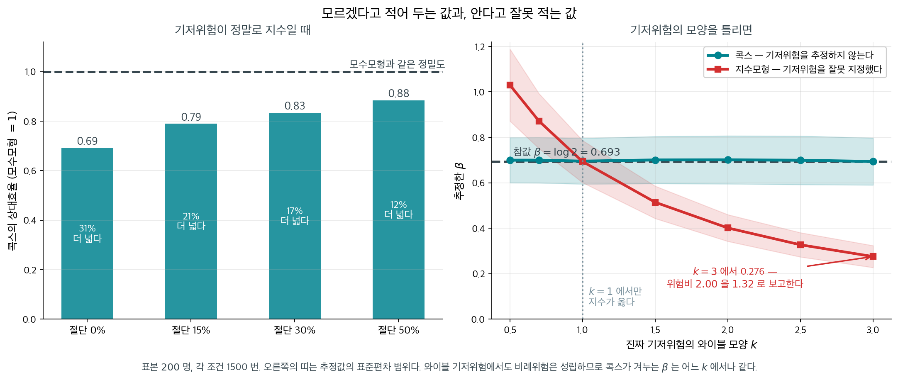
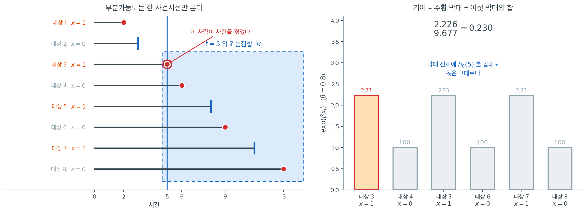
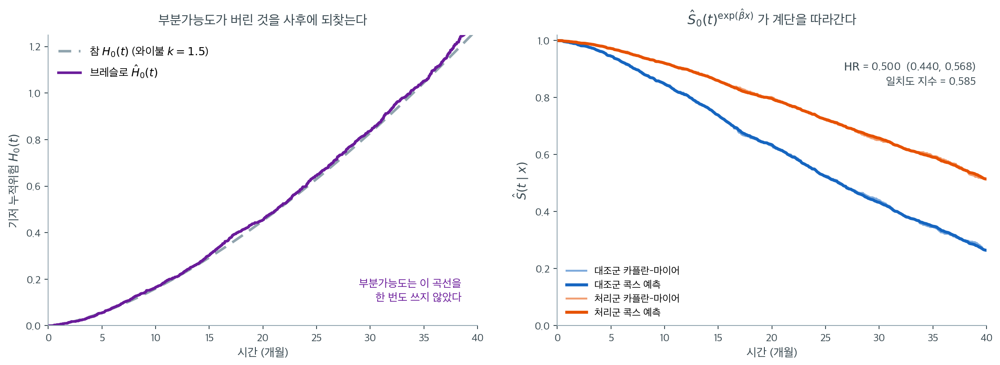
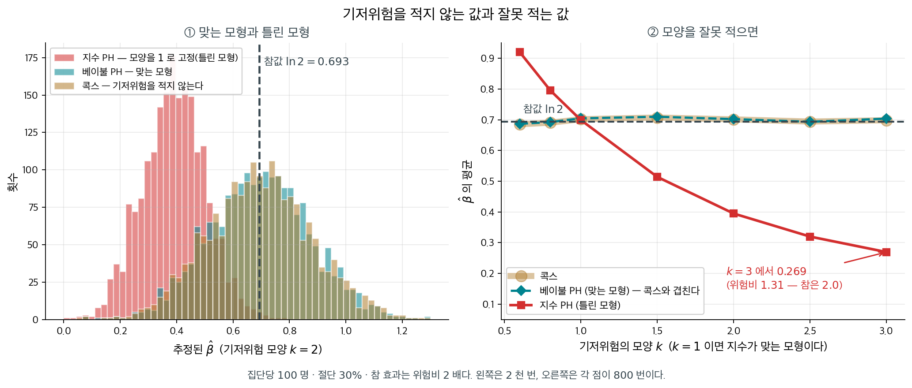

# 부분가능도와 콕스 모형

모수적 생존 모형은 분석자가 사건시간의 분포를 지정할 것을 요구한다. 고른 분포가 틀리면 공변량
효과에 대한 추론이 편향될 수 있다. Cox(1972)가 도입한 **콕스 비례위험 모형**은 이 지정을 아예
피한다. **기저위험함수**를 전혀 지정하지 않은 채 공변량이 위험률에 미치는 효과를 모형화한다.

이 준모수적 접근은 생존분석에서 가장 널리 쓰이는 회귀 모형이다. 이 절에서는 콕스 모형을
정의하고, 공변량 효과를 추정하는 부분가능도를 유도하며, 기저 누적위험에 대한 브레슬로
추정량을 소개한다.

---

## 1. 콕스 비례위험 모형

콕스 모형은 공변량 벡터 $\mathbf{x}_i = (x_{i1}, \ldots, x_{ip})^\top$를 갖는 대상 $i$의
위험함수를 다음과 같이 설정한다.

$$
h(t \mid \mathbf{x}_i) = h_0(t) \exp(\boldsymbol{\beta}^\top \mathbf{x}_i)
$$

여기서,

- $h_0(t)$는 **기저위험함수**로, 모든 공변량이 0일 때의 위험이다. 임의의, 지정되지 않은 음이
  아닌 함수다.
- $\boldsymbol{\beta} = (\beta_1, \ldots, \beta_p)^\top$는 회귀계수 벡터다.
- $\exp(\boldsymbol{\beta}^\top \mathbf{x}_i)$는 공변량 프로파일 $\mathbf{x}_i$에 결부된
  **상대위험**이다.

이 모형을 "비례위험"이라 부르는 이유는 임의의 두 대상 $i$와 $j$의 위험비가 시간에 걸쳐
일정하기 때문이다.

$$
\frac{h(t \mid \mathbf{x}_i)}{h(t \mid \mathbf{x}_j)} = \frac{\exp(\boldsymbol{\beta}^\top \mathbf{x}_i)}{\exp(\boldsymbol{\beta}^\top \mathbf{x}_j)} = \exp\!\bigl(\boldsymbol{\beta}^\top (\mathbf{x}_i - \mathbf{x}_j)\bigr)
$$

이 비는 $t$에 의존하지 않는다.

!!! note "준모수적 성격"

    콕스 모형은 준모수적이다. 공변량 효과 $\boldsymbol{\beta}$는 유한차원 모수이지만 기저위험
    $h_0(t)$는 무한차원의 성가신 모수다. 부분가능도는 $\boldsymbol{\beta}$의 추정에서
    $h_0(t)$를 소거한다.

<div class="storybox" markdown>

**그림으로 보는 통계학 1.** 모르겠다고 적어 두는 값, 안다고 잘못 적는 값

$h_0(t)$ 를 끝내 추정하지 않는다는 말은 그냥 넘길 문장이 아니다. **가능도가 아닌 것을 가능도처럼 쓰겠다**는 선언이기 때문이다.

$1972$ 년에 콕스가 이 모형을 발표했을 때 영국왕립통계학회의 토론에서 바로 그 질문이 나왔다. 저것을 최대화해서 얻은 추정량의 성질은 무엇으로 보장하는가? 콕스는 $1975$ 년에 **부분가능도를 따로 정의하는 논문**을 다시 써야 했고, 점근이론이 제대로 완성된 것은 그보다도 한참 뒤, 계수과정(counting process)의 언어가 들어오고 나서다.

낯설었던 그 논문이 지금 과학 전체에서 가장 많이 인용된 축에 든다.

**그래서 버리는 값은 얼마인가.** 기저위험이 **정말로** 지수인 자료를 만들어, 그 사실을 알고 지수모형을 적합한 사람과 모른다고 적어 둔 콕스를 견주어 보자.

<figure markdown>
{ width="900" }
  <figcaption markdown>오른쪽에서 와이블 기저위험도 비례위험을 만족하므로, 콕스가 겨누는 $\beta$ 는 어느 모양 $k$ 에서나 같은 값이다.</figcaption>
</figure>

| 중도절단 | 콕스의 상대효율 | 신뢰구간이 |
|---|---|---|
| $0\%$ | $0.69$ | $31\%$ 더 넓다 |
| $15\%$ | $0.79$ | $21\%$ 더 넓다 |
| $30\%$ | $0.83$ | $17\%$ 더 넓다 |
| $50\%$ | $0.88$ | $12\%$ 더 넓다 |

**모수모형이 정확히 맞을 때 콕스는 효율을 $12$–$31\%$ 잃는다.** 적은 값이 아니다. 절단이 많을수록 격차가 줄어드는 것도 눈여겨볼 만하다 — 절단된 관측은 어차피 모수모형에도 적게 기여하기 때문이다.

**그런데 그 모형이 틀렸다면.** 진짜 기저위험이 와이블(모양 $k$)인데 분석자가 지수로 적합했다고 하자. 참값은 $\beta = \log 2 = 0.693$ 이다.

| 모양 $k$ | 콕스 | 지수모형 |
|---|---|---|
| $0.5$ | $0.700$ | $1.030$ |
| $1.0$ | $0.695$ | $0.694$ |
| $2.0$ | $0.701$ | $0.401$ |
| $3.0$ | $0.694$ | $\mathbf{0.276}$ |

**콕스는 어느 모양에서나 참값을 맞힌다.** 지수모형은 $k = 3$ 에서 $0.276$ 을 내놓는다 — 위험비로 옮기면 참값 $2.00$ 을 **$1.32$** 로 보고하는 것이다. 신약의 위험을 절반으로 줄인다는 결과가 $3$ 분의 $1$ 쯤 줄인다는 결과로 바뀐다. 그리고 그림의 붉은 띠를 보라. 그 틀린 값에 붙은 신뢰구간은 **좁다.** 자신 있게 틀린다.

$k = 1$ 에서만 두 선이 만난다. 실무에서 그 점 위에 정확히 서 있다고 확신할 근거는 거의 없다.

**이것이 준모수적이라는 말의 값이다.** 모르는 것을 모른다고 적어 두면 효율을 얼마쯤 치르고, 안다고 잘못 적으면 답 전체를 잃는다. 콕스가 부분가능도를 변호하느라 세 해를 더 써야 했던 까닭도, 그 논문이 반세기를 버틴 까닭도 같은 자리에 있다.

_확인한 곳 — 콕스가 $1972$ 년 영국왕립통계학회에서 모형을 발표했을 때 추정량의 근거를 묻는 토론이 있었고 $1975$ 년에 부분가능도를 따로 정의하는 논문을 다시 썼다는 것, 점근이론이 계수과정의 언어가 들어온 뒤에야 완성되었다는 것. 두 표의 수는 모두 직접 모의실험한 값이다_

</div>

---

## 2. 부분가능도

서로 다른 $K$개의 사건시간을 크기순으로 $t_{(1)} < \cdots < t_{(K)}$라 하고, $t_{(j)}$에서
사건을 겪는 대상을 $i_j$라 하자. 시점 $t_{(j)}$의 **위험집합**은

$$
\mathcal{R}_j = \{i : t_i \geq t_{(j)}\}
$$

로, $t_{(j)}$ 직전까지 관측 중인 모든 대상의 집합이다.

사건시간 $t_{(j)}$에서 위험집합 안에 정확히 하나의 사건이 일어난다는 조건 아래, 그 사건을
겪는 대상이 $i_j$일 조건부확률은

$$
\frac{h(t_{(j)} \mid \mathbf{x}_{i_j})}{\sum_{l \in \mathcal{R}_j} h(t_{(j)} \mid \mathbf{x}_l)} = \frac{h_0(t_{(j)}) \exp(\boldsymbol{\beta}^\top \mathbf{x}_{i_j})}{\sum_{l \in \mathcal{R}_j} h_0(t_{(j)}) \exp(\boldsymbol{\beta}^\top \mathbf{x}_l)} = \frac{\exp(\boldsymbol{\beta}^\top \mathbf{x}_{i_j})}{\sum_{l \in \mathcal{R}_j} \exp(\boldsymbol{\beta}^\top \mathbf{x}_l)}
$$

이다. 비에서 기저위험 $h_0(t_{(j)})$가 소거된다. **부분가능도**는 모든 사건시간에 걸친 이
조건부확률들의 곱이다.

$$
PL(\boldsymbol{\beta}) = \prod_{j=1}^{K} \frac{\exp(\boldsymbol{\beta}^\top \mathbf{x}_{i_j})}{\sum_{l \in \mathcal{R}_j} \exp(\boldsymbol{\beta}^\top \mathbf{x}_l)}
$$

**부분 로그가능도**는

$$
\ell_P(\boldsymbol{\beta}) = \sum_{j=1}^{K} \left[\boldsymbol{\beta}^\top \mathbf{x}_{i_j} - \ln\!\left(\sum_{l \in \mathcal{R}_j} \exp(\boldsymbol{\beta}^\top \mathbf{x}_l)\right)\right]
$$

이다.



대상 여덟 명에 공변량 $x \in \{0, 1\}$이 붙어 있고, $t = 5$에서 대상 3이 사건을 겪었다. 부분가능도의 한 인자를 계산할 때 쓰이는 것은 **파란 상자 안의 여섯 명뿐이다.** 대상 1과 2는 이미 빠졌으므로 아무 역할도 하지 않고, 위험집합에 남은 여섯 명은 각자 $\exp(\beta x_l)$만큼의 "몫 후보"를 들고 있다.

$\beta = 0.8$일 때 $x = 1$인 사람의 무게는 $e^{0.8} = 2.226$, $x = 0$인 사람의 무게는 $1$이다. 여섯 명의 무게를 더하면 $9.677$이고, 실제로 사건을 겪은 대상 3의 몫은 $2.226 / 9.677 = 0.230$이다. 공변량이 아무 효과가 없다면($\beta = 0$) 여섯 명이 모두 무게 1을 가져 몫이 $1/6 = 0.167$이었을 것이다. **$0.230$이 $0.167$보다 크다는 사실이 "$x = 1$인 사람이 먼저 사건을 겪는 경향"을 지지하는 증거이며, 부분가능도는 이런 증거를 사건시점마다 모아 곱한다.**

여기서 기저위험이 사라지는 장면을 눈으로 확인할 수 있다. 시점 5에서 각 사람의 실제 위험은 $h_0(5)\exp(\beta x_l)$이므로, **막대 여섯 개 전체를 $h_0(5)$배로 늘이거나 줄여도 몫 $0.230$은 변하지 않는다.** 분자와 분모에 같은 수가 곱해지기 때문이다. $h_0(5)$가 $0.01$이든 $100$이든 이 인자는 똑같으므로, 기저위험을 지정하지 않고도 $\beta$를 추정할 수 있다.

대가도 이 그림 안에 있다. 부분가능도가 쓰는 정보는 "$t = 5$에 사건이 하나 있었고 그것이 여섯 명 중 세 번째 사람이었다"뿐이다. **5라는 숫자 자체는 쓰이지 않는다.** 사건시간을 모두 제곱하든 로그를 취하든 순서만 보존되면 위험집합의 구성이 같고 부분가능도도 같다. 21.2절의 로그순위 검정이 순위만 쓰는 것과 정확히 같은 성격이며, 실제로 공변량이 집단 지시자 하나뿐일 때 콕스 모형의 점수검정은 로그순위 검정과 일치한다.

---

<div class="aibox" markdown>

**AI로 보는 통계학 1.** 부분가능도는 위험집합 위의 소프트맥스다

위 식을 한 번 더 보자. 사건시각 $t_{(j)}$ 에서 위험집합 $\mathcal R_j$ 안의 각 사람에게
점수 $\boldsymbol\beta^\top \mathbf x_l$ 을 주고, 지수를 씌워 합으로 나눈다. 그것이

$$
\frac{\exp(\boldsymbol\beta^\top \mathbf x_{i_j})}{\sum_{l \in \mathcal R_j} \exp(\boldsymbol\beta^\top \mathbf x_l)}
$$

인데, 이 꼴은 **소프트맥스**다. 분류기가 $K$ 개 후보에 점수를 매겨 확률로 바꿀 때 쓰는
바로 그 식이고, 다른 점은 **후보 집합이 시각마다 달라진다**는 것뿐이다. 그래서 콕스
모형의 적합은 이렇게 읽을 수 있다 — **「지금 위험집합에 남은 사람들 가운데 누가 먼저
일어날 것인가」를 맞히는 분류 문제를 사건 수만큼 푸는 일.** 부분 로그가능도는 그 문제들의
로그소프트맥스를 더한 것이고, 그 음수가 곧 손실이다.

이 읽기가 실무에서 값진 까닭은 **그대로 손실함수가 되기** 때문이다. $\boldsymbol\beta^\top\mathbf x$
자리에 신경망이 내놓는 점수 $\eta_i$ 를 넣기만 하면 식이 그대로 선다 — 공변량이 선형으로
들어갈 까닭이 애초에 없었다. 아래 구현이 그 손실이다.

```python
import numpy as np
from scipy.optimize import minimize

rng = np.random.default_rng(0)
n = 400
x = rng.normal(size=(n, 2))
T = rng.exponential(1 / np.exp(0.8 * x[:, 0] - 0.5 * x[:, 1]))   # 참 계수
C = rng.exponential(1.2, n)
t, d = np.minimum(T, C), (T <= C).astype(float)
o = np.argsort(t)                     # 시간순으로 한 번만 정렬한다
xs, ds = x[o], d[o]

def log_softmax_over_risk_sets(beta):
    """위험집합 = 자기 이후. 뒤에서부터 누적합 한 번이면 분모가 모두 구해진다."""
    eta = xs @ beta
    m = eta.max()
    logden = m + np.log(np.cumsum(np.exp(eta - m)[::-1])[::-1])
    return eta - logden               # 사건마다의 로그소프트맥스

beta = minimize(lambda b: -float((ds * log_softmax_over_risk_sets(b)).sum()),
                np.zeros(2), method="BFGS").x
lp = log_softmax_over_risk_sets(beta)
size = np.arange(n, 0, -1)            # 위험집합의 크기
ev = ds == 1

print(f"사건 {int(ds.sum())} 건 / {n} 명,  추정 계수 {beta.round(3)} (참값 [0.8, -0.5])")
print(f"사건당 평균 로그확률 {lp[ev].mean():.4f},  "
      f"무작위로 찍을 때 {np.mean(-np.log(size[ev])):.4f}")
print("\n 위험집합 크기   사건 수   모형이 준 확률   무작위 1/|R|   배수")
for lo, hi in ((200, 401), (50, 200), (2, 50)):
    s = ev & (size >= lo) & (size < hi)
    p, q = np.exp(lp[s]).mean(), (1 / size[s]).mean()
    print(f"{lo:>8}–{hi-1:<7}{int(s.sum()):>7}{p:>15.4f}{q:>14.4f}{p/q:>8.2f}")
```

출력:

```
사건 217 건 / 400 명,  추정 계수 [ 0.884 -0.452] (참값 [0.8, -0.5])
사건당 평균 로그확률 -4.7416,  무작위로 찍을 때 -5.0490

 위험집합 크기   사건 수   모형이 준 확률   무작위 1/|R|   배수
     200–400        116         0.0067        0.0035    1.91
      50–199         77         0.0162        0.0095    1.72
       2–49          24         0.1120        0.0754    1.48
```

**맞히는 일이 얼마나 어려운지가 위험집합의 크기로 정해진다.** 후보가 $400$ 명일 때
무작위로 찍으면 $0.0025$ 인데 모형은 $0.0067$ 을 준다. 끝으로 갈수록 후보가 줄어
확률 자체는 커지지만(마지막 구간 $0.1120$), **무작위 기준 대비 배수는 오히려 줄어든다**
($1.91 \to 1.48$). 쉬운 문제에서는 모형이 보탤 것이 적다는 뜻이다.

계산도 소프트맥스를 닮았다. 분모를 사건마다 새로 더하면 $O(n^2)$ 이지만, 시간순으로
정렬해 두고 **뒤에서부터 누적합**을 한 번 굴리면 분모가 모두 구해진다. 위 코드의
`np.cumsum(...[::-1])[::-1]` 한 줄이 그것이고, 큰 자료에서 콕스 모형이 실용적인 까닭이다.

**다만 소프트맥스로 읽어도 달라지지 않는 것이 있다.** 후보 집합에는 **절단된 사람도
들어간다** — 아직 사건을 겪지 않았을 뿐 위험집합의 일원이다. 그리고 이 손실이 주는 것은
**순위뿐이어서**, 「언제」를 말하려면 기저위험을 따로 추정해야 한다. 그것이 아래 $5$ 절의
브레슬로 추정량이다.

</div>

## 3. 추정

MLE $\hat{\boldsymbol{\beta}}$는 $\ell_P(\boldsymbol{\beta})$를 최대화한다. 점수와 정보는
다음과 같다.

**점수벡터:**

$$
U(\boldsymbol{\beta}) = \sum_{j=1}^{K} \left[\mathbf{x}_{i_j} - \bar{\mathbf{x}}_j(\boldsymbol{\beta})\right]
$$

여기서 $\bar{\mathbf{x}}_j(\boldsymbol{\beta})$는 위험집합에 속한 공변량의 가중평균이다.

$$
\bar{\mathbf{x}}_j(\boldsymbol{\beta}) = \frac{\sum_{l \in \mathcal{R}_j} \mathbf{x}_l \exp(\boldsymbol{\beta}^\top \mathbf{x}_l)}{\sum_{l \in \mathcal{R}_j} \exp(\boldsymbol{\beta}^\top \mathbf{x}_l)}
$$

**관측정보:**

$$
\mathcal{I}(\boldsymbol{\beta}) = \sum_{j=1}^{K} \mathbf{V}_j(\boldsymbol{\beta})
$$

여기서 $\mathbf{V}_j$는 $t_{(j)}$의 위험집합에 속한 공변량의 가중 공분산행렬이다.

뉴턴–랩슨 반복은

$$
\boldsymbol{\beta}^{(m+1)} = \boldsymbol{\beta}^{(m)} + \mathcal{I}(\boldsymbol{\beta}^{(m)})^{-1} U(\boldsymbol{\beta}^{(m)})
$$

이다.

---

## 4. 동점 사건시간 다루기

같은 시점에 여러 사건이 일어나면 부분가능도를 수정해야 한다. 흔한 접근은 다음과 같다.

- **브레슬로 근사**(대부분의 소프트웨어 기본값): 동점 사건들이 같은 위험집합 안에서 순차적으로
  일어난 것처럼 취급한다. 빠르지만 근사적이다.
- **에프론 근사**: 동점 사건의 가능한 순서들에 대해 평균하여 브레슬로보다 정확하다.
- **정확 부분가능도**: 가능한 모든 순서를 열거한다. 동점이 많으면 계산 비용이 크다.

!!! tip "어떤 동점 처리 방법을 쓸 것인가"

    동점이 드물면 브레슬로와 에프론이 거의 같은 결과를 준다. 동점이 흔하면(예: 이산 사건시간)
    에프론을 권한다. 정확 방법은 동점이 많은 작은 자료에만 쓴다.

    R의 `survival` 패키지는 에프론을, `lifelines`와 SAS는 브레슬로를 기본으로 쓴다. 동점이
    많은 자료에서 두 소프트웨어의 결과가 다르게 나오면 이 차이를 먼저 의심하라.

---

## 5. 기저위험의 브레슬로 추정량

$\hat{\boldsymbol{\beta}}$를 추정한 뒤 기저 누적위험은 **브레슬로 추정량**으로 추정할 수 있다.

$$
\hat{H}_0(t) = \sum_{j:\, t_{(j)} \leq t} \frac{d_j}{\sum_{l \in \mathcal{R}_j} \exp(\hat{\boldsymbol{\beta}}^\top \mathbf{x}_l)}
$$

여기서 $d_j$는 $t_{(j)}$의 사건 수다. 기저 생존함수는

$$
\hat{S}_0(t) = \exp\!\bigl(-\hat{H}_0(t)\bigr)
$$

이고, 공변량 $\mathbf{x}$를 갖는 대상의 생존함수는

$$
\hat{S}(t \mid \mathbf{x}) = \hat{S}_0(t)^{\exp(\hat{\boldsymbol{\beta}}^\top \mathbf{x})}
$$

이다.

!!! warning "브레슬로 추정량은 계단함수다"

    넬슨–알렌 추정량과 마찬가지로 $\hat{H}_0(t)$는 관측된 사건시간에서만 뛴다. 사건시간
    사이에서는 추정치가 일정하다. 필요하면 평활 기법으로 연속 추정치를 만들 수 있지만
    계단함수가 표준 출력이다.

    $\boldsymbol{\beta} = \mathbf{0}$이면 브레슬로 추정량이 정확히 넬슨–알렌 추정량으로
    환원된다는 점도 확인하라. 분모의 $\exp(\hat{\boldsymbol{\beta}}^\top\mathbf{x}_l)$이
    모두 1이 되어 $\sum_l 1 = n_j$가 되기 때문이다.

### 브레슬로가 되찾은 것을 그림으로



각 집단 $1{,}000$명, 기저는 와이불 $k = 1.5$·척도 $34$, 처리 효과는 $\beta = -0.7$(곧 $\text{HR} = 0.497$)인 자료를 만들어 콕스 모형을 적합했다. 결과는 $\hat\beta = -0.694$, $\text{HR} = 0.500$(95% 신뢰구간 $0.440$--$0.568$)으로 참값을 거의 그대로 되찾는다. 기저위험의 모양을 한 번도 가정하지 않고 얻은 값이다.

왼쪽 그림이 이 절에서 가장 놀라운 부분이다. 보라색 계단이 브레슬로 추정치 $\hat H_0(t)$이고 회색 점선이 자료를 만든 참 $H_0(t) = (t/34)^{1.5}$인데, 둘이 거의 포개진다. $t = 10$에서 $0.166$ 대 $0.160$, $t = 20$에서 $0.455$ 대 $0.451$, $t = 30$에서 $0.838$ 대 $0.829$, $t = 40$에서 $1.330$ 대 $1.276$이다. **부분가능도는 이 곡선을 계산에 한 번도 쓰지 않았다.** $\hat\beta$를 먼저 구하고 나서, 각 사건시점의 사건 수를 그 시점 위험집합의 가중합으로 나누어 사후에 쌓아 올린 것이다.

이 순서가 콕스 모형의 설계다. 성가신 무한차원 모수 $h_0(t)$를 추정 단계에서는 **소거해 버리고**, 관심 모수 $\boldsymbol\beta$를 먼저 확정한 뒤, 필요하면 그때 가서 $\boldsymbol\beta$를 고정한 채 기저를 비모수적으로 채워 넣는다. 그래서 "기저를 지정하지 않는다"는 말이 "기저를 알 수 없다"는 뜻은 아니다.

오른쪽은 그렇게 얻은 $\hat S_0(t)^{\exp(\hat\beta x)}$를 집단별 카플란–마이어 위에 겹친 것이다. 굵은 선(콕스 예측)이 연한 선(카플란–마이어)을 거의 완벽히 따라간다. 모형이 옳게 지정되었을 때의 모습이며, 여기서 체계적으로 어긋난다면 비례위험이 깨졌거나 공변량의 함수 형태가 잘못된 것이다. 아래 일치도 지수는 $0.585$로, 두 집단만 구별하는 이항 공변량 하나로는 이 정도가 한계다. **$\text{HR} = 0.50$처럼 강한 효과조차 개별 대상의 순서를 맞히는 능력으로는 $0.5$(동전 던지기)에서 크게 못 벗어난다**는 사실은 21.5절에서 다시 다룬다.

---

<div class="storybox" markdown>

**그림으로 보는 통계학 2.** 만든 사람은 「다시 한다면 모수적으로」라고 했다

바로 위의 설계 — 기저위험을 추정 단계에서 소거하는 것 — 덕분에 $1972$ 년 콕스의 논문
「Regression models and life-tables」는 통계학 밖까지 퍼졌다. $2014$ 년 『네이처』가 꼽은
「가장 많이 인용된 논문 $100$ 편」에서 **$24$ 위**다.

그런데 $1994$ 년 낸시 리드와의 대담에서 콕스 자신은 이렇게 말했다.

> 그 뒤에 알게 된 것들에 비추어 보면, 나라면 보통은 문제를 **모수적으로** 다루고 싶을 것
> 같다. 기저위험을 베이불 같은 것으로 두고서 말이다.

만든 사람이 그렇게 말했다면 따라야 하는가. 이것은 수로 재어 볼 수 있는 물음이다. 베이불
비례위험에서 자료를 만들고 — 집단당 $100$ 명, 참 위험비 $2$ 배, 절단 $30\%$ — 세 가지로
$\beta$ 를 추정한다. 부분가능도(콕스), **맞는** 베이불 모수모형, 그리고 모양모수를 $1$ 로
고정해 버린 **틀린** 지수모형이다.

<figure markdown>
{ width="960" }
  <figcaption markdown>오른쪽에서 콕스(굵은 호박)와 맞는 베이불(점선)은 어느 $k$ 에서도 겹친다. 갈라지는 것은 모양을 틀리게 적은 쪽뿐이다.</figcaption>
</figure>

왼쪽은 참 모양이 $k = 2$ 일 때다. 콕스와 맞는 베이불은 거의 포개진다 — 평균이 $0.695$ 와
$0.696$(참값 $\ln 2 = 0.693$), 표준편차가 $0.184$ 와 $0.180$ 이다. **콕스가 치르는 값은
분산으로 $4.6\%$, 표준오차로는 $2\%$ 남짓이다.** 기저위험의 모양을 통째로 포기하고 그 정도만
잃는다.

나머지 절반이 오른쪽이다. 모양을 **틀리게** 적으면 $\hat\beta$ 가 참값에서 멀어진다.

| 기저위험 모양 $k$ | 콕스 | 베이불(맞음) | 지수(틀림) |
|---:|---:|---:|---:|
| $0.6$ | $0.685$ | $0.687$ | $0.920$ |
| $1.0$ | $0.702$ | $0.705$ | $0.699$ |
| $2.0$ | $0.701$ | $0.702$ | $0.395$ |
| $3.0$ | $0.699$ | $0.704$ | $0.269$ |

$k = 3$ 인 자료에 지수모형을 씌우면 $\hat\beta = 0.269$, 위험비로 $1.31$ 이다. 참이 $2.0$ 인데
「$1.3$ 배」라고 적는 셈이고, **표본을 아무리 키워도 그 자리에 머문다** — 요동이 아니라
치우침이기 때문이다. $k < 1$ 쪽에서는 거꾸로 부풀린다($0.920$, 위험비 $2.51$). 가운데
$k = 1$ 에서만 지수모형이 맞는 모형이 되어 셋이 나란해진다.

그러니 콕스의 말은 **조건부**로 읽어야 한다. 기저위험의 모양을 맞게 적을 수 있다면 얻는 것이
$2$–$5\%$ 이고, 틀리게 적으면 잃는 것이 $40$–$60\%$ 다. 오늘도 기본값이 부분가능도인 까닭이
그것이다.

다만 그가 가리킨 것이 효율만은 아니었을 것이다. 모수모형은 **절대 위험**을 바로 내놓는다 —
「$5$ 년 뒤 생존확률」을 식 하나로 적고, 관측이 끝난 시점 너머로 외삽도 한다. 부분가능도는
거기서 멈추고, 이 절의 브레슬로 추정량을 따로 얹어야 비로소 곡선이 나온다. 묻는
것이 「몇 배」인지 「몇 년 뒤 몇 퍼센트」인지에 따라 답이 갈린다.

_확인한 곳 — 콕스의 말은 N. Reid, 「A conversation with Sir David Cox」, 『Statistical
Science』 $9$ 권($1994$) $439$–$455$ 쪽의 대담에서 왔다. 원문은 「In the light of some of
the further results one knows since, I think I would normally want to tackle problems
parametrically, so I would take the underlying hazard to be a Weibull or something」이다 ·
논문은 D. R. Cox, 「Regression models and life-tables」, 『Journal of the Royal Statistical
Society B』 $34$ 권($1972$) $187$–$220$ 쪽이고, $2014$ 년 『네이처』의 「The top 100 papers」가
꼽은 $24$ 위다 · 그림과 표의 수는 모두 직접 계산한 값이며, 부분가능도 풀이는 `lifelines` 의
`CoxPHFitter` 와 소수 여섯째 자리까지 같은 것을 맞춰 보았다_

</div>

---

## 연습문제

<div class="drillbox" markdown>

**연습문제 1.** <span class="diff easy" title="쉬움"></span>
어떤 콕스 모형에서 처리 지시자의 계수가 $\hat{\beta} = 0.5$다. 이를 위험비로 해석하라.

</div>

??? success "풀이"
    위험비는 $\text{HR} = e^{\hat{\beta}} = e^{0.5} = 1.649$다.

    해석: 비례위험 가정 아래에서 처리군의 위험(사건의 순간 위험)이 모든 시점에서 대조군의
    1.649배다. 달리 말해 처리가 위험을 약 65% 높인다.

    사건이 사망이라면 $\text{HR} = 1.649$는 처리군이 임의의 시점에서 대조군보다 순간 사망
    위험이 65% 높다는 뜻이다. $\text{HR} < 1$이면 처리가 보호적이다.

    !!! warning "위험비는 생존시간의 비가 아니다"
        $\text{HR} = 1.649$가 "처리군이 1.649배 빨리 죽는다"거나 "생존시간이 $1/1.649$배"라는
        뜻이 **아니다.** 위험비는 순간 위험률의 비이며, 생존시간에 미치는 영향은 기저위험의
        모양에 달려 있다. 생존시간에 직접적인 곱셈 해석을 원한다면 AFT 모형(21.3절)을 써야
        한다. 와이불의 경우 두 해석이 연결되는데, 형상이 $k$이면 위험비 $\text{HR}$은 생존시간
        비 $\text{HR}^{-1/k}$에 대응한다.

---

<div class="drillbox" markdown>

**연습문제 2.** <span class="diff med" title="중간"></span>
콕스 비례위험 모형의 부분가능도를 쓰고 왜 "부분"이라 불리는지 설명하라.

</div>

??? success "풀이"
    사건시간을 크기순으로 $t_{(1)} < t_{(2)} < \dots < t_{(D)}$라 하고 대응하는 대상을
    $j_1, j_2, \dots, j_D$라 하면 부분가능도는

    $$
    L(\boldsymbol{\beta}) = \prod_{i=1}^D \frac{\exp(\mathbf{x}_{j_i}^\top\boldsymbol{\beta})}{\sum_{k \in R(t_{(i)})} \exp(\mathbf{x}_k^\top\boldsymbol{\beta})}
    $$

    이다. 여기서 $R(t_{(i)})$는 시점 $t_{(i)}$의 위험집합(아직 관측 중인 모든 대상)이다.

    "부분"이라 불리는 이유는 사건의 **순서**만 쓰고 실제 사건시간이나 기저위험 $h_0(t)$를
    쓰지 않기 때문이다. $h_0(t)$를 소거함으로써 콕스 모형은 기저위험함수를 지정하지 않아도
    되고, 그래서 준모수적이다.

    더 정확히 말하면 이것은 완전한 가능도가 아니라 **조건부확률들의 곱**이다. 각 인자는
    "이 시점에 사건이 하나 일어났다는 조건에서 그것이 대상 $i_j$일 확률"이며, 사건시간의
    주변분포에 대한 정보는 버린다. 그럼에도 Cox는 이 부분가능도를 통상의 가능도처럼 다루어
    얻은 추정량이 일치성과 점근 정규성을 갖는다는 것을 보였고, 이후 계수과정 이론으로
    엄밀하게 증명되었다.

---

<div class="drillbox" markdown>

**연습문제 3.** <span class="diff med" title="중간"></span>
비례위험 가정을 설명하라. 수학적으로 어떻게 표현되는가?

</div>

??? success "풀이"
    비례위험 가정은 임의의 두 대상 사이의 위험비가 시간에 걸쳐 일정하다는 것이다.

    $$
    \frac{h(t \mid \mathbf{x}_i)}{h(t \mid \mathbf{x}_j)} = \frac{h_0(t)\exp(\mathbf{x}_i^\top\boldsymbol{\beta})}{h_0(t)\exp(\mathbf{x}_j^\top\boldsymbol{\beta})} = \exp\!\left((\mathbf{x}_i - \mathbf{x}_j)^\top\boldsymbol{\beta}\right)
    $$

    기저위험 $h_0(t)$가 소거되어 비가 시간과 무관해진다. 비가 시간에 따라 변하면(예: 처리가
    초기에는 효과적이지만 그 효과가 사라지면) 비례위험 가정이 위배되고 콕스 모형이 잘못
    지정된 것이다. 쇤펠트 잔차와 로그–로그 생존 그림으로 이 가정을 점검한다.

---

<div class="drillbox" markdown>

**연습문제 4.** <span class="diff med" title="중간"></span>
콕스 모형은 왜 절단된 관측치를 다룰 수 있는가? 절단된 대상이 부분가능도에 어떻게 들어가는지
설명하라.

</div>

??? success "풀이"
    절단된 대상은 사건으로서가 아니라 **위험집합**을 통해 부분가능도에 기여한다. 각 사건시간
    $t_{(i)}$에서 위험집합 $R(t_{(i)})$는 아직 살아 있고 관측 중인 모든 대상을 포함한다.
    나중에 사건을 겪을 대상과 나중에 절단될 대상 모두가 들어간다.

    절단된 대상은 부분가능도의 **분모**에 기여하지만(절단되기 전까지는 "위험에 있었다")
    분자에는 결코 나타나지 않는다(관측된 사건이 없었다). 이는 절단이 무정보라는 가정, 즉
    절단의 이유가 사건 위험과 무관하다는 가정 아래에서 타당하다.

    절단된 관측치를 버리지도, 사건시간을 대체하지도 않는 이 우아한 처리가 콕스 모형의 핵심
    장점이다. 카플란–마이어가 절단된 대상을 위험집합에서만 빼는 방식과 정확히 같은 착상이며,
    콕스 모형은 여기에 공변량 가중을 더한 것이라고 볼 수 있다.

---

## 정리하며

콕스 모형은 **기저위험을 지정하지 않는다.**

$$
h(t\mid\mathbf x)=h_0(t)\,e^{\mathbf x^\top\boldsymbol\beta}
$$

- **준모수적이다.** $h_0(t)$ 는 자유롭게 두고 공변량 효과만 모수로 둔다. **분포를 잘못 고를 위험을 피하는 것**이 이 모형의 존재 이유다.
- **부분가능도가 그 비결이다.** 각 사건시점에서 "위험집합 중 하필 이 사람이 사건을 겪을 조건부 확률"을 곱하면 $h_0(t)$ 가 분자와 분모에서 약분되어 사라진다.
- **사건의 순서만 쓴다.** 정확한 시간은 필요 없고 순위만 필요하므로, 16장의 순위 기반 방법과 정신이 같다.
- **동점 처리 방식이 여럿이다.** 에프론·브레슬로·정확법이 있으며, 동점이 많으면 에프론이 권장된다.
- **비례위험 가정이 핵심 제약이다.** 위험비가 시간에 따라 일정해야 하며, 진단으로 확인해야 한다.

다음 절 **[위험비](hazard_ratios.md)**로 넘어간다.
