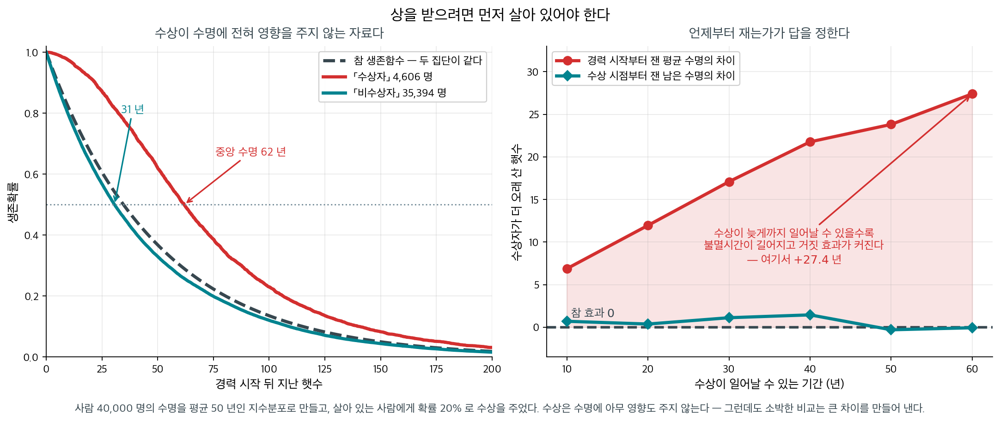
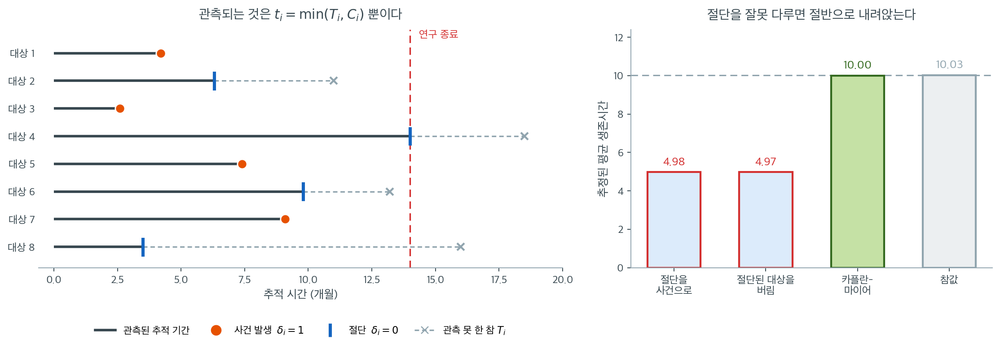

# 사건까지의 시간 자료와 중도절단

많은 응용에서 관심의 대상이 되는 결과는 이항 이름표나 연속 측정치가 아니라 **사건이 일어날
때까지의 시간**이다. 병원은 수술 후 환자가 얼마나 오래 생존하는지를 추적하고, 은행은 차입자가
대출을 연체할 때까지 몇 달이 걸리는지 기록하며, 공학자는 터빈 날개가 고장 나기까지의 가동시간을
측정한다. *생존시간* 또는 *사건시간*이라 불리는 이 지속시간들은 보통의 회귀가 무시하는 문제,
곧 **중도절단**을 안고 있어 자체적인 통계 틀을 필요로 한다.

이 절에서는 생존자료를 정의하고 중도절단 문제를 소개하며 이 장 전체에서 쓸 표기를 세운다.

---

## 1. 생존자료란 무엇인가

생존자료는 $n$명의 대상으로 이루어지며, 각 대상은 두 값을 갖는다.

1. 관측된 시간 $t_i > 0$.
2. 사건 지시자 $\delta_i \in \{0, 1\}$. $\delta_i = 1$이면 시점 $t_i$에서 관심 사건이
   관측되었다는 뜻이고, $\delta_i = 0$이면 시점 $t_i$에서 관측이 **절단**되었다는 뜻이다.

관심 있는 확률변수는 *참 사건시간* $T_i$이지만, 절단된 대상에 대해서는 $T_i > t_i$라는 것만
알 수 있다.

!!! example "생존자료의 배치"

    | 대상 | 시간(개월) | 사건 ($\delta$) | 해석 |
    |:-------:|:-------------:|:----------------:|:---------------|
    | 1       | 8             | 1                | 8개월에 연체 |
    | 2       | 14            | 0                | 14개월 시점에 아직 정상(절단) |
    | 3       | 3             | 1                | 3개월에 연체 |
    | 4       | 12            | 0                | 12개월에 추적 실패(절단) |

<div class="storybox" markdown>

**그림으로 보는 통계학 1.** 상을 받으려면 먼저 살아 있어야 한다

위의 표에서 각 대상의 시간이 **어디서부터** 재어졌는지를 적어 두는 것은 형식이 아니다. 그 한 줄을 흘리면 통째로 틀린 답이 나온다.

$2001$ 년에 의학 학술지에 논문 하나가 실렸다. 아카데미상을 **받은** 배우가 후보에 그친 배우보다 평균 네 해쯤 더 오래 살았다는 것이다. 설명이 따라붙었다 — 지위와 인정이 건강에 좋다는 것이다. 언론이 크게 다루었다.

그런데 상을 받으려면 **시상식 날까지 살아 있어야 한다.** 서른에 죽은 배우는 예순에 상을 받을 수 없다. 수상자 집단은 애초에 「수상까지의 세월을 살아남은 사람들」로 걸러져 있고, 소박한 비교는 그 세월을 통째로 수상의 공로로 돌린다.

이것을 **불멸시간**(immortal time)이라 부른다. 수상자에게 수상 이전은, 자료의 구성상 **죽을 수 없었던 시간**이기 때문이다.

<figure markdown>
{ width="900" }
  <figcaption markdown>왼쪽 두 곡선은 **같은 모집단**에서 나왔다. 검은 파선이 참 생존함수이고, 두 집단을 가른 것은 수상 여부뿐이다.</figcaption>
</figure>

그 크기를 재 보자. 사람 $40{,}000$ 명의 수명을 평균 $50$ 년인 지수분포로 만들고, **수상이 수명에 아무 영향도 주지 않도록** 못 박은 뒤, 살아 있는 사람에게만 확률 $20\%$ 로 상을 준다.

| 수상이 일어날 수 있는 기간 | 소박한 비교 | 수상 시점부터 잰 비교 |
|---|---|---|
| $10$ 년 | $+6.9$ 년 | $+0.7$ 년 |
| $30$ 년 | $+17.1$ 년 | $+1.1$ 년 |
| $60$ 년 | $\mathbf{+27.4}$ 년 | $-0.1$ 년 |

**참 효과가 정확히 $0$ 인데 소박한 비교는 $27$ 년을 만들어 낸다.** 수상이 늦게까지 일어날 수 있을수록 불멸시간이 길어지고 거짓 효과가 함께 자란다.

고치는 법은 식을 바꾸는 것이 아니라 **시계를 바꾸는 것**이다. 수상 시점부터 남은 수명을 재면(랜드마크 분석) 차이가 사라진다. 또는 수상을 **시간의존 공변량**으로 두어, 한 사람이 수상 전에는 「비수상자」로 위험집합에 들어 있다가 수상 뒤에 「수상자」로 옮겨 가게 한다. $2006$ 년에 나온 재분석이 그렇게 했고, 수상의 이득은 **한 해 남짓으로 줄고 유의하지 않게** 되었다.

이 편향은 영화계 이야기가 아니다. **「약을 꾸준히 복용한 환자가 더 오래 살았다」**, **「이식을 받은 환자가 대기자보다 오래 살았다」**, **「전환 고객이 비전환 고객보다 오래 머물렀다」** — 모두 같은 모양이다. 약을 꾸준히 먹으려면, 이식을 받으려면, 전환하려면, 먼저 그 시점까지 남아 있어야 한다.

그래서 이 쪽의 $t_i$ 를 적을 때 반드시 함께 물어야 한다. **이 시계는 언제 켜졌는가, 그리고 집단 배정은 시계가 켜진 그 순간에 정해졌는가.**

_확인한 곳 — 레델마이어·싱이 $2001$ 년 『Annals of Internal Medicine』에 수상 배우가 네 해 가까이 더 오래 살았다고 보고한 것, 실베스트르·후스티·핸리의 $2006$ 년 재분석이 **수상 이전의 세월을 수상 뒤 생존으로 쳐 준 것**을 불멸시간 편향으로 지적하고 수상을 시간의존 공변량으로 바꾸자 이득이 한 해 남짓으로 줄며 유의하지 않게 되었다는 것. 표의 수는 모두 직접 모의실험한 값이다_

</div>

---

<div class="aibox" markdown>

**AI로 보는 통계학 1.** 어느 시계로 재는가가 곡선을 바꾼다

위 상자는 「시계가 **언제** 켜졌는가」를 물었다. 거기에 붙는 물음이 하나 더 있다 —
**어느 시계인가.** 이 쪽이 적는 $t_i$ 는 「관측된 시간」인데, 그 시간을 무엇부터 세는지는
자료에 적혀 있지 않다. 가입일부터 센 개월인지, 분기가 시작된 날부터 센 개월인지,
첫 결제일부터인지는 분석하는 사람이 고른다.

고르는 일이 결과를 바꾼다. 위험이 **가입 이후의 햇수**에만 달려 있는 자료를 만들어,
같은 자료를 두 시계로 집계해 보았다.

```python
import numpy as np

rng = np.random.default_rng(23)
N, WIN = 20_000, 24.0                       # 24 개월짜리 관측 창
# 참 위험은 가입 이후의 햇수(테뉴어)에만 달려 있다 — 초반이 높고 곧 가라앉는다
def hazard(a):
    return 0.20 * np.exp(-0.35 * a) + 0.010

join = rng.uniform(0, WIN, N)               # 가입은 창 안에 고르게 들어온다
step, grid = 0.05, np.arange(0, 40, 0.05)
H = np.cumsum(hazard(grid)) * step          # 테뉴어 기준 누적위험
u = rng.exponential(1.0, N)
age_at_event = np.interp(u, H, grid)        # 사건이 일어난 테뉴어
calendar = join + age_at_event              # 사건이 일어난 달력 시각
seen = calendar <= WIN

def mean_hazard(t_obs, d_obs, start_obs, lo, hi):
    """구간 [lo, hi) 의 평균 위험 = 그 구간의 사건 수 / 노출(사람-개월)."""
    inside = (t_obs >= lo) & (t_obs < hi) & d_obs
    expo = np.clip(np.minimum(t_obs, hi) - np.maximum(start_obs, lo), 0, None).sum()
    return inside.sum() / expo

ten_t = np.where(seen, age_at_event, WIN - join)      # (가) 테뉴어 시계
cal_t = np.where(seen, calendar, WIN)                 # (나) 달력 시계
print("  구간(개월)   테뉴어 시계   달력 시계   참 위험(구간 가운데)")
for lo in (0, 3, 6, 12, 18):
    hi = lo + 3 if lo < 12 else lo + 6
    a = mean_hazard(ten_t, seen, np.zeros(N), lo, hi)
    b = mean_hazard(cal_t, seen, join, lo, hi)        # 가입 전에는 위험에 없다
    print(f"{lo:>7}–{hi:<5}{a:>13.4f}{b:>12.4f}{hazard((lo+hi)/2):>18.4f}")
print(f"\n사건 {int(seen.sum()):,} 건 / {N:,} 명")
```

출력:

```
  구간(개월)   테뉴어 시계   달력 시계   참 위험(구간 가운데)
      0–3           0.1428      0.1561            0.1283
      3–6           0.0548      0.1191            0.0514
      6–9           0.0245      0.0872            0.0245
     12–18          0.0113      0.0568            0.0110
     18–24          0.0130      0.0472            0.0101

사건 9,178 건 / 20,000 명
```

**테뉴어 시계는 참값을 되찾는다.** $0.1428$, $0.0548$, $0.0245$, $0.0113$ 이 참값
$0.1283$, $0.0514$, $0.0245$, $0.0110$ 을 따라간다. 「초기에 몰리고 곧 가라앉는다」가
그대로 보인다.

**달력 시계는 다른 이야기를 한다.** $0.1561$ 에서 $0.0472$ 로 **천천히** 줄 뿐이다. 늦은
구간에서 참값의 네다섯 배다. 까닭은 섞임이다 — 달력으로 $20$ 개월째 위험에 놓인 사람들은
$20$ 개월 된 고객과 **지난달 들어온 고객**이 섞인 집단이라, 그 구간의 위험은 테뉴어가
다른 사람들의 **평균**이 된다. 가입이 계속 들어오는 한 그 평균은 낮아지지 않는다.

**어느 쪽도 틀리지 않았다 — 두 시계가 서로 다른 물음에 답한다.** 「가입 초기에 이탈이
몰리는가」는 테뉴어 시계의 물음이고, 「이번 분기에 이탈이 늘었는가」는 달력 시계의 물음이다.
사고가 나는 자리는 **달력으로 집계해 놓고 테뉴어의 말을 할 때**다 — 위 표의 둘째 열을
보며 「시간이 갈수록 고객이 안정된다」고 적으면, 그 문장은 자료가 아니라 유입 속도를
말하고 있다.

그러니 $t_i$ 를 적기 전에 두 가지를 함께 적어 두어야 한다 — **시계가 언제 켜지는가**(위
상자)와 **무엇을 세는 시계인가**(이 상자). 둘 다 자료가 아니라 사람이 고르는 것이다.

</div>

## 2. 중도절단 문제

중도절단은 연구가 끝나거나 대상이 연구에서 이탈할 때까지 일부 대상에게 사건이 아직 관측되지
않은 경우에 생긴다. 절단된 관측치를 무시하는 것은 --- 버리든 사건으로 취급하든 --- 편향을
낳는다.

- **절단된 대상을 버리면** 정보를 잃는다. 위 표의 대상 2는 *적어도* 14개월을 버텼고, 이는
  유의미한 정보다.
- **절단시간을 사건시간으로 취급하면** 참 생존시간을 과소평가한다. 절단 시점에 사건이 일어난
  것처럼 기록하기 때문이다.

생존분석은 절단된 관측치를 가능도함수에 포함시켜 이 문제를 해결한다. 절단된 대상은
$P(T = t_i)$가 아니라 $P(T > t_i)$라는 정보를 기여한다는 사실을 이용한다.

---

## 3. 절단을 무시하면 얼마나 틀리는가

우측절단에서 관측되는 것은 참 사건시간이 아니라

$$
t_i = \min(T_i, C_i), \qquad \delta_i = \mathbf{1}(T_i \leq C_i)
$$

뿐이다. 절단이 생기는 세 갈래(연구 종료·추적 실패·경쟁 사건)와 제 $1$·$2$ 종의
구별은 다음 절 [중도절단의 유형](censoring_types.md)이 다룬다. 여기서는 그것을
**무시했을 때 치르는 대가**를 수로 본다.



왼쪽 그림에서 진한 선이 우리가 실제로 보는 부분, 곧 $0$부터 $t_i$까지다. 주황 점은 사건이 관측된 시점이고 파란 세로 막대는 절단된 시점이며, 회색 점선은 **관측되지 않은 참 사건시간** $T_i$까지의 나머지다. 여기서 눈여겨볼 것이 대상 8이다. 참 사건시간이 16개월로 여덟 명 중 두 번째로 길지만, 3.5개월에 추적이 끊겨 **자료에는 가장 짧은 관측시간으로 기록된다.** 대상 4도 마찬가지로 14개월 연구 종료선에서 잘려, 18.5개월까지 버틸 사람이 "14"로 남는다. 관측된 시간 $t_i$만 보면 누가 오래 버텼는지에 대한 순서조차 뒤집힌다는 뜻이다.

오른쪽 그림은 이 뒤틀림을 무시했을 때 치르는 대가다. 참 사건시간과 절단시간을 모두 평균 10인 독립 지수분포로 두고 10만 개를 뽑으면 절단율이 $50.4\%$가 되는데, 이때 참 평균은 $10.03$이다. 절단시간을 사건시간인 양 그대로 평균 내면 $4.98$, 절단된 대상을 통째로 버리고 사건이 관측된 것만 평균 내면 $4.97$이 나온다. **두 방법 모두 참값의 절반이다.** 방향이 같은 이유는 분명하다. 앞의 방법은 아직 오지 않은 사건을 앞당겨 적는 것이고, 뒤의 방법은 일찍 사건을 겪은 사람만 골라 남기는 것이라, 둘 다 짧은 쪽으로 자료를 끌어당긴다.

이 예에서 두 편향의 크기가 거의 같은 것은 지수분포의 우연이지만, **아래쪽으로 치우친다는 방향은 언제나 같다.** 반면 초록 막대의 카플란–마이어는 $10.00$으로 참값을 거의 그대로 되찾는다. 절단된 대상을 버리지도 않고 사건으로 세지도 않으면서, "적어도 $t_i$까지는 버텼다"는 사실만 위험집합에 반영하기 때문이다. 이 장 전체가 결국 그 한 줄을 형식화하는 작업이다.

---

## 4. 독립 절단 가정

표준적인 방법은 모두 절단이 **무정보**라고 — $T \perp C \mid \mathbf{x}$ — 가정한다.
그 뜻과 깨질 때 생기는 일은 다음 절 [중도절단의 유형](censoring_types.md) 절 $5$ 에 있다.

---

## 5. 여러 분야의 예

생존분석은 결과가 지속시간인 곳이면 어디에나 적용된다.

- **의학.** 진단에서 사망, 재발, 회복까지의 시간.
- **금융.** 대출 실행에서 부도까지의 시간, 계좌 개설에서 고객 이탈까지의 시간, 시장미시구조의
  거래 지속시간.
- **공학.** 배치에서 부품 고장까지의 시간(신뢰성 분석).
- **사회과학.** 실업 기간, 출소 후 재범까지의 시간.

각 경우에 중도절단은 예외가 아니라 일반적인 상황이다. 임상시험은 정해진 날짜에 끝나고, 대출
포트폴리오에는 정상 계좌가 남아 있으며, 유지보수 보고서를 쓸 때 기계는 여전히 돌아가고 있다.

---

## 6. 표기 요약

이 장 전체에서 다음 표기를 쓴다.

| 기호 | 의미 |
|:------:|:--------|
| $T$ | 참(관측되지 않을 수 있는) 사건시간 |
| $C$ | 절단시간 |
| $t_i$ | 대상 $i$의 관측된 시간: $\min(T_i, C_i)$ |
| $\delta_i$ | 사건 지시자: 1 = 사건 관측, 0 = 절단 |
| $n$ | 전체 대상 수 |
| $d$ | 관측된 사건의 총수: $d = \sum_{i=1}^{n} \delta_i$ |
| $S(t)$ | 생존함수: $P(T > t)$ |
| $h(t)$ | 위험함수: 시점 $t$에서의 순간 사건율 |
| $H(t)$ | 누적위험함수: $\int_0^t h(u)\,du$ |

??? tip "앞 장들과의 연결"

    6장(통계적 추정)에서 전개한 가능도 기반 논증이 그대로 이어진다. 핵심적인 차이는 절단된
    관측치가 가능도에 밀도값 $f(t_i)$가 아니라 생존확률 $S(t_i)$를 기여한다는 점이다.
    21.3절에서 이 착상을 형식적으로 전개한다.

---

## 연습문제

<div class="drillbox" markdown>

**연습문제 1.** <span class="diff easy" title="쉬움"></span>
위 보기 표에서 $n$, $d$, 절단율을 구하라. 대상 2와 대상 4의 절단은 각각 어떤 유형에
해당하는가?

</div>

??? success "풀이"

    $n = 4$, $d = \sum_i \delta_i = 1 + 0 + 1 + 0 = 2$, 절단율 $= 2/4 = 50\%$다.

    - **대상 2**(14개월 시점에 아직 정상)는 **연구 종료에 의한 절단**이다. 사건이 일어나지
      않은 채 관측 기간이 끝났다.
    - **대상 4**(12개월에 추적 실패)는 **추적 실패**다. 대상이 관측에서 사라졌다.

    두 절단은 형식적으로는 똑같이 $\delta = 0$으로 기록되지만 **독립 절단 가정의 타당성이
    다르다.** 연구 종료 절단은 사건시간과 무관한 달력상의 이유로 생기므로 독립성이 대체로
    성립한다. 반면 추적 실패는 대상의 상태와 관련될 수 있다. 상환이 어려워진 차입자가 연락을
    끊는 경우가 그렇다. 자료에서 두 유형을 구별해 기록해 두면 민감도 분석이 가능해진다.
    $\square$

---

<div class="drillbox" markdown>

**연습문제 2.** <span class="diff med" title="중간"></span>
참 생존시간이 평균 10인 지수분포이고 절단시간도 독립인 평균 10의 지수분포라 하자. 다음 세
방식으로 추정한 평균 생존시간을 모의실험으로 비교하라. (a) 절단시간을 사건시간으로 취급,
(b) 절단된 대상을 버림, (c) 카플란–마이어 곡선 아래 면적.

</div>

??? success "풀이"

    ```python
    import numpy as np

    rng = np.random.default_rng(42)
    n = 100_000
    T = rng.exponential(10, n)          # true event times
    C = rng.exponential(10, n)          # independent censoring
    t = np.minimum(T, C)
    d = (T <= C).astype(int)

    print(f"true mean       : {T.mean():.4f}")
    print(f"censoring rate  : {1 - d.mean():.3f}")
    print(f"(a) censored=event : {t.mean():.4f}")
    print(f"(b) drop censored  : {t[d == 1].mean():.4f}")
    ```

    출력:

    ```
    true mean       : 10.0350
    censoring rate  : 0.504
    (a) censored=event : 4.9800
    (b) drop censored  : 4.9735
    ```

    | 방법 | 추정치 |
    |---|---|
    | 참값 | $10.035$ |
    | (a) 절단을 사건으로 취급 | $4.980$ |
    | (b) 절단된 대상을 버림 | $4.974$ |
    | (c) 카플란–마이어 곡선 아래 면적 | $\mathbf{10.005}$ |

    절단율은 $50.4\%$다.

    **(a)와 (b) 모두 참값의 절반 수준으로 심하게 편향된다.** 두 편향이 거의 같은 것은 지수분포의
    성질 때문이다. $T$와 $C$가 각각 평균 10인 독립 지수분포이면 $\min(T,C)$가 평균 5인
    지수분포이고, 조건부 기댓값 $E[T \mid T \le C]$도 5다. 일반적으로는 두 방법의 편향 크기가
    다를 수 있지만 **방향은 언제나 아래쪽**이다.

    **핵심:** (b)의 "절단된 대상을 버리면 그래도 남은 자료는 온전하지 않은가"라는 직관은
    틀렸다. 사건이 관측된 대상은 **일찍 사건을 겪은 대상들**에 치우쳐 선택된 표본이기 때문이다.
    이는 1장에서 다룬 선택편향의 한 형태다.

    **(c) 카플란–마이어**만이 $10.005$로 참값을 되찾는다. 절단된 대상의 "적어도 $t_i$까지
    버텼다"는 정보를 위험집합을 통해 활용하기 때문이다. $\square$

---

<div class="drillbox" markdown>

**연습문제 3.** <span class="diff med" title="중간"></span>
독립 절단이 깨지는 구체적인 상황을 하나 만들고, 추정된 생존곡선의 편향 방향을 모의실험으로
확인하라.

</div>

??? success "풀이"

    **상황:** 대출 자료에서 상환 능력이 나빠진 차입자일수록 연락을 끊고 사라진다고 하자. 즉
    사건시간 $T$가 짧을수록 절단시간 $C$도 짧다. 이는 $T$와 $C$가 **양의 상관**을 갖는 경우다.

    ```python
    import numpy as np

    rng = np.random.default_rng(7)
    n = 200_000
    # 공유 프레일티: Z 가 큰 개체는 사건도 일찍 겪고 관찰에서도 일찍 빠진다.
    # 중도절단이 사건과 얽히는 경우라, 보통의 방법이 편향된 답을 준다
    Z = rng.exponential(1.0, n)
    T = rng.exponential(10.0, n) / Z      # high Z -> short T
    C = rng.exponential(10.0, n) / Z      # high Z -> short C  (dependent!)
    t = np.minimum(T, C); d = (T <= C).astype(int)

    # 카플란-마이어 곡선 아래 넓이. 관측된 구간까지만 잰다
    def km_area(t, d, tmax):
        order = np.argsort(t); ts, ds = t[order], d[order]
        S, prev, area = 1.0, 0.0, 0.0
        for u in np.unique(ts[ds == 1]):
            if u > tmax: break
            nr = (ts >= u).sum(); di = ((ts == u) & (ds == 1)).sum()
            area += S * (u - prev); prev = u; S *= (1 - di / nr)
        return area + S * (tmax - prev)

    tmax = 20.0
    truth = np.mean(np.minimum(T, tmax))
    print(f"true restricted mean : {truth:.4f}")
    print(f"KM restricted mean   : {km_area(t, d, tmax):.4f}")
    ```

    출력:

    ```
    true restricted mean : 10.9753
    KM restricted mean   : 12.3421
    ```

    **예상되는 결과와 그 이유.** 여기서는 위험이 큰(=$Z$가 큰) 대상이 사건과 절단을 모두 일찍
    겪는다. 따라서 어느 시점 $t$에서의 위험집합은 남아 있어야 할 대상보다 **건강한 쪽으로
    치우쳐 있다.** 카플란–마이어는 위험집합이 대표성을 갖는다고 가정하므로, 각 시점의 조건부
    사건확률을 과소추정하고 결과적으로 **생존곡선을 위쪽으로 편향**시킨다.

    반대 방향의 위배도 가능하다. 상태가 좋아진 환자가 병원에 오지 않는다면 위험집합이 아픈
    쪽으로 치우쳐 생존곡선이 아래쪽으로 편향된다.

    **점검이 어려운 이유:** 절단된 대상의 참 사건시간을 관측할 수 없으므로 자료만으로는 이
    가정을 검정할 수 없다. 할 수 있는 것은 (1) 절단의 원인을 유형별로 기록하고, (2) 절단
    사유별로 별도의 분석을 수행하며, (3) 최선/최악 시나리오(절단된 대상이 즉시 사건을 겪었다고
    가정 vs 끝까지 생존했다고 가정)로 민감도 분석을 하는 것이다. $\square$

---

<div class="drillbox" markdown>

**연습문제 4.** <span class="diff hard" title="어려움"></span>
가능도에서 절단된 관측치가 밀도 $f(t_i)$가 아니라 생존확률 $S(t_i)$를 기여하는 이유를
유도하라. 전체 가능도를 $f$와 $S$로 쓰라.

</div>

??? success "풀이"

    관측된 자료는 쌍 $(t_i, \delta_i)$다. 두 경우로 나눈다.

    **사건이 관측된 경우($\delta_i = 1$).** 참 사건시간이 정확히 $t_i$였고 절단시간이 그보다
    컸다는 것을 안다. 독립 절단 가정 아래 이 사건의 기여는

    $$
    f_T(t_i)\,S_C(t_i)
    $$

    이다. 여기서 $S_C$는 절단시간의 생존함수다.

    **절단된 경우($\delta_i = 0$).** 절단시간이 정확히 $t_i$였고 사건시간이 그보다 컸다는 것만
    안다. 기여는

    $$
    f_C(t_i)\,S_T(t_i)
    $$

    이다.

    전체 가능도는

    $$
    L = \prod_{i=1}^{n} \bigl[f_T(t_i)S_C(t_i)\bigr]^{\delta_i}\bigl[f_C(t_i)S_T(t_i)\bigr]^{1-\delta_i}
    $$

    이고, $T$에 관한 항과 $C$에 관한 항으로 정리하면

    $$
    L = \underbrace{\prod_{i} f_T(t_i)^{\delta_i} S_T(t_i)^{1-\delta_i}}_{T\text{의 모수에만 의존}}
        \times \underbrace{\prod_{i} S_C(t_i)^{\delta_i} f_C(t_i)^{1-\delta_i}}_{C\text{의 모수에만 의존}}
    $$

    가 된다. 절단 기제의 모수가 $T$의 모수와 공유되지 않는다면(이를 **무정보 절단**이라 한다)
    두 번째 인자는 상수이므로 무시할 수 있고, 우리는

    $$
    L \propto \prod_{i=1}^{n} f(t_i)^{\delta_i}\, S(t_i)^{1-\delta_i}
    $$

    만 최대화하면 된다.

    !!! note "독립 절단과 무정보 절단은 다른 조건이다"
        **독립성**($T \perp C$)은 위에서 가능도를 인수분해하는 데 쓰였고, **무정보성**은
        절단의 모수가 관심 모수와 분리되어 있다는 조건이다. 실무에서는 대개 함께 가정하지만
        논리적으로는 구별된다. 예컨대 $C = T + 5$처럼 결정론적으로 연결된 절단은 독립성을
        어기고, 절단 분포가 $T$의 모수를 공유하는 경우는 독립이면서도 무정보가 아니다.
        $\square$

---

## 정리하며

생존분석의 반응은 **사건까지의 시간**이며, 두 가지 특징이 있다.

- **비음수이고 대개 오른쪽으로 치우쳐 있다.** 정규성을 가정하는 보통의 회귀가 맞지 않는다.
- **중도절단이 본질적이다.** 연구가 끝날 때까지 사건이 일어나지 않았거나 추적이 끊긴 관측이 있으며, **"아직 일어나지 않았다"는 것도 정보**다.
- **절단 자료를 버리면 편향이 생긴다.** 오래 버틴 대상을 골라 버리는 셈이라 생존시간을 과소추정한다. 1장의 생존자 편향과 반대 방향의 선택 문제다.
- **절단을 "사건이 일어난 것"으로 취급해도 안 된다.** 역시 과소추정이다.
- **무작위 절단 가정이 필요하다.** 절단 시점이 생존시간과 독립이어야 하며, **병이 악화되어 추적이 끊겼다면 이 가정이 깨진다.**

다음 절 **중도절단의 유형**으로 넘어간다. 사건을 끝까지 보지 못한 자료가 어떤 꼴로 들어오는지를 우측·좌측·구간으로 갈라 본다.
