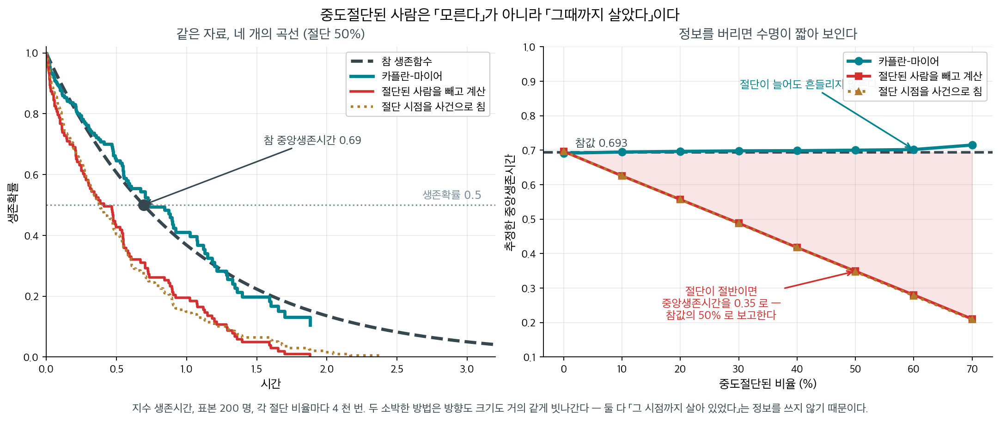
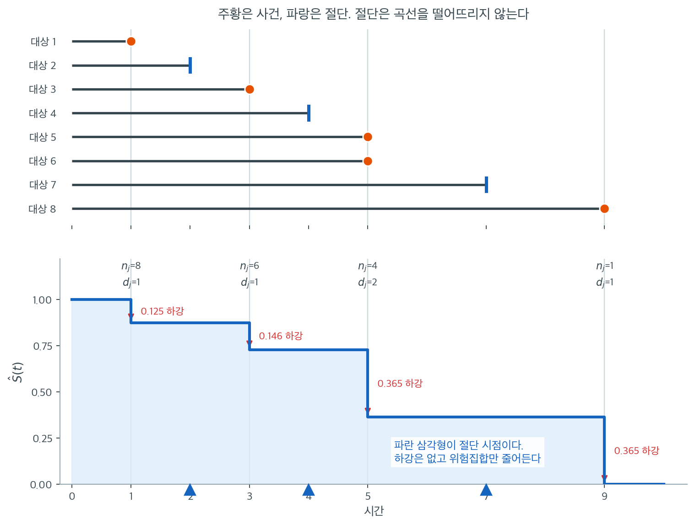
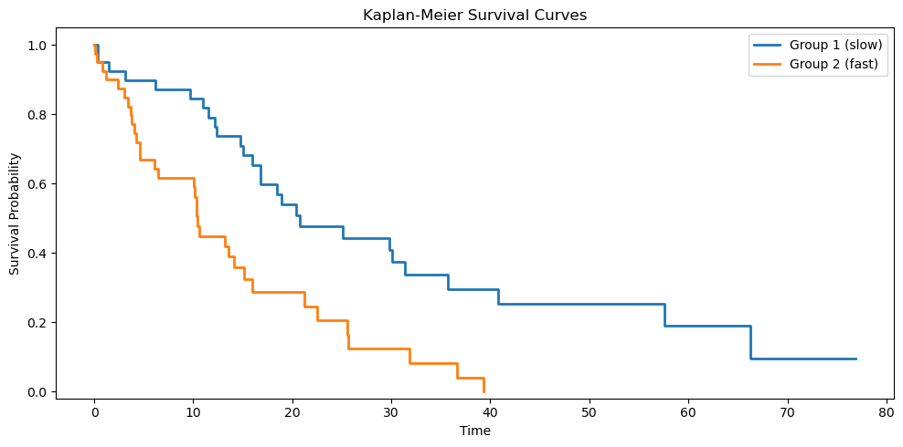

# 카플란–마이어 추정량

관측 자료로부터 생존함수 $S(t)$를 추정하는 일은 모든 생존분석의 첫 과제다. 사건시간에 대해
어떤 분포 가정도 하지 않을 때 쓰는 표준 도구가 **카플란–마이어 추정량**이며 **곱–극한
추정량**이라고도 한다. Kaplan과 Meier(1958)가 도입했으며, 우측절단된 관측치를 올바르게
처리하는 $S(t)$의 비모수 추정치를 만든다.

이 절에서는 추정량을 유도하고 그 성질을 논의하며 수치 보기를 따라간다.

---

## 1. 설정과 표기

대상 $n$명을 관측하여 서로 다른 사건시간을 크기순으로 나열했다고 하자.

$$
t_{(1)} < t_{(2)} < \cdots < t_{(K)}
$$

각 사건시간 $t_{(j)}$에서 다음을 정의한다.

- $d_j$ = 시점 $t_{(j)}$에서의 사건 수(사망, 부도 등).
- $n_j$ = 시점 $t_{(j)}$ 직전에 **위험에 있는** 대상 수. 즉 $t_{(j)}$ 이전에 사건을 겪지도
  절단되지도 않은 대상의 수다.

정확히 $t_{(j)}$에 절단된 대상은 관례상 위험집합 $n_j$에 포함시킨다(사건시간 직전까지는 여전히
위험에 있었기 때문이다).

---

## 2. 생존확률을 조건부확률의 곱으로 쪼갠다

핵심 착상은 생존확률을 조건부확률의 곱으로 분해하는 것이다. $t_{(j)}$ 직전까지 생존했다는
조건에서 $t_{(j)}$를 넘겨 생존할 확률은 다음으로 추정된다.

$$
\hat{P}\bigl(T > t_{(j)} \mid T \geq t_{(j)}\bigr) = 1 - \frac{d_j}{n_j}
$$

임의의 시점 $t$에서의 생존함수는 $t$까지의 모든 사건시간에 걸친 이 조건부 생존확률들의 곱이다.

$$
\hat{S}(t) = \prod_{j:\, t_{(j)} \leq t} \left(1 - \frac{d_j}{n_j}\right)
$$

이것이 **카플란–마이어 추정량**이다. 관측된 사건시간에서만 감소하는 계단함수를 만든다.

!!! note "절단된 관측치의 역할"

    절단된 대상은 $\hat{S}(t)$를 떨어뜨리지 않지만, 이후 사건시간의 위험집합 $n_j$를
    줄인다. 카플란–마이어 추정량은 이런 방식으로 절단된 관측치를 사건으로 취급하지 않으면서도
    그 부분적 정보를 반영한다.

---

## 3. 분포 가정 없이 절단을 다룬다

1. **비모수적.** 어떤 분포 가정도 필요 없다.
2. **최대가능도.** 카플란–마이어 추정량은 $S(t)$의 비모수 최대가능도 추정량이다.
3. **일치성.** 독립 절단 아래에서 $n \to \infty$일 때
   $\hat{S}(t) \xrightarrow{P} S(t)$이다.
4. **계단함수.** $\hat{S}(t)$는 사건시간 사이에서 상수이고 각 사건시간에서 떨어진다.
5. **우연속.** 관례상 $\hat{S}(t)$는 좌극한을 갖는 우연속 함수(cadlag)다.

<div class="storybox" markdown>

**그림으로 보는 통계학 1.** 두 사람이 같은 것을 따로 보냈다

두 사람은 프린스턴 수학과 대학원에서 **같은 지도교수** 밑에 있었다. $1952$ 년 무렵부터 각자 중도절단 자료를 붙들었는데 — 카플란(벨 연구소)은 진공관의 수명을, 마이어(당시 존스홉킨스)는 임상자료를 생각하고 있었다 — 서로 무엇을 하는지 몰랐다. 문제가 같으니 답도 같았다.

$1954$ 년에 둘이 사실상 같은 추정량을 담은 원고를 『미국통계학회지』에 **따로** 보냈다. 받아 본 편집자가 겹침을 알아보고 합치라고 권했는데, 그 편집자가 바로 두 사람의 지도교수 **존 튜키**였다. 서로 다른 접근을 맞추는 데 편지가 네 해 오갔고 — 그동안 누가 먼저 내놓을까 조마조마했다고 한다 — 공저 논문은 $1958$ 년에야 실렸다.

그 논문이 지금 과학 전체에서 가장 많이 인용된 축에 든다. 늦어진 네 해가 아깝지 않았던 셈이다.

**이 식이 없으면 무엇이 틀어지는가.** 중도절단을 다루는 소박한 두 방법과 견주어 보자.

- **(가)** 절단된 사람을 빼고, 사건이 관측된 사람만으로 계산한다.
- **(나)** 절단 시점을 사건 시점으로 친다.

<figure markdown>
{ width="900" }
  <figcaption markdown>왼쪽은 같은 자료 한 벌에서 그린 네 곡선이다. 오른쪽은 절단 비율을 $0$ 에서 $70\%$ 까지 올리며 $4$ 천 번씩 돌린 것이다.</figcaption>
</figure>

참 중앙생존시간이 $0.693$ 인 자료에서 재면 이렇다.

| 절단 비율 | 카플란–마이어 | (가) 버림 | (나) 사건으로 |
|---|---|---|---|
| $0\%$ | $0.691$ | $0.696$ | $0.696$ |
| $20\%$ | $0.697$ | $0.557$ | $0.557$ |
| $50\%$ | $0.700$ | $\mathbf{0.349}$ | $\mathbf{0.348}$ |
| $70\%$ | $0.715$ | $\mathbf{0.210}$ | $\mathbf{0.209}$ |

**절단이 절반이면 소박한 방법은 중앙생존시간을 절반으로 줄여 보고한다.** 신약의 생존기간이라면 효과를 통째로 지우는 크기다. 그런데 카플란–마이어는 절단이 $70\%$ 가 되어도 꿈쩍하지 않는다.

두 소박한 방법이 **방향도 크기도 거의 같게** 빗나간다는 점이 핵심이다. 겉보기에 둘은 정반대 처리처럼 보인다 — 하나는 절단된 사람을 지우고 하나는 죽은 것으로 친다. 그런데 결과가 같다. 까닭도 같기 때문이다.

**중도절단된 사람은 「모른다」가 아니라 「그 시점까지 살아 있었다」이다.** 그 사람은 자기가 관측된 구간 동안 **위험집합에 있었다**는 정보를 가지고 있고, 곱–극한 추정량의 $n_i$ 가 바로 그 정보를 센다. 절단된 사람을 지우면 분모에서 빠지고, 사건으로 치면 분자에 잘못 들어간다. 어느 쪽이든 「살아 있었다」가 사라진다.

§2 의 유도에서 $\hat S(t) = \prod (1 - d_i/n_i)$ 의 $n_i$ 를 「그 시점 직전까지 관측 중이던 사람 수」로 정의한 것이 이 한 줄을 지키기 위한 장치다.

_확인한 곳 — 카플란과 마이어가 프린스턴 수학과에서 튜키를 지도교수로 두었고 $1952$ 년 무렵 각자 이 문제를 붙들었다는 것, $1954$ 년에 따로 투고한 원고를 편집자이자 지도교수였던 튜키가 합치게 했고 네 해의 서신 끝에 $1958$ 년에 실렸다는 것, 카플란이 $1950$–$57$ 년 벨 연구소에 있었고 마이어가 존스홉킨스에 있었다는 것. 표의 수는 모두 직접 모의실험한 값이다_

</div>

---

## 4. 동점 처리

같은 시점에 여러 사건과 절단이 함께 일어나면 다음 관례를 따른다.

1. 시점 $t_{(j)}$의 사건을 먼저 처리한다($d_j$에 기여한다).
2. 시점 $t_{(j)}$의 절단은 그다음에 처리한다(이후 시점의 위험집합을 줄이지만 $n_j$에는
   포함된다).

이 관례에 따라 시점 $t_{(j)}$에 절단된 대상은 그 시점에 위험에 있는 것으로 센다.

<div class="exbox" markdown>

**보기 1.** <span class="diff easy" title="쉬움"></span> 대상 8명의 카플란–마이어 추정. 다음과 같은 관측 시간과 사건 지시자를 갖는 대상 8명을 생각하자.

| 대상 | 시간 | $\delta$ |
|:-------:|:----:|:--------:|
| 1 | 1 | 1 |
| 2 | 2 | 0 |
| 3 | 3 | 1 |
| 4 | 4 | 0 |
| 5 | 5 | 1 |
| 6 | 5 | 1 |
| 7 | 7 | 0 |
| 8 | 9 | 1 |

서로 다른 사건시간은 $t_{(1)} = 1$, $t_{(2)} = 3$, $t_{(3)} = 5$, $t_{(4)} = 9$이다.

</div>

??? success "풀이"
    **단계별 계산:**

    | $t_{(j)}$ | $n_j$ | $d_j$ | $1 - d_j/n_j$ | $\hat{S}(t_{(j)})$ |
    |:----------:|:-----:|:-----:|:--------------:|:-------------------:|
    | 1 | 8 | 1 | 7/8 = 0.875 | 0.875 |
    | 3 | 6 | 1 | 5/6 = 0.833 | 0.875 $\times$ 0.833 = 0.729 |
    | 5 | 4 | 2 | 2/4 = 0.500 | 0.729 $\times$ 0.500 = 0.365 |
    | 9 | 1 | 1 | 0/1 = 0.000 | 0.365 $\times$ 0.000 = 0.000 |

    $t_{(2)} = 3$에서 위험집합이 $n_2 = 6$인 이유는 대상 1이 $t = 1$에 사건을 겪었고 대상 2가
    $t = 2$에 절단되어 6명이 남았기 때문이다.

    $t_{(3)} = 5$에서 위험집합이 $n_3 = 4$인 이유는 대상 1, 2, 3, 4가 빠졌기 때문이다
    (사건 2건, 절단 2건).

    카플란–마이어 추정치는 다음과 같다.

    - $t < 1$이면 $\hat{S}(t) = 1.000$
    - $1 \leq t < 3$이면 $\hat{S}(t) = 0.875$
    - $3 \leq t < 5$이면 $\hat{S}(t) = 0.729$
    - $5 \leq t < 9$이면 $\hat{S}(t) = 0.365$
    - $t \geq 9$이면 $\hat{S}(t) = 0.000$



위쪽이 대상 여덟 명의 추적 기간이고 아래쪽이 그로부터 나온 계단이다. 두 그림의 시간축이 같으므로 눈으로 짝을 지어 볼 수 있다. **주황 점이 있는 자리에서만 계단이 내려간다.** 파란 삼각형으로 표시한 $t = 2, 4, 7$은 절단 시점인데, 곡선이 꿈쩍도 하지 않는다. 절단은 "이 사람이 죽었다"는 정보가 아니라 "여기까지는 살아 있었다"는 정보이므로 하강의 근거가 되지 못한다.

그런데 절단이 아무 일도 하지 않는 것은 아니다. **다음 사건에서 곡선이 얼마나 떨어질지를 바꾼다.** 하강 폭을 보면 $t = 1$에서 $0.125$, $t = 3$에서 $0.146$, $t = 5$에서 $0.365$다. 세 번 모두 사건이 한두 건인데 하강이 세 배 가까이 커졌다. 이유는 각 계단 위에 적어 둔 $n_j$에 있다. 위험집합이 $8 \to 6 \to 4$로 줄었기 때문이다. $t = 2$와 $t = 4$의 절단 두 건이 **곡선을 건드리지 않은 채 분모만 갉아먹은** 결과다.

이것이 앞의 상자에서 "절단된 관측치를 사건으로 취급하지 않으면서도 부분적 정보를 반영한다"고 한 말의 정확한 기제다. 한 사람이 $t = 2$에 사라지면 그 사람은 $t = 3$의 하강에 표를 던지지 못한다. 남은 여섯 명이 그 판단을 대신하므로, 한 명이 죽었다는 사실이 $1/8$이 아니라 $1/6$의 무게를 갖는다. **곡선을 직접 내리지 못하는 대신 남은 사람들의 발언권을 키우는 것**, 이것이 카플란–마이어가 절단을 다루는 방식이다.

마지막 계단도 눈여겨보라. $t = 9$에는 한 명만 남았고($n_j = 1$) 그 한 명이 사건을 겪으므로 $1 - 1/1 = 0$이 되어 곡선이 $0.365$에서 곧장 0으로 떨어진다. 사람 한 명의 운명이 생존율을 36.5%p나 움직인 것이다. 뒤에서 다룰 "꼬리에서 분산이 크다"는 말이 이 한 계단에 들어 있다.

---

<div class="exbox" markdown>

**보기 2.** <span class="diff easy" title="쉬움"></span> 카플란–마이어 추정 구현. 여덟 명을 관측해 다음을 얻었다(+ 는 절단).

| 시각 | 3 | 5+ | 7 | 7 | 10+ | 12 | 15+ | 18 |
|:---|:-:|:-:|:-:|:-:|:-:|:-:|:-:|:-:|

**(1)** $\hat S(t)$를 손으로 계산하고, 그린우드 공식으로 $t = 12$에서의 표준오차를 구하시오.

**(2)** 절단을 무시하고 여덟 시각을 그냥 평균 내면 $9.625$다. 카플란–마이어 곡선이 말하는 값과 견주시오.

</div>

??? success "풀이"

    **(1) 해석적으로.** 사건이 일어난 시각은 $3, 7, 12, 18$이다(절단된 $5, 10, 15$는 곡선을 떨어뜨리지 않는다). 각 시점에서 위험집합 $n_j$는 **그 시각 이상인 관측의 수**다.

    | $t_{(j)}$ | $n_j$ | $d_j$ | $1 - d_j/n_j$ | $\hat S(t_{(j)})$ |
    |:---:|:---:|:---:|:---:|:---:|
    | 3 | 8 | 1 | $7/8$ | $7/8 = 0.875000$ |
    | 7 | 6 | 2 | $4/6$ | $7/12 = 0.583333$ |
    | 12 | 3 | 1 | $2/3$ | $7/18 = 0.388889$ |
    | 18 | 1 | 1 | $0/1$ | $0$ |

    $t = 7$에서 $n_2 = 6$인 것이 절단의 작동 방식을 보여 준다. $t = 3$의 사건과 $t = 5$의 절단으로 두 명이 빠져 여섯이 남았다. **절단된 사람은 곡선을 떨어뜨리지 않지만 그 뒤의 위험집합을 줄인다.**

    그린우드 공식은

    $$
    \widehat{\operatorname{Var}}\big(\hat S(t)\big)
    = \hat S(t)^2 \sum_{t_{(j)} \le t} \frac{d_j}{n_j(n_j - d_j)}
    $$

    이다. $t = 12$까지의 합은

    $$
    \frac{1}{8\cdot 7} + \frac{2}{6\cdot 4} + \frac{1}{3\cdot 2}
    = 0.017857 + 0.083333 + 0.166667 = 0.267857
    $$

    이고 $\hat S(12) = 7/18$이므로

    $$
    \operatorname{SE}\big(\hat S(12)\big) = \frac{7}{18}\sqrt{0.267857} = 0.201269
    $$

    이다. **추정값 $0.389$에 표준오차가 $0.201$이다.** 여덟 명으로는 생존확률을 거의 못 재며, 세 항 가운데 마지막 $0.167$이 전체의 $62\%$를 차지한다. 위험집합이 셋으로 줄어든 꼬리가 불확실성을 지배한다.

    **(2) 해석적으로.** 절단된 세 명의 기록은 "적어도 그때까지는 살아 있었다"는 뜻이므로, 그 값을 사건시각처럼 평균에 넣으면 생존시간을 **반드시 과소평가한다.** 카플란–마이어가 주는 짝은 곡선 아래 넓이, 곧 $18$까지의 제한평균생존시간이다.

    $$
    \int_0^{18}\hat S(t)\,dt
    = 1\cdot 3 + \tfrac78\cdot 4 + \tfrac7{12}\cdot 5 + \tfrac7{18}\cdot 6
    = 3 + 3.5 + 2.916667 + 2.333333 = 11.75
    $$

    **$9.625$ 대 $11.75$로 $22\%$ 차이다.** 절단을 무시하는 것은 자료를 조금 낭비하는 일이 아니라 답을 한 방향으로 틀리게 만드는 일이다.

    **(1)(2) 수치적으로.**

    ```python
    import numpy as np

    def kaplan_meier(times, censored):
        """카플란-마이어 생존함수 추정값을 구한다.

        사건이 일어난 시점마다 "그 직전까지 살아 있던 사람 중 그 시점을
        넘긴 비율"을 곱해 나간다. 중도절단된 사람은 절단 시점까지만
        위험집합에 남아 있다가 조용히 빠진다 — 이것이 중도절단 자료를
        버리지 않고 쓰는 방법이다.

        매개변수
        --------
        times    : 관측된 시각(사건 또는 절단)
        censored : 1 이면 중도절단, 0 이면 사건이 관측됨

        돌려주는 값
        ----------
        t_plot, s_plot : 계단그림에 쓸 시각과 생존확률
        """
        order = np.argsort(times)
        times = times[order]
        censored = censored[order]

        event_times = times[censored == 0]
        unique_events = np.unique(event_times)

        s = 1.0
        t_list = [0.0]
        s_list = [1.0]

        for t_j in unique_events:
            # 위험집합: 그 시점에 아직 사건도 절단도 겪지 않은 사람 수
            n_at_risk = np.sum(times >= t_j)
            d_j = np.sum((times == t_j) & (censored == 0))
            s *= (n_at_risk - d_j) / n_at_risk
            t_list.append(t_j)
            s_list.append(s)

        t_list.append(times.max())
        s_list.append(s_list[-1])

        return np.array(t_list), np.array(s_list)

    # --- (1) 의 표와 그린우드 표준오차를 확인한다 ---
    times = np.array([3., 5., 7., 7., 10., 12., 15., 18.])
    censored = np.array([0, 1, 0, 0, 1, 0, 1, 0])

    t, s = kaplan_meier(times, censored)
    print("t_plot =", t)
    print("s_plot =", np.round(s, 6))

    acc, S = 0.0, 1.0
    for t_j in np.unique(times[censored == 0]):
        n = int(np.sum(times >= t_j))
        d = int(np.sum((times == t_j) & (censored == 0)))
        S *= (n - d) / n
        if n > d:
            acc += d / (n * (n - d))
        print(f"  t={t_j:5.1f}  n={n}  d={d}  S={S:.6f}  "
              f"그린우드합={acc:.6f}  SE={S * np.sqrt(acc):.6f}")

    # --- (2) 절단을 무시한 평균과 곡선 아래 넓이 ---
    print(f"절단을 사건으로 보고 낸 평균 = {times.mean():.4f}")
    area = np.sum(s[:-2] * np.diff(t[:-1]))
    print(f"곡선 아래 넓이 (18 까지의 제한평균생존시간) = {area:.4f}")
    ```

    출력:

    ```
    t_plot = [ 0.  3.  7. 12. 18. 18.]
    s_plot = [1.       0.875    0.583333 0.388889 0.       0.      ]
      t=  3.0  n=8  d=1  S=0.875000  그린우드합=0.017857  SE=0.116927
      t=  7.0  n=6  d=2  S=0.583333  그린우드합=0.101190  SE=0.185561
      t= 12.0  n=3  d=1  S=0.388889  그린우드합=0.267857  SE=0.201269
      t= 18.0  n=1  d=1  S=0.000000  그린우드합=0.267857  SE=0.000000
    절단을 사건으로 보고 낸 평균 = 9.6250
    곡선 아래 넓이 (18 까지의 제한평균생존시간) = 11.7500
    ```

    **손으로 만든 표와 코드가 전부 맞는다.** $0.875$, $0.583333$, $0.388889$, $0$의 네 값과 $t = 12$의 표준오차 $0.201269$가 그대로 나왔고, 곡선 아래 넓이도 $11.75$다.

    마지막 줄의 $\operatorname{SE} = 0$은 그린우드 공식의 알려진 결함이다. 마지막 사건에서 $\hat S$가 정확히 0이 되면 공식이 $\hat S^2$을 곱하므로 분산도 0이 된다. **한 사람이 남아 있을 때의 추정이 확실할 리 없다.** 곡선의 끝부분은 신뢰구간을 믿지 말고 위험집합 크기를 함께 보아야 한다.

!!! warning "이 코드의 `censored`는 $\delta$와 부호가 반대다"
    이 페이지의 코드는 `censored == 1`이 절단, `censored == 0`이 사건을 뜻한다. 이 장의 본문
    표기 $\delta_i$는 반대로 $\delta_i = 1$이 사건이다. 두 관례가 모두 쓰이므로 코드를 옮겨
    쓸 때 반드시 확인하라. `lifelines`는 `event_observed`(사건이 1), R의 `Surv()`는
    `event`(사건이 1)를 쓴다. 이 페이지의 관례가 오히려 소수파다.

**알고리즘의 핵심 단계:**

1. 관측치를 시간순으로 **정렬**한다.
2. 서로 다른 사건시간(`censored == 0`인 시점)을 **식별**한다.
3. **각 사건시간** $t_j$에서 위험집합 크기 $n_j$($t_i \geq t_j$인 대상 수)와 사건 수 $d_j$를
   계산한다.
4. 생존확률을 **갱신**한다. $\hat{S}(t_j) = \hat{S}(t_{j-1}) \times (1 - d_j / n_j)$.
5. 곡선을 관측된 최대 시점까지 **연장**한다.

!!! note "절단된 관측치"

    절단된 대상(`censored == 1`)은 생존곡선의 하강을 일으키지 않지만 이후 사건시간의 위험집합을
    줄인다. 불완전한 관측이 담은 부분적 정보를 이렇게 반영한다.

---

## 5. 중앙 생존시간

**중앙 생존시간**은 카플란–마이어 곡선이 처음으로 0.5에 도달하거나 그 아래로 내려가는 시점
$\hat{t}_{0.5}$이다.

$$
\hat{t}_{0.5} = \inf\{t : \hat{S}(t) \leq 0.5\}
$$

위 보기에서 $\hat{S}(5) = 0.365 < 0.5$이고 $\hat{S}(3) = 0.729 > 0.5$이므로
$\hat{t}_{0.5} = 5$개월이다.

!!! warning "중앙값이 존재하지 않을 수 있다"

    카플란–마이어 곡선이 0.5 아래로 내려가지 않으면(예: 절단이 심해 곡선이 0.5 위에서
    평평해지면) 중앙 생존시간이 정의되지 않는다. 평균 생존시간은 카플란–마이어 곡선 아래
    면적으로 추정할 수 있지만, 곡선이 0에 도달하지 않으면 외삽이 필요하다.

---

## 6. 우측절단만 다룬다

- 카플란–마이어 추정량은 우측절단 자료만 다룬다. 구간절단과 좌측 절단에는 다른 방법이 필요하다.
- 일변량 방법이다. 공변량을 보정하지 않고 $S(t)$를 추정한다. 공변량 보정 생존곡선에는
  콕스 모형(21.4절)이나 층화 카플란–마이어 추정이 필요하다.
- 위험에 있는 대상이 몇 명 남지 않은 후반부에서는 추정치의 분산이 크다. 신뢰구간(21.2절)이
  이 불확실성을 정량화한다.

??? tip "넬슨–알렌 추정량과의 연결"

    다음 절의 넬슨–알렌 추정량은 누적위험을 통해 또 다른 비모수 추정치를 준다. 대표본에서는
    $\hat{S}_{\text{KM}}(t) \approx \exp(-\hat{H}_{\text{NA}}(t))$이므로 두 추정량이
    거의 같다.

---

<div class="aibox" markdown>

**AI로 보는 통계학 1.** 다른 사유로 떠난 사람을 절단으로 적으면

위 한계에 한 줄을 보태야 한다. 카플란–마이어가 자료에 요구하는 것은 「아직 안 일어났다」
이고, 절단된 줄이 뜻하는 것은 **「그 사람은 나중에 일어날 수도 있었다」**이다. 그 전제가
깨지는 자리가 오늘 자료에 흔하다.

이탈을 보자. 떠나는 길이 하나가 아니다 — 스스로 해지하기도 하고, 결제가 실패해 계정이
닫히기도 하고, 규정 위반으로 정지되기도 한다. 「해지까지의 시간」을 보려고 나머지를
**절단으로 적는 것**이 흔한 처리인데, 결제 실패로 계정이 사라진 사람은 그 뒤에 **해지할
수가 없다.** 절단이라 적는 순간 그 사람은 「언젠가 해지할 사람」으로 계산에 남는다.

```python
import numpy as np

rng = np.random.default_rng(13)
N, HORIZON = 30_000, 24.0
L_QUIT, L_FAIL = 0.030, 0.045        # 달마다 해지 0.030, 결제 실패 0.045

t_quit = rng.exponential(1 / L_QUIT, N)
t_fail = rng.exponential(1 / L_FAIL, N)
t_event = np.minimum(t_quit, t_fail)
cause = np.where(t_quit <= t_fail, 1, 2)          # 1 = 해지, 2 = 결제 실패
cens = rng.uniform(0, HORIZON, N)                 # 관측 창
t = np.minimum(t_event, cens)
c = np.where(t_event <= cens, cause, 0)           # 0 = 절단

o = np.argsort(t); t, c = t[o], c[o]
n_risk = np.arange(N, 0, -1)
d_quit = (c == 1).astype(float)
d_any = (c > 0).astype(float)

S_all = np.cumprod(1 - d_any / n_risk)            # 두 사유를 합친 생존함수
S_lag = np.r_[1.0, S_all[:-1]]
cif = np.cumsum(S_lag * d_quit / n_risk)          # 알렌-요한센 누적발생률 (해지)
km_quit = np.cumprod(1 - d_quit / n_risk)         # 결제 실패를 절단으로 본 KM

def at(x, day):
    return x[np.searchsorted(t, day, side="right") - 1]

print("  개월   1 - KM (실패를 절단으로)   누적발생률 (CIF)      참값    과대 비율")
for m in (3, 6, 12, 18, 24):
    naive, correct = 1 - at(km_quit, m), at(cif, m)
    true = L_QUIT / (L_QUIT + L_FAIL) * (1 - np.exp(-(L_QUIT + L_FAIL) * m))
    print(f"{m:>6}{naive:>23.4f}{correct:>20.4f}{true:>11.4f}{naive/correct:>12.2f}")
print(f"\n해지 {int((c==1).sum()):,} 건, 결제 실패 {int((c==2).sum()):,} 건, "
      f"절단 {int((c==0).sum()):,} 건")
```

출력:

```
  개월   1 - KM (실패를 절단으로)   누적발생률 (CIF)      참값    과대 비율
     3                 0.0862              0.0806     0.0806        1.07
     6                 0.1638              0.1439     0.1449        1.14
    12                 0.3025              0.2364     0.2374        1.28
    18                 0.4225              0.2972     0.2963        1.42
    24                 0.5219              0.3356     0.3339        1.55

해지 6,393 건, 결제 실패 9,706 건, 절단 13,901 건
```

**$24$ 개월에서 $0.52$ 와 $0.34$ 다.** 「두 해 안에 절반이 해지한다」와 「셋에 하나가
해지한다」는 전혀 다른 문장인데, 같은 자료에서 절단을 어떻게 적느냐만으로 갈렸다.
어긋남은 시간이 갈수록 커진다($1.07 \to 1.55$) — 결제 실패로 빠져나간 사람이 쌓일수록
「해지할 수 있었던 사람」을 더 많이 상상하게 되기 때문이다.

**셋째 열이 옳은 양이다.** 누적발생률은 $\hat S(t_{j-1})\,d_j^{\text{해지}}/n_j$ 를 더한
것인데, 앞의 $\hat S$ 가 **두 사유를 합친** 생존함수라는 것이 요점이다 — 「그때까지 아무
일도 없었고, 그 순간 해지한다」를 세는 것이라 참값을 맞힌다. 셋째 열과 넷째 열이 소수
셋째 자리까지 같다.

**다만 두 양이 다른 물음에 답한다는 것도 분명히 해 두자.** $1 - \hat S$ 가 겨냥하는 것은
「결제 실패가 **없었더라면** 얼마나 해지했을까」이고, 그 값은 두 사유가 독립이라는 가정
없이는 자료만으로 정해지지 않는다. 사업 계획에 넣을 수는 몇 명이 실제로 해지하느냐이므로
누적발생률이고, 그래서 사유가 둘 이상이면 **사유별 곡선을 합해 $1$ 이 되도록** 그리는
것이 맞다.

</div>

## 7. 로그순위 검정으로 두 곡선을 견주기

두 집단의 곡선이 갈라져 보일 때 그것이 우연인지 묻는 검정이 **로그순위 검정**이다.
가설, 기대 사건 수 $e_{1j} = d_j r_{1j}/r_j$, 검정통계량, 그리고 가중 변형까지는
[로그순위 검정](log_rank_test.md)이 다룬다. 여기서는 카플란–마이어 곡선과
나란히 놓고 읽는 법만 본다.

---

## 8. 모의실험과 시각화

다음 코드는 사건율이 다른 두 집단의 생존자료를 모의로 생성하고 카플란–마이어 곡선을 그린다.

<div class="exbox" markdown>

**보기 3.** <span class="diff easy" title="쉬움"></span> 두 집단의 생존곡선 그리기. 1집단은 평균 $20$, 2집단은 평균 $12$인 지수분포에서 각각 $40$명을 뽑고 $20\%$를 절단으로 표시한다.

**(1)** 두 집단의 참 중앙생존시간과 참 위험비를 구하시오. 그런데 이 코드의 절단 방식은 관측시각을 줄이지 않고 **이름표만 바꾼다.** 그러면 카플란–마이어 추정값이 무엇으로 수렴하는가.

**(2)** 실행해 추정 중앙값과 로그순위 결과를 (1)의 값들과 견주시오.

</div>

??? success "풀이"

    **(1) 해석적으로.** 평균 $\theta$인 지수분포는 $S(t) = e^{-t/\theta}$이므로 중앙값은 $S(t) = 0.5$에서

    $$
    t_{1/2} = \theta\ln 2
    $$

    다. 따라서 1집단은 $20\ln 2 = 13.863$, 2집단은 $12\ln 2 = 8.318$이다. 위험은 $\lambda = 1/\theta$로 일정하므로 참 위험비는

    $$
    \frac{\lambda_1}{\lambda_2} = \frac{1/20}{1/12} = 0.6
    $$

    이고, 1집단의 위험이 2집단의 $60\%$다.

    이제 절단 방식을 따진다. 올바른 절단이라면 각자에게 절단시각 $C_i$가 있고 관측값이 $\min(T_i, C_i)$여야 한다. 그런데 이 코드는 $T_i$를 그대로 두고 그중 $20\%$에 "절단"이라는 이름표만 붙인다. 이는 **각 사람의 사건을 그 사건시각에 절단한 것**과 같다. 그러면 카플란–마이어가 각 시점에서 세는 $d_j$는 참 사건 수의 $(1-q)$배(여기서 $q$는 절단 비율)가 되고, 추정 위험이 참 위험의 $(1-q)$배로 줄어든다. 곧

    $$
    \hat S(t) \;\longrightarrow\; e^{-(1-q)t/\theta},
    \qquad
    \hat t_{1/2} \;\longrightarrow\; \frac{\theta\ln 2}{1-q}
    $$

    이다. **생존이 실제보다 좋아 보인다.** $q = 0.2$라면 중앙값이 $1/0.8 = 1.25$배로 부풀려져 1집단 $17.33$, 2집단 $10.40$이 된다. 위험비는 두 집단 모두 같은 비율로 줄어들면 유지되지만, 표본마다 $q$가 다르면 그것도 흔들린다.

    **(2) 수치적으로.**

    ```python
    import matplotlib.pyplot as plt
    from scipy import stats

    plt.rcParams["font.sans-serif"] = ["NanumGothic", "Apple SD Gothic Neo", "Malgun Gothic"]
    plt.rcParams["font.family"] = "sans-serif"
    plt.rcParams["axes.unicode_minus"] = False

    np.random.seed(0)

    # 1집단: 사건이 늦게 일어난다(평균 20). 20%는 중도절단된다.
    # 중도절단은 "그 시점까지는 살아 있었다"는 정보를 주므로 버리지 않는다.
    n1 = 40
    times_1 = np.random.exponential(scale=20, size=n1)
    censored_1 = (np.random.rand(n1) < 0.2).astype(int)

    # 2집단: 사건이 빨리 일어난다(평균 12).
    n2 = 40
    times_2 = np.random.exponential(scale=12, size=n2)
    censored_2 = (np.random.rand(n2) < 0.2).astype(int)

    t1, s1 = kaplan_meier(times_1, censored_1)
    t2, s2 = kaplan_meier(times_2, censored_2)

    # 그림으로 확인
    fig, ax = plt.subplots(figsize=(10, 5))
    # where="post" 가 계단을 오른쪽으로 뻗게 한다. 생존함수는 사건이 일어난
    # 그 순간에 떨어지고 다음 사건까지 평평하므로, 이 설정이라야 맞다.
    ax.step(t1, s1, where="post", linewidth=2, label="Group 1 (slow)")
    ax.step(t2, s2, where="post", linewidth=2, label="Group 2 (fast)")
    ax.set_xlabel("Time")
    ax.set_ylabel("Survival Probability")
    ax.set_title("Kaplan-Meier Survival Curves")
    ax.set_ylim(-0.02, 1.05)
    ax.legend()
    plt.tight_layout()
    plt.show()

    # --- (1) 의 예측과 맞추어 본다 ---
    def km_median(t, s):
        idx = np.where(s <= 0.5)[0]
        return t[idx[0]] if len(idx) else np.nan

    q1, q2 = censored_1.mean(), censored_2.mean()
    print(f"실제 절단 비율: 1집단 {q1:.3f}, 2집단 {q2:.3f}  (설계값 0.200)")
    print(f"KM 중앙값          : 1집단 {km_median(t1, s1):6.3f}, 2집단 {km_median(t2, s2):6.3f}")
    print(f"참 중앙값 th*ln2    : 1집단 {20 * np.log(2):6.3f}, 2집단 {12 * np.log(2):6.3f}")
    print(f"이름표 절단이 뜻하는 값: 1집단 {20 * np.log(2) / (1 - q1):6.3f}, "
          f"2집단 {12 * np.log(2) / (1 - q2):6.3f}")

    # 로그순위 검정은 전용 쪽([로그순위 검정](log_rank_test.md))에서 유도한다.
    # 여기서는 같은 함수를 그대로 가져와 KM 곡선과 나란히 읽는다.
    def logrank_test(times_1, censored_1, times_2, censored_2):
        """이표본 로그순위 검정.

        사건 시점마다 2x2 분할표를 만들어 관측 사건 수와 기대 사건 수를
        비교한다. 그 차이를 모든 시점에 걸쳐 누적한 것이 통계량이다.
        두 생존곡선이 같다는 귀무가설 아래에서 자유도 1 인 카이제곱을 따른다.

        돌려주는 값
        ----------
        chi2, p_value
        """
        event_1 = times_1[censored_1 == 0]
        event_2 = times_2[censored_2 == 0]
        all_event_times = np.unique(np.concatenate([event_1, event_2]))

        O1, E1, V = 0.0, 0.0, 0.0

        for t_j in all_event_times:
            r1 = np.sum(times_1 >= t_j)
            r2 = np.sum(times_2 >= t_j)
            r  = r1 + r2

            d1 = np.sum(event_1 == t_j)
            d2 = np.sum(event_2 == t_j)
            d  = d1 + d2

            # 두 집단의 생존이 같다면, 그 시점의 사건은 위험집합 크기에
            # 비례해 나뉘어야 한다. 그것이 기대 사건 수 e1 이다.
            e1 = r1 * d / r if r > 0 else 0
            v  = r1 * r2 * d * (r - d) / (r**2 * (r - 1)) if r > 1 else 0

            O1 += d1
            E1 += e1
            V  += v

        chi2 = (O1 - E1)**2 / V if V > 0 else 0
        p_value = stats.chi2(1).sf(chi2)
        return chi2, p_value
    chi2, p = logrank_test(times_1, censored_1, times_2, censored_2)
    print(f"로그순위: chi2 = {chi2:.4f},  p = {p:.5f}")
    ```

    출력:

    ```
    실제 절단 비율: 1집단 0.325, 2집단 0.175  (설계값 0.200)
    KM 중앙값          : 1집단 20.763, 2집단 10.446
    참 중앙값 th*ln2    : 1집단 13.863, 2집단  8.318
    이름표 절단이 뜻하는 값: 1집단 20.538, 2집단 10.082
    로그순위: chi2 = 12.6889,  p = 0.00037
    ```

    

    **추정 중앙값이 참값과 크게 어긋나며, 어긋나는 방향과 크기가 (1)의 예측과 맞는다.** 1집단의 KM 중앙값 $20.763$은 참값 $13.863$보다 $50\%$ 크지만, 이 표본의 절단 비율 $q = 0.325$를 넣은 예측값 $13.863/0.675 = 20.538$과는 $1.1\%$ 안에서 일치한다. 2집단도 $10.446$ 대 예측 $10.082$로 가깝고 참값 $8.318$과는 멀다.

    **이것은 추정량의 결함이 아니라 자료를 만든 방식의 결함이다.** 카플란–마이어는 주어진 자료에 대해 옳게 작동했다. 다만 그 자료에서 "절단"이라 표시된 사람은 실제로는 그 시각에 사건을 겪었으므로, 추정량이 보기에는 생존이 실제보다 좋아 보인다. 쪽 아래의 주의 상자가 지적하는 대로 절단은 **관측시각을 줄여야** 하며, 그렇게 만든 자료에서는 이런 치우침이 생기지 않는다.

    로그순위 쪽은 영향이 훨씬 작다. $\chi^2 = 12.69$, $p = 0.00037$로 두 집단의 차이를 또렷하게 잡아낸다. 사건이 양쪽에서 같은 비율로 지워졌다면 순위 구조가 크게 망가지지 않기 때문이다. 다만 여기서도 $q_1 = 0.325$와 $q_2 = 0.175$가 서로 달라 1집단의 사건이 더 많이 지워졌고, 그 탓에 1집단이 실제보다 더 좋아 보이는 쪽으로 검정이 조금 기울었다.

    !!! note "이 코드의 절단은 사건시간과 독립이 아니다"
        `censored_1 = (np.random.rand(n1) < 0.2)`는 관측된 시간과 **무관하게** 20%를 절단으로 표시한다. 이는 실제 절단 기제(대상마다 절단시간 $C_i$가 있고 $t = \min(T, C)$)와 다르다. 여기서는 관측 시간을 그대로 두고 이름표만 바꾸므로, 절단된 대상의 기록된 시간이 참 사건시간이다. 위에서 보았듯 그 결과로 **생존이 체계적으로 좋게 추정된다.** 21.1절의 모의실험 코드가 올바른 방식을 보여준다.

---

## 9. 평평한 구간은 사건이 없던 때다

- 카플란–마이어 곡선은 관측된 각 사건시간에서 떨어지는 **계단함수**다. 평평한 구간은 사건이
  없는 구간에 해당하며, 위험집합을 줄이는 절단된 관측치가 그 안에 있을 수 있다.
- 곡선이 더 오래 높이 머무를수록 그 집단의 **생존이 낫다**.
- **로그순위 검정**은 두 곡선의 시각적 분리가 통계적으로 유의한지를 형식적으로 평가한다. p-값이
  작으면(예: $p < 0.05$) 생존분포가 같다는 영가설을 기각한다.
- 로그순위 검정은 **비례위험** 가정이 성립할 때(집단 간 위험비가 시간에 걸쳐 대략 일정할 때)
  검정력이 가장 높다. 생존곡선이 교차하면 차이를 탐지하지 못할 수 있다.

!!! tip "로그순위 검정을 언제 쓰는가"

    공변량 보정이 필요 없을 때 두 개 이상의 집단을 비교하는 데 적절하다. 다변량 분석에는
    콕스 비례위험 모형을 쓰라.

---

## 연습문제

<div class="drillbox" markdown>

**연습문제 1.** <span class="diff easy" title="쉬움"></span>
카플란–마이어 추정

환자 10명을 진단 후 추적했다. 관측된 시간(개월)과 사건 지시자($\delta$: 1 = 사망,
0 = 절단)는 다음과 같다.

| 대상 | 시간 | $\delta$ |
|:-------:|:----:|:--------:|
| 1 | 3 | 1 |
| 2 | 5 | 0 |
| 3 | 7 | 1 |
| 4 | 8 | 1 |
| 5 | 10 | 0 |
| 6 | 12 | 1 |
| 7 | 12 | 0 |
| 8 | 15 | 1 |
| 9 | 18 | 0 |
| 10 | 20 | 1 |

**(a)** 각 사건시간에서 카플란–마이어 추정치 $\hat{S}(t)$를 계산하라.

**(b)** 추정된 중앙 생존시간은 얼마인가?

</div>

??? success "풀이"

    **(a)** 서로 다른 사건시간은 3, 7, 8, 12, 15, 20이다.

    | $t_{(j)}$ | $n_j$ | $d_j$ | $1 - d_j/n_j$ | $\hat{S}(t_{(j)})$ |
    |:----------:|:-----:|:-----:|:--------------:|:-------------------:|
    | 3 | 10 | 1 | 0.900 | 0.900 |
    | 7 | 8 | 1 | 0.875 | 0.788 |
    | 8 | 7 | 1 | 0.857 | 0.675 |
    | 12 | 5 | 1 | 0.800 | 0.540 |
    | 15 | 3 | 1 | 0.667 | 0.360 |
    | 20 | 1 | 1 | 0.000 | 0.000 |

    위험집합 계산에서 유의할 점 두 가지.

    - $t = 7$에서 $n_j = 8$이다. 대상 1(사건)과 대상 2(절단)가 빠졌다. 절단된 대상 2도
      위험집합에서 제외된다.
    - $t = 12$에서 $d_j = 1$이다. 대상 6과 7이 모두 시점 12인데 대상 6만 사건이고 대상 7은
      절단이다. 동점 관례에 따라 대상 7은 $n_j = 5$에 포함되지만 $d_j$에는 기여하지 않는다.

    **(b)** $\hat{S}(12) = 0.540 > 0.5$이고 $\hat{S}(15) = 0.360 < 0.5$이므로 중앙
    생존시간은 $\hat{t}_{0.5} = 15$개월이다.

---

<div class="drillbox" markdown>

**연습문제 2.** <span class="diff med" title="중간"></span>
같은 자료에서 절단된 관측치를 모두 **버리고** 계산한 경험적 생존함수와, 절단시간을
**사건으로 취급**해 계산한 경험적 생존함수를 카플란–마이어 추정치와 비교하라.

</div>

??? success "풀이"

    **방법 1: 절단된 대상 버리기.** 사건이 관측된 6명(시간 3, 7, 8, 12, 15, 20)만 쓰면
    경험적 생존함수는 각 시점에서 $1/6$씩 떨어진다.

    | $t$ | 3 | 7 | 8 | 12 | 15 | 20 |
    |---|---|---|---|---|---|---|
    | 절단 버림 | $0.833$ | $0.667$ | $0.500$ | $0.333$ | $0.167$ | $0.000$ |
    | 절단=사건 | $0.900$ | $0.700$ | $0.600$ | $0.400$ | $0.200$ | $0.000$ |
    | **카플란–마이어** | $\mathbf{0.900}$ | $\mathbf{0.788}$ | $\mathbf{0.675}$ | $\mathbf{0.540}$ | $\mathbf{0.360}$ | $\mathbf{0.000}$ |

    (두 번째 행은 10명 전부를 사건으로 보고 $\hat S(t) = \#\{t_i > t\}/10$을 계산한 것이다.
    시점 5, 10, 12, 18의 절단도 하강을 만들지만 위 표에는 사건시간만 표시했다.)

    **두 순진한 방법 모두 생존을 과소추정한다.** 예컨대 $t = 12$에서 카플란–마이어는
    $0.540$인데 절단을 버리면 $0.333$, 사건으로 취급하면 $0.400$이다.

    **왜 그런가.**

    - **절단을 버리면** 남은 표본이 일찍 사건을 겪은 쪽으로 선택된다. 오래 관측된 대상일수록
      절단될 가능성이 높으므로, 긴 생존시간이 표본에서 조직적으로 빠진다.
    - **절단을 사건으로 취급하면** 실제로는 더 오래 살았을 대상을 절단 시점에 죽은 것으로
      기록한다. 각 관측치의 생존시간을 아래로 밀어낸다.

    카플란–마이어는 절단된 대상을 **하강 없이 위험집합에서만 빼서** 두 오류를 모두 피한다.
    $\square$

---

<div class="drillbox" markdown>

**연습문제 3.** <span class="diff med" title="중간"></span>
연습문제 1의 자료에서 대상 10(시점 20, 사건)이 절단이었다면 $\hat S(t)$가 어떻게 달라지는가?
이때 평균 생존시간을 추정할 수 있는가?

</div>

??? success "풀이"

    대상 10이 절단이면 $t = 20$에서 사건이 없으므로 마지막 하강이 사라진다.

    | $t$ | 원래 $\hat S$ | 수정된 $\hat S$ |
    |---|---|---|
    | $15 \le t < 20$ | $0.360$ | $0.360$ |
    | $t \ge 20$ | $0.000$ | $\mathbf{0.360}$ |

    **곡선이 $0.360$에서 평평해지고 0에 도달하지 않는다.** 관측이 끝난 뒤의 생존에 대해
    자료가 아무 말도 하지 않기 때문이다.

    **중앙값은 여전히 추정 가능하다.** 곡선이 $0.5$ 아래로는 내려갔으므로
    $\hat t_{0.5} = 15$로 변하지 않는다.

    **평균은 추정할 수 없다.** 평균 생존시간은 $\int_0^\infty S(t)\,dt$인데, 곡선이 $0.360$에서
    멈추면 이 적분이 발산한다. 카플란–마이어 곡선 아래 면적을 그대로 계산하면 마지막 절단
    시점 이후를 0으로 취급하는 셈이라 **평균을 과소추정**한다.

    **표준적인 대안 세 가지.**

    1. **제한 평균 생존시간(RMST).** 미리 정한 $\tau$까지만 적분한다.
       $\text{RMST}(\tau) = \int_0^{\tau} \hat S(t)\,dt$. 여기서 $\tau = 20$으로 두면
       계단함수 아래 면적은

       $$
       3(1.000) + 4(0.900) + 1(0.7875) + 4(0.675) + 3(0.540) + 5(0.360) = 13.51
       $$

       개월이다. $\tau$를 자료에 근거해 고르지 말고 **미리** 정하는 것이 중요하다.
       $\tau$를 관측된 최대 시점으로 잡으면 그 값 자체가 확률변수가 되어 추론이 꼬인다.
    2. **꼬리 외삽.** 마지막 구간에 지수 꼬리 등을 가정한다. 가정에 크게 의존하므로 민감도
       분석이 필요하다.
    3. **중앙값 보고.** 곡선이 $0.5$까지만 내려가면 되므로 절단에 훨씬 강건하다. 생존분석에서
       평균 대신 중앙값을 보고하는 관례의 실질적 근거다.

    $\square$

---

<div class="drillbox" markdown>

**연습문제 4.** <span class="diff hard" title="어려움"></span>
카플란–마이어 추정량이 $S(t)$의 비모수 최대가능도 추정량임을 이산 시점의 경우에 대해
보여라.

</div>

??? success "풀이"

    사건이 서로 다른 시점 $t_{(1)} < \cdots < t_{(K)}$에서만 일어날 수 있다고 하고,
    $q_j = P(T = t_{(j)} \mid T \ge t_{(j)})$를 시점 $t_{(j)}$의 조건부 사건확률이라 하자.
    그러면 $S(t) = \prod_{j: t_{(j)} \le t}(1 - q_j)$이다.

    가능도를 $q_1, \ldots, q_K$의 함수로 쓴다. 시점 $t_{(j)}$에서,

    - 사건을 겪은 $d_j$명은 각각 $q_j$를 기여한다.
    - 그 시점을 넘겨 생존한 $n_j - d_j$명은 각각 $1 - q_j$를 기여한다.

    (절단된 대상은 자신이 통과한 모든 시점에서 $1-q_j$를 기여하고, 절단 이후 시점에는 아무
    기여도 하지 않는다.) 따라서

    $$
    L(q_1,\ldots,q_K) = \prod_{j=1}^{K} q_j^{\,d_j}\,(1-q_j)^{\,n_j - d_j}
    $$

    이다. 이는 **$q_j$들에 대해 분리되는** 이항 가능도의 곱이다. 각 인자를 따로 최대화하면
    이항분포의 MLE로부터

    $$
    \hat q_j = \frac{d_j}{n_j}
    $$

    를 얻고, 대입하면

    $$
    \hat S(t) = \prod_{j: t_{(j)} \le t}\left(1 - \frac{d_j}{n_j}\right)
    $$

    로 정확히 카플란–마이어 추정량이 된다.

    **왜 사건시간에서만 하강하는가.** 사건이 관측되지 않은 시점에서는 $d_j = 0$이므로
    $\hat q_j = 0$이고 그 인자가 1이 되어 $\hat S$를 바꾸지 않는다. 즉 "사건시간에서만
    떨어진다"는 성질은 관례가 아니라 **최대가능도의 결과**다. $\square$

---

<div class="drillbox" markdown>

**연습문제 5.** <span class="diff easy" title="쉬움"></span>
카플란–마이어 계산

환자 6명의 생존자료가 다음과 같다.

| 대상 | 시간 | 상태 (0 = 사건, 1 = 절단) |
|:-------:|:----:|:--------------------------------:|
| A | 2 | 0 |
| B | 3 | 1 |
| C | 5 | 0 |
| D | 5 | 0 |
| E | 8 | 1 |
| F | 10 | 0 |

카플란–마이어 추정량으로 각 사건시간의 $\hat{S}(t)$를 계산하라.

</div>

??? success "풀이"

    서로 다른 사건시간은 $t_{(1)} = 2$, $t_{(2)} = 5$, $t_{(3)} = 10$이다.

    | $t_{(j)}$ | $n_j$ | $d_j$ | $1 - d_j/n_j$ | $\hat{S}(t_{(j)})$ |
    |:----------:|:-----:|:-----:|:--------------:|:-------------------:|
    | 2 | 6 | 1 | 5/6 = 0.833 | 0.833 |
    | 5 | 4 | 2 | 2/4 = 0.500 | 0.833 $\times$ 0.500 = 0.417 |
    | 10 | 1 | 1 | 0/1 = 0.000 | 0.417 $\times$ 0.000 = 0.000 |

    $t_{(2)} = 5$에서는 대상 A가 $t = 2$에 사건을 겪었고 대상 B가 $t = 3$에 절단되어
    $n_2 = 4$가 위험에 남는다.

---

<div class="drillbox" markdown>

**연습문제 6.** <span class="diff easy" title="쉬움"></span>
로그순위 검정의 설정

두 집단을 관측했다.

**집단 1:** 3, 6+, 9, 15 (+ = 절단).

**집단 2:** 1, 4, 8+, 12.

**(a)** 두 집단의 서로 다른 사건시간을 모두 나열하라.

**(b)** $t = 1$에서 집단 1의 기대 사건 수 $e_{11}$과 분산 기여 $v_1$을 계산하라.

</div>

??? success "풀이"

    **(a)** 사건시간(절단 제외)은 집단 1에서 3, 9, 15이고 집단 2에서 1, 4, 12이다. 합친 서로
    다른 사건시간은 1, 3, 4, 9, 12, 15다.

    **(b)** $t = 1$에서 $r_1 = 4$, $r_2 = 4$, $r = 8$, $d_1 = 0$, $d_2 = 1$, $d = 1$이므로

    $$
    e_{11} = d \cdot \frac{r_1}{r} = 1 \cdot \frac{4}{8} = 0.5
    $$

    $$
    v_1 = \frac{r_1 \cdot r_2 \cdot d \cdot (r - d)}{r^2 (r - 1)} = \frac{4 \cdot 4 \cdot 1 \cdot 7}{64 \cdot 7} = \frac{112}{448} = 0.25
    $$

---

<div class="drillbox" markdown>

**연습문제 7.** <span class="diff easy" title="쉬움"></span>
로그순위 검정의 해석

처리군과 대조군을 비교한 로그순위 검정이 $\chi^2_{\text{LR}} = 5.23$, $p = 0.022$를 냈다.

**(a)** 유의수준 $\alpha = 0.05$에서의 결론을 서술하라.

**(b)** 처리군의 관측 사건 수가 $O_1 = 15$이고 기대 사건 수가 $E_1 = 21.3$이었다면 효과의
방향을 해석하라.

**(c)** 로그순위 검정의 어떤 가정이 위배되면 이 결과가 오도할 수 있는가?

</div>

??? success "풀이"

    **(a)** $p = 0.022 < 0.05$이므로 5% 수준에서 $H_0$을 기각하고, 처리군과 대조군의 생존분포가
    유의하게 다르다고 결론짓는다.

    **(b)** $O_1 = 15 < E_1 = 21.3$이므로 처리군의 사건이 영가설 아래의 기대보다 적었다. 처리군의
    생존이 대조군보다 낫다(위험이 낮다)는 뜻이다.

    대략적인 위험비를 $O_1/E_1 = 15/21.3 = 0.70$으로 어림할 수도 있다. 이를 **관측/기대
    위험비**라 하며, 콕스 모형을 적합하지 않고도 효과크기를 가늠하는 데 쓰인다. 다만 어디까지나
    근사이며, 정확한 위험비와 그 신뢰구간은 콕스 모형에서 얻어야 한다.

    **(c)** 로그순위 검정은 **비례위험**을 가정한다. 집단 간 위험비가 시간에 걸쳐 일정하다는
    것이다. 생존곡선이 교차하면(예: 처리가 초기에는 이롭지만 후반에는 해로우면) 로그순위
    검정이 차이를 탐지하지 못하거나 오도하는 요약을 줄 수 있다.

---

<div class="drillbox" markdown>

**연습문제 8.** <span class="diff med" title="중간"></span>
절단의 효과

대상 10명이 모두 비율 $\lambda = 0.1$인 같은 지수분포를 따른다고 하자. 시나리오 A에서는 아무도
절단되지 않는다. 시나리오 B에서는 5명이 시점 $t = 5$에 절단된다.

**(a)** 두 시나리오에서 카플란–마이어 곡선이 어떻게 다를지 정성적으로 설명하라.

**(b)** 후반 시점에서 어느 시나리오가 더 넓은 신뢰띠를 만드는가? 이유는?

</div>

??? success "풀이"

    **(a)** 시나리오 A에서는 10명 모두가 사건을 기여하므로 카플란–마이어 곡선이 완전한 정보에
    근거하며 꾸준히 0까지 내려간다. 시나리오 B에서는 $t = 5$에 절단된 5명이 그 시점에
    위험집합에서 빠진다. 곡선은 $t = 5$까지는 시나리오 A와 같지만, $t = 5$ 이후에는 위험집합이
    작아져(절단되지 않은 5명만 남는다) 각 사건이 생존 추정치를 더 크게 떨어뜨린다.

    **(b)** 시나리오 B가 $t = 5$ 이후에 더 넓은 신뢰띠를 갖는다. 그린우드 공식에 따른
    카플란–마이어 추정량의 분산은 위험집합이 작아질수록 커진다. 원래 10명 대신 5명만 위험에
    있으면 각 사건이 추정치에 더 큰 불확실성을 기여한다.

    !!! note "곡선의 기댓값은 두 시나리오에서 같다"
        절단이 편향을 만들지 않는다는 점을 놓치지 말라. 시나리오 B의 곡선은 A보다 **덜 정확할**
        뿐 체계적으로 위나 아래로 치우치지 않는다. 절단이 $t = 5$라는 고정 시점에 일어나고
        사건시간과 무관하므로 독립 절단 가정이 성립하기 때문이다. 절단이 정보를 담고 있을 때에만
        (예: 상태가 나쁜 대상이 먼저 절단될 때) 편향이 생긴다.

---

<div class="drillbox" markdown>

**연습문제 9.** <span class="diff hard" title="어려움"></span>
로그순위 통계량의 분산 유도

영가설 아래에서 $d_{1j}$(시점 $t_{(j)}$의 집단 1 사건 수)가 초기하분포를 따름을 보이고 다음
식을 유도하라.

$$
v_j = \frac{r_{1j} \, r_{2j} \, d_j \, (r_j - d_j)}{r_j^2 \, (r_j - 1)}
$$

</div>

??? success "풀이"

    $H_0$ 아래에서 시점 $t_{(j)}$에 $r_j$명이 위험에 있고 그중 $r_{1j}$명이 집단 1에 속한다.
    이 $r_j$명 중에서 $d_j$개의 사건이 일어난다. 집단 1의 사건 수 $d_{1j}$는 초기하분포를
    따른다. 집단 1 소속 $r_{1j}$명을 포함한 $r_j$명의 풀에서 "사건" $d_j$개를 뽑는 것이다.

    초기하 확률변수 $X \sim \text{Hyper}(N, K, n)$의 분산은

    $$
    \text{Var}(X) = n \cdot \frac{K}{N} \cdot \frac{N - K}{N} \cdot \frac{N - n}{N - 1}
    $$

    이다. $N = r_j$, $K = r_{1j}$, $n = d_j$를 대입하면

    $$
    v_j = d_j \cdot \frac{r_{1j}}{r_j} \cdot \frac{r_j - r_{1j}}{r_j} \cdot \frac{r_j - d_j}{r_j - 1}
    $$

    이고 $r_j - r_{1j} = r_{2j}$이므로

    $$
    v_j = \frac{r_{1j} \, r_{2j} \, d_j \, (r_j - d_j)}{r_j^2 \, (r_j - 1)}
    $$

    $\square$

---

<div class="drillbox" markdown>

**연습문제 10.** <span class="diff med" title="중간"></span>
절단 부호화 관례

2절의 구현에서 `censored = 1`은 절단, `censored = 0`은 사건 관측을 뜻한다. 많은 생존분석
패키지는 반대 관례(`event = 1`)를 쓴다.

**(a)** `event` 부호화 관례로 카플란–마이어의 핵심 루프를 다시 쓰라.

**(b)** 부호화 관례가 수학적 결과에 영향을 주지 않는 이유를 설명하라.

</div>

??? success "풀이"

    **(a)** `event` 지시자(1 = 사건, 0 = 절단)를 쓰면 다음과 같다.

    ```python
    import numpy as np

    times = np.array([5, 8, 8, 12, 15, 20, 22, 30], dtype=float)
    event = np.array([1, 1, 0, 1, 0, 1, 0, 1])   # 1 = 사건, 0 = 절단

    event_times = times[event == 1]
    unique_events = np.unique(event_times)

    s = 1.0
    for t_j in unique_events:
        n_at_risk = np.sum(times >= t_j)
        d_j = np.sum((times == t_j) & (event == 1))
        s *= (n_at_risk - d_j) / n_at_risk
        print(f"t = {t_j:5.1f}  n = {n_at_risk}  d = {d_j}  S = {s:.4f}")

    # 같은 자료를 앞의 관례(1 = 절단)로 넘겨도 결과가 같다
    t_plot, s_plot = kaplan_meier(times, 1 - event)
    print("final S:", s, "vs", s_plot[-1])
    ```

    출력:

    ```
    t =   5.0  n = 8  d = 1  S = 0.8750
    t =   8.0  n = 7  d = 1  S = 0.7500
    t =  12.0  n = 5  d = 1  S = 0.6000
    t =  20.0  n = 3  d = 1  S = 0.4000
    t =  30.0  n = 1  d = 1  S = 0.0000
    final S: 0.0 vs 0.0
    ```

    바뀌는 것은 `censored == 0`을 `event == 1`로 대체하는 것뿐이다.

    **(b)** 수학적 양 $n_j$와 $d_j$는 어느 관측치가 사건이고 어느 것이 절단인지로 정의된다.
    사건에 0을 붙이든 1을 붙이든 순전히 소프트웨어 관례다. 코드가 사건과 절단을 옳게 식별하는
    한 계산된 $\hat{S}(t)$는 동일하다.

    !!! warning "그러나 실수는 조용히 일어난다"
        관례가 결과를 바꾸지 않는다는 것은 **코드를 옳게 썼을 때**의 이야기다. 관례를 헷갈려
        지시자를 반대로 넘기면 사건과 절단이 통째로 뒤바뀌어, 오류 없이 실행되면서 완전히
        틀린 곡선이 나온다. 이런 실수는 예외를 던지지 않으므로 발견하기 어렵다.

        간단한 방어법은 결과를 검산하는 것이다. 사건 수 $d = \sum \delta_i$를 출력해 자료에서
        기대하는 값과 맞는지 확인하고, 절단율이 그럴듯한지 보라. 절단율이 90%로 나왔는데
        연구 설계상 30%여야 한다면 지시자가 뒤집혔을 가능성이 크다.
---

## 정리하며

카플란–마이어는 **분포 가정 없이** 생존함수를 추정한다.

$$
\hat S(t)=\prod_{t_i\le t}\left(1-\frac{d_i}{n_i}\right)
$$

- **곱–극한 추정량이다.** 각 사건시점에서 "그 시점을 넘길 조건부 확률"을 곱해 나가며, 3장의 곱셈 규칙이 그대로 쓰인다.
- **절단을 자연스럽게 다룬다.** 절단된 관측은 그 시점까지 **위험집합 $n_i$ 에 기여**하고 이후 빠진다. 정보를 버리지도 왜곡하지도 않는다.
- **계단함수다.** 사건이 일어난 시점에서만 내려가며, 절단 시점에서는 내려가지 않는다.
- **마지막 관측이 절단이면 곡선이 $0$ 에 닿지 않는다.** 그 이후는 추정되지 않으며, **중앙생존시간이 정의되지 않을 수도 있다.**
- **비모수라 유연하지만 공변량을 다루지 못한다.** 집단별로 나눠 그릴 수는 있어도 연속 공변량은 콕스 모형이 필요하다.

다음 절 **[넬슨–알렌 누적위험](nelson_aalen.md)**으로 넘어간다. 같은 생존함수를 생존확률의 곱이 아니라 **위험의 합**으로 겨냥한다.
