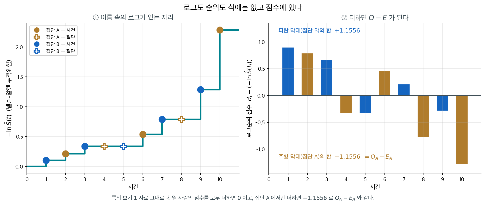
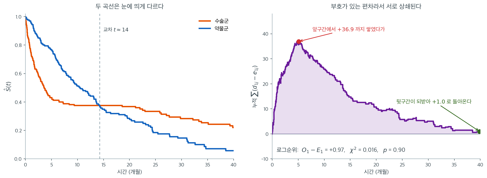

# 로그순위 검정

카플란–마이어 추정량은 집단마다 별도의 생존곡선을 준다. 자연스러운 다음 질문은, 두 개(또는 그
이상) 생존곡선 사이에서 관측된 차이가 바탕 생존분포의 진짜 차이를 반영하는지 아니면 단순한
표집 변동인지다. **로그순위 검정**이 이 비교를 위한 표준적인 비모수 가설검정이다.

이 절에서는 가설을 세우고 검정통계량을 유도하며 두 집단 보기를 따라간다.

---

## 1. 가설

두 집단(예: 처리군 대 대조군)에 대해 로그순위 검정은 다음을 평가한다.

$$
H_0 : S_1(t) = S_2(t) \quad \text{for all } t \geq 0
$$

$$
H_1 : S_1(t) \neq S_2(t) \quad \text{for some } t \geq 0
$$

$H_0$ 아래에서 두 집단은 같은 생존분포를 공유하며, 카플란–마이어 곡선에서 관측된 어떤 차이도
우연에 의한 것이다.

---

## 2. 두 집단의 사건시간을 합쳐 줄 세운다

두 집단의 사건시간을 합쳐 서로 다른 $K$개의 사건시간을 크기순으로 나열한다.
$t_{(1)} < t_{(2)} < \cdots < t_{(K)}$. 각 사건시간 $t_{(j)}$에서 다음을 기록한다.

| 양 | 집단 1 | 집단 2 | 합계 |
|:---------|:-------:|:-------:|:-----:|
| 사건 | $d_{1j}$ | $d_{2j}$ | $d_j$ |
| 위험집합 | $n_{1j}$ | $n_{2j}$ | $n_j$ |

---

## 3. 영가설 아래의 기대 사건 수

$H_0$ 아래에서 각 시점 $t_{(j)}$의 사건은 두 집단의 위험집합 크기에 비례하여 배분된다. 시점
$t_{(j)}$에 집단 1에서 기대되는 사건 수는

$$
e_{1j} = d_j \cdot \frac{n_{1j}}{n_j}
$$

이다. 이는 초기하분포의 기댓값이다. 대상 $n_j$명의 위험집합에서 비복원으로 $d_j$개의 사건이
뽑히며, 그중 $n_{1j}$명이 집단 1에 속한다.

집단 1의 총 기대 사건 수는

$$
E_1 = \sum_{j=1}^{K} e_{1j} = \sum_{j=1}^{K} d_j \cdot \frac{n_{1j}}{n_j}
$$

이다.

---

## 4. 검정통계량

로그순위 검정통계량은 집단 1에서 관측된 총 사건 수 $O_1 = \sum_{j=1}^{K} d_{1j}$을 기대값
$E_1$과 비교한다. $H_0$ 아래의 분산은

$$
V_1 = \sum_{j=1}^{K} \frac{n_{1j} \, n_{2j} \, d_j \, (n_j - d_j)}{n_j^2 \, (n_j - 1)}
$$

이고 검정통계량은

$$
\chi^2_{\text{LR}} = \frac{(O_1 - E_1)^2}{V_1}
$$

이다. $H_0$ 아래에서 이 통계량은 근사적으로 자유도 1의 카이제곱분포를 따른다.

$$
\chi^2_{\text{LR}} \;\xrightarrow{d}\; \chi^2_1
$$

p-값은 $P(\chi^2_1 \geq \chi^2_{\text{LR}})$이다.

!!! note "동등한 정식화"

    $O_1 + O_2 = d$이고 $E_1 + E_2 = d$로 합계가 고정되어 있으므로, 집단 2를 기준으로 한
    검정통계량도 같은 결과를 준다. 두 집단 로그순위 검정은 어느 집단을 고르든 자유도 1을 쓴다.

<div class="exbox" markdown>

**보기 1.** <span class="diff easy" title="쉬움"></span> 두 집단의 로그순위검정. 진단 후 두 집단의 환자를 추적했다.

**집단 A**(처리): 2, 4+, 6, 8+, 10 (+는 절단을 뜻한다).

**집단 B**(대조): 1, 3, 5+, 7, 9.

합친 사건시간(절단 제외)은 1, 2, 3, 6, 7, 9, 10이다.

| $t_{(j)}$ | $n_{Aj}$ | $n_{Bj}$ | $n_j$ | $d_{Aj}$ | $d_{Bj}$ | $d_j$ | $e_{Aj}$ | $v_{Aj}$ |
|:----------:|:--------:|:--------:|:-----:|:--------:|:--------:|:-----:|:--------:|:--------:|
| 1 | 5 | 5 | 10 | 0 | 1 | 1 | 0.500 | 0.250 |
| 2 | 5 | 4 | 9 | 1 | 0 | 1 | 0.556 | 0.247 |
| 3 | 4 | 4 | 8 | 0 | 1 | 1 | 0.500 | 0.250 |
| 6 | 3 | 2 | 5 | 1 | 0 | 1 | 0.600 | 0.240 |
| 7 | 2 | 2 | 4 | 0 | 1 | 1 | 0.500 | 0.250 |
| 9 | 1 | 1 | 2 | 0 | 1 | 1 | 0.500 | 0.250 |
| 10 | 1 | 0 | 1 | 1 | 0 | 1 | 1.000 | 0.000 |

합계: $O_A = 3$, $E_A = 4.156$, $V_A = 1.487$.

집단 A의 관측 사건 수(3건)가 기대값(4.156)보다 적어 집단 A의 생존이 더 나을 가능성을 시사한다.
검정통계량은

</div>

??? success "풀이"
    $$
    \chi^2_{\text{LR}} = \frac{(3 - 4.156)^2}{1.487} = \frac{1.3353}{1.487} = 0.898
    $$

    이고 p-값은 $P(\chi^2_1 \geq 0.898) = 0.343$이다.

    !!! warning "차이가 보인다고 유의한 것은 아니다"
        $O_A = 3$과 $E_A = 4.156$의 차이는 눈에 띄지만 **전혀 유의하지 않다**($p = 0.343$).
        각 집단이 5명뿐이고 전체 사건이 7건이라 검정력이 거의 없기 때문이다. 카플란–마이어
        곡선을 그리면 두 곡선이 눈에 띄게 벌어져 보이겠지만, 그 정도 차이는 우연으로 충분히
        설명된다.

        마지막 행($t = 10$)에서 $v_{Aj} = 0$인 것도 눈여겨보라. 그 시점에는 집단 B에 아무도 남지
        않아 $n_j = 1$이므로 분모의 $(n_j - 1)$이 0이 되고, 관례상 기여를 0으로 둔다. 비교할
        대상이 없으면 정보도 없다는 뜻이다.

---

<div class="storybox" markdown>

**그림으로 보는 통계학 1.** 이름에 든 로그와 순위가 식에는 없다

절 $4$ 의 통계량을 다시 보자. $O_1 - E_1$ 과 그 분산 $V_1$ 뿐이다. **로그도 순위도
없다.** 그런데 이름은 「로그순위」다.

내력은 이렇다. $1966$ 년 **네이선 만텔**이 생존자료를 사건이 난 시점마다 $2\times2$ 표로
쪼개 쌓는 방법으로 이 검정을 내놓았다. 바탕은 그가 $1959$ 년에 핸슬과 함께 만든 분할표
기법이고, 논문이 실린 곳은 통계 학술지가 아니라 **암 화학요법 보고서**였다. 이름을 붙인
사람은 $1972$ 년의 **리처드 피토와 줄리언 피토**다. 그들은 같은 검정을 **순위 점수의
합**으로 다시 적었고, 그 글에서 「logrank」라는 말이 처음 쓰였다. 식에서 보이지 않는
로그와 순위가 어디 있는지는 그 점수를 보면 드러난다.

점수는 관측 하나마다 이렇게 준다.

$$
a_i = \underbrace{d_i}_{\text{사건이면 } 1,\ \text{절단이면 } 0}
\;-\; \underbrace{\hat\Lambda(t_i)}_{-\ln \hat S(t_i)}
$$

뒤쪽 항이 **생존함수의 로그**다(넬슨–알렌 누적위험). 「그때까지 쌓인 위험」을 「실제로
사건이 났는가」에서 뺀 값이므로, 일찍 사건을 맞으면 점수가 양수로 크고 오래 버티다
사건을 맞거나 절단되면 음수가 된다.

<figure markdown>
{ width="960" }
  <figcaption markdown>바로 위 보기 $1$ 의 자료 그대로다. 주황이 집단 A, 파랑이 집단 B 이고 속이 빈 표시가 절단이다.</figcaption>
</figure>

열 사람의 점수를 적어 보면 이렇다.

| 시간 | $1$ | $2$ | $3$ | $4^+$ | $5^+$ | $6$ | $7$ | $8^+$ | $9$ | $10$ |
|---|---:|---:|---:|---:|---:|---:|---:|---:|---:|---:|
| 집단 | B | A | B | A | B | A | B | A | B | A |
| 점수 | $0.900$ | $0.789$ | $0.664$ | $-0.336$ | $-0.336$ | $0.464$ | $0.214$ | $-0.786$ | $-0.286$ | $-1.286$ |

**집단 A 에서만 더하면 $-1.1556$ 이다.** 보기 $1$ 이 표 일곱 줄을 쌓아서 얻은
$O_A - E_A = 3 - 4.1556$ 과 소수 넷째 자리까지 같다. 열 사람 전체를 더하면 정확히 $0$ 이고,
그래서 두 집단의 점수합은 언제나 크기가 같고 부호만 다르다.

왜 하필 이 점수인가. 어떤 연속분포에서 뽑든 $-\ln S(T)$ 는 **평균 $1$ 의 지수분포**가
된다. 그러니 이 점수는 「지수분포로 눈금을 바꾼 뒤의 순위검정」이고, 피토 부부의 논문
제목에 있는 「점근적으로 효율적인 순위불변 검정」이 그 뜻이다. 절 $6$ 이 「비례위험일 때
검정력이 가장 좋다」고 적은 것도 같은 자리에서 나온다.

남은 한 글자 **순위**는 점수가 시간의 **순서**에만 기대어 있다는 데서 온다. 시간축을
로그로 바꾸든 제곱으로 바꾸든 순서만 그대로면 점수가 한 자리도 변하지 않는다. 튼튼한
성질이지만 뒤집어 보면 **언제 벌어졌는지는 보지 않는다**는 뜻이기도 하다. 두 곡선이 늦게
갈라지는 자료에서 이 검정이 힘을 잃는 까닭이 그것이고, 절 $7$ 의 가중 로그순위가 그 자리를
메우려는 시도다.

_확인한 곳 — 만텔의 「Evaluation of survival data and two new rank order statistics
arising in its consideration」은 『Cancer Chemotherapy Reports』 $50$ 권 $3$ 호($1966$)
$163$–$170$ 쪽이고, 「logrank」라는 이름은 R. Peto 와 J. Peto 의 「Asymptotically
efficient rank invariant test procedures」, 『Journal of the Royal Statistical Society A』
$135$ 권($1972$) $185$–$206$ 쪽에서 왔다 · 표와 그림의 수는 모두 이 쪽 보기 $1$ 의 자료로
직접 계산한 값이다_

</div>

### 손으로 끝까지 — 구현

<div class="exbox" markdown>

**보기 2.** <span class="diff easy" title="쉬움"></span> 로그순위 검정 구현. 두 집단을 다음과 같이 관측했다(+ 는 절단).

**집단 1:** 5, 8, 12+, 15.  **집단 2:** 2, 4, 6+, 10.

**(1)** $t = 2$와 $t = 8$에서 $e_{1j}$와 $v_j$를 손으로 계산하고, 로그순위 통계량이 시각의 **값이 아니라 순서에만** 의존함을 보이시오.

**(2)** 전체 통계량을 손으로 합산해 구한 뒤 코드로 확인하고, 시각을 $\log(1+t)$나 $t^3$으로 바꾸어도 답이 그대로인지 보시오.

</div>

??? success "풀이"

    **(1) 해석적으로.** 통계량에 들어가는 재료는 각 사건시각에서의 $r_{1j}, r_{2j}, d_{1j}, d_{2j}$ 넷뿐이다. 그런데 $r_{1j} = \#\{i : t_{1i} \ge t_{(j)}\}$는 **"몇 명이 아직 남아 있는가"**를 세는 양이고, $d_{1j}$는 **"그 시각에 몇 건이 일어났는가"**를 세는 양이다. 둘 다 부등식 $t_{1i} \ge t_{(j)}$와 등식 $t_{1i} = t_{(j)}$로만 정해진다.

    $g$가 **순증가함수**이면 $t_{1i} \ge t_{(j)} \iff g(t_{1i}) \ge g(t_{(j)})$이고 $t_{1i} = t_{(j)} \iff g(t_{1i}) = g(t_{(j)})$이므로, 변환 뒤에도 네 수가 모두 그대로다. 따라서 $O_1$, $E_1$, $V$가 바뀌지 않고 $\chi^2$도 바뀌지 않는다. **로그순위는 순위검정이다.** 시간을 일로 재든 달로 재든 로그로 재든 답이 같다.

    이제 두 시각을 계산한다. $t = 2$에서는 아무도 빠지지 않았으므로 $r_1 = 4$, $r_2 = 4$, $r = 8$이고 집단 2에서 한 건이 일어났으므로 $d_1 = 0$, $d = 1$이다.

    $$
    e_{11} = d\cdot\frac{r_1}{r} = \frac48 = 0.5,
    \qquad
    v_1 = \frac{4\cdot 4\cdot 1\cdot 7}{8^2\cdot 7} = \frac{16}{64} = 0.25
    $$

    $t = 8$에서는 집단 1에 $8, 12, 15$가 남아 $r_1 = 3$, 집단 2에는 $10$만 남아 $r_2 = 1$이다. $r = 4$이고 집단 1에서 한 건이 일어났으므로 $d_1 = d = 1$이다.

    $$
    e_{14} = \frac{3}{4} = 0.75,
    \qquad
    v_4 = \frac{3\cdot 1\cdot 1\cdot 3}{4^2\cdot 3} = \frac{3}{16} = 0.1875
    $$

    합친 사건시각은 $2, 4, 5, 8, 10, 15$ 여섯이고, 같은 방식으로 나머지를 채우면

    | $t_{(j)}$ | $r_1$ | $r_2$ | $d_1$ | $d$ | $e_{1j}$ | $v_j$ |
    |:---:|:---:|:---:|:---:|:---:|---:|---:|
    | 2 | 4 | 4 | 0 | 1 | $0.500000$ | $0.250000$ |
    | 4 | 4 | 3 | 0 | 1 | $0.571429$ | $0.244898$ |
    | 5 | 4 | 2 | 1 | 1 | $0.666667$ | $0.222222$ |
    | 8 | 3 | 1 | 1 | 1 | $0.750000$ | $0.187500$ |
    | 10 | 2 | 1 | 0 | 1 | $0.666667$ | $0.222222$ |
    | 15 | 1 | 0 | 1 | 1 | $1.000000$ | $0$ |

    이다. 마지막 줄의 $v_6 = 0$을 눈여겨보라. $r = 1$이면 분모의 $r-1$이 0이 되므로 코드가 $v$를 0으로 둔다. **집단 2에 아무도 남지 않은 시점은 비교할 것이 없으므로 정보를 주지 않는다.**

    합하면 $O_1 = 3$, $E_1 = 4.154762$, $V = 1.126842$이고

    $$
    \chi^2 = \frac{(3 - 4.154762)^2}{1.126842} = \frac{1.333475}{1.126842} = 1.183373
    $$

    이다. 자유도 1인 카이제곱에서 $p = 0.2767$이다. 집단 2의 사건이 먼저 몰려 있었지만 각 집단 네 명으로는 **아무것도 말할 수 없다.**

    **(2) 수치적으로.**

    ```python
    import numpy as np
    from scipy import stats

    def logrank_test(times_1, censored_1, times_2, censored_2):
        """이표본 로그순위 검정.

        사건 시점마다 2x2 분할표를 만들어 관측 사건 수와 기대 사건 수를
        비교한다. 그 차이를 모든 시점에 걸쳐 누적한 것이 통계량이다.
        두 생존곡선이 같다는 귀무가설 아래에서 자유도 1 인 카이제곱을 따른다.

        돌려주는 값
        ----------
        chi2, p_value
        """
        event_1 = times_1[censored_1 == 0]
        event_2 = times_2[censored_2 == 0]
        all_event_times = np.unique(np.concatenate([event_1, event_2]))

        O1, E1, V = 0.0, 0.0, 0.0

        for t_j in all_event_times:
            r1 = np.sum(times_1 >= t_j)
            r2 = np.sum(times_2 >= t_j)
            r  = r1 + r2

            d1 = np.sum(event_1 == t_j)
            d2 = np.sum(event_2 == t_j)
            d  = d1 + d2

            # 두 집단의 생존이 같다면, 그 시점의 사건은 위험집합 크기에
            # 비례해 나뉘어야 한다. 그것이 기대 사건 수 e1 이다.
            e1 = r1 * d / r if r > 0 else 0
            v  = r1 * r2 * d * (r - d) / (r**2 * (r - 1)) if r > 1 else 0

            O1 += d1
            E1 += e1
            V  += v

        chi2 = (O1 - E1)**2 / V if V > 0 else 0
        p_value = stats.chi2(1).sf(chi2)
        return chi2, p_value

    # --- (1) 의 합산과 순위 불변성을 확인한다 ---
    t1 = np.array([5., 8., 12., 15.]); c1 = np.array([0, 0, 1, 0])
    t2 = np.array([2., 4., 6., 10.]);  c2 = np.array([0, 0, 1, 0])

    chi2, p = logrank_test(t1, c1, t2, c2)
    print(f"chi2 = {chi2:.6f},  p = {p:.4f}")

    for name, g in [("log(1+t)", np.log1p), ("t^3", lambda x: x ** 3),
                    ("sqrt(t)", np.sqrt)]:
        c, pp = logrank_test(g(t1), c1, g(t2), c2)
        print(f"  {name:9s}: chi2 = {c:.6f}  p = {pp:.4f}")
    ```

    출력:

    ```
    chi2 = 1.183373,  p = 0.2767
      log(1+t) : chi2 = 1.183373  p = 0.2767
      t^3      : chi2 = 1.183373  p = 0.2767
      sqrt(t)  : chi2 = 1.183373  p = 0.2767
    ```

    **손으로 합산한 $\chi^2 = 1.183373$과 $p = 0.2767$이 코드와 소수 여섯째 자리까지 같다.**

    세 변환 모두 통계량을 **한 자리도 바꾸지 않는다.** $t^3$은 $15$를 $3375$로, $\sqrt t$는 $2$를 $1.414$로 보내 시각의 간격을 완전히 뒤바꾸는데도 답이 같다. (1)에서 보인 대로 $r$과 $d$가 순서로만 정해지기 때문이다.

    **이것은 로그순위의 힘이자 한계다.** 시간 눈금을 잘못 잡아도 안전하다는 것이 힘이고, 생존시간이 **얼마나** 길어졌는지는 전혀 재지 못한다는 것이 한계다. 효과의 크기를 말하려면 중앙생존시간이나 위험비 같은 다른 양이 필요하다.

    이 구현은 합쳐진 각 사건시간을 순회하며 집단 1의 관측 사건 수, 기대 사건 수, 분산을 누적한 뒤 카이제곱 통계량을 계산한다.

---

---

<div class="aibox" markdown>

**AI로 보는 통계학 1.** 전환율만 보면 속도를 놓친다

이 절이 검정하는 귀무가설은 「**모든 시점에서** 두 생존곡선이 같다」였다. 실험을 돌릴 때
흔히 쓰는 가설은 그것이 아니다 — 기간이 끝난 뒤 **한 시점의 비율** 하나를 견준다.
「$14$ 일 안에 전환했는가」, 「$30$ 일 뒤에도 남아 있는가」 같은 식이다.

둘은 같은 말이 아니다. 많은 처치가 바꾸는 것은 **도달 여부가 아니라 도달 속도**이기
때문이다. 추천을 바꾸든 안내 문구를 고치든, 결국 전환할 사람은 전환하고 달라지는 것은
그 시점뿐인 경우가 많다. 그런 효과는 기간 끝의 비율 하나에 **흔적을 남기지 않는다.**

```python
import numpy as np
from scipy import stats

HORIZON = 10.0
LAM_A = 0.30                        # 가 군: 내내 같은 위험
LAM_B1, SWITCH = 0.60, 2.5          # 나 군: 처음엔 두 배로 빠르고
LAM_B2 = (LAM_A * HORIZON - LAM_B1 * SWITCH) / (HORIZON - SWITCH)   # 뒤엔 느리게

def draw(n, rng):
    """두 군 모두 기간 끝까지의 전환율이 같도록 맞춘 자료. 두 군은 독립으로 뽑는다."""
    a = rng.exponential(1.0, n) / LAM_A
    E = rng.exponential(1.0, n)
    early = E / LAM_B1
    b = np.where(early <= SWITCH, early,
                 SWITCH + (E - LAM_B1 * SWITCH) / LAM_B2)
    return a, b

def logrank(t, d, g):
    o = np.argsort(t); t, d, g = t[o], d[o], g[o]
    n1 = np.cumsum(g[::-1])[::-1]
    n = np.arange(len(t), 0, -1)
    ev = d == 1
    e1 = n1[ev] / n[ev]                     # 사건마다 「나 군이 겪을」 기대 몫
    stat = (g[ev].sum() - e1.sum()) ** 2 / (e1 * (1 - e1)).sum()
    return stat, stats.chi2.sf(stat, 1)

rng = np.random.default_rng(2)
print(f"나 군의 위험 {LAM_B1} (t < {SWITCH}), 그 뒤 {LAM_B2:.2f}   |   가 군 {LAM_A} 내내")
print(f"기간 끝 전환율 (참값)  가 {1-np.exp(-LAM_A*HORIZON):.4f}   "
      f"나 {1-np.exp(-(LAM_B1*SWITCH+LAM_B2*(HORIZON-SWITCH))):.4f}")
print(f"중앙 전환시간 (참값)   가 {np.log(2)/LAM_A:.2f}   나 {np.log(2)/LAM_B1:.2f}\n")
print("   집단당 n   전환율 차이   비율검정 p   로그순위 p   중앙시간 가/나")
for n in (500, 2_000, 10_000):
    A, B = draw(n, rng)
    da, db = A <= HORIZON, B <= HORIZON
    ta, tb = np.minimum(A, HORIZON), np.minimum(B, HORIZON)
    pool = (da.sum() + db.sum()) / (2 * n)
    z = (db.mean() - da.mean()) / np.sqrt(pool * (1 - pool) * 2 / n)
    _, p_lr = logrank(np.r_[ta, tb], np.r_[da, db].astype(float),
                      np.r_[np.zeros(n), np.ones(n)])
    print(f"{n:>10}{db.mean()-da.mean():>13.4f}{2*stats.norm.sf(abs(z)):>13.4f}"
          f"{p_lr:>13.2e}{np.median(A):>9.2f} /{np.median(B):>5.2f}")
```

출력:

```
나 군의 위험 0.6 (t < 2.5), 그 뒤 0.20   |   가 군 0.3 내내
기간 끝 전환율 (참값)  가 0.9502   나 0.9502
중앙 전환시간 (참값)   가 2.31   나 1.16

   집단당 n   전환율 차이   비율검정 p   로그순위 p   중앙시간 가/나
       500      -0.0060       0.6057     3.84e-08     2.08 / 1.17
      2000      -0.0050       0.4682     5.65e-29     2.33 / 1.15
     10000      -0.0027       0.3817    2.10e-135     2.29 / 1.14
```

**비율검정은 셋 다 아무것도 찾지 못한다.** 참 전환율이 양쪽 $0.9502$ 로 **정말 같기**
때문이니 그 판정은 옳다. 그런데 같은 자료에서 로그순위는 $p = 10^{-8}$, $10^{-29}$,
$10^{-135}$ 다. 중앙 전환시간이 $2.1$–$2.3$ 대 $1.15$ 로 **두 배 가까이 빠르다**는 것을
읽어 낸 것이다.

까닭은 이 절의 $O - E$ 에 있다. 로그순위는 **사건이 일어난 자리마다** 위험집합의 구성을
보고 기대 몫을 센다. 나 군이 초반에 빨리 전환하면 그 구간의 사건이 나 군에 몰리고,
$O_1 - E_1$ 이 거기서 쌓인다. 기간 끝의 비율 하나는 그 과정을 전부 지우고 마지막 숫자만
남긴다 — **같은 자료에서 정보를 버리는 쪽을 고른 셈이다.**

**다만 로그순위가 말해 주는 것은 「다르다」까지다.** 위 보기의 풀이가 적었듯 이 통계량은
시간 눈금의 단조변환에 둔감하므로 **얼마나** 빨라졌는지는 재지 못한다. 그리고 두 곡선이
교차하면 $O - E$ 가 서로 상쇄되어 힘을 잃는데, 그것이 아래 $6$ 절의 한계이고 $7$ 절의
가중 로그순위가 손보려는 자리다. 실험 보고서에는 검정 하나가 아니라 **곡선과 중앙시간**이
함께 있어야 한다.

</div>

## 5. 세 집단 이상으로의 확장

집단이 $G$개이면 로그순위 검정은 자유도 $G - 1$의 다변량 카이제곱 검정으로 일반화된다.
집단 $1, \ldots, G-1$의 관측값 빼기 기댓값 벡터를

$$
\mathbf{U} = \begin{pmatrix} O_1 - E_1 \\ O_2 - E_2 \\ \vdots \\ O_{G-1} - E_{G-1} \end{pmatrix}
$$

로 정의하고 $\mathbf{V}$를 $\mathbf{U}$의 $(G-1) \times (G-1)$ 분산–공분산행렬이라 하면
검정통계량은

$$
\chi^2_{\text{LR}} = \mathbf{U}^\top \mathbf{V}^{-1} \mathbf{U} \;\xrightarrow{d}\; \chi^2_{G-1}
$$

이다.

---

## 6. 가정과 한계

1. **독립 절단.** 공변량을 조건으로 할 때 절단 기제가 사건시간에 의존해서는 안 된다.
2. **무정보 절단.** 임의의 시점에 절단된 대상이 그 시점에 위험에 있는 모든 대상을 대표해야
   한다.
3. **비례위험.** 로그순위 검정은 집단 간 위험비가 시간에 걸쳐 일정할 때 최적의 검정력을 갖는다.
   위험이 교차하면(예: 어떤 처리가 초기에는 낫지만 후반에는 나쁘면) 로그순위 검정이 차이를
   탐지하지 못할 수 있다.

!!! warning "위험의 교차"

    생존곡선이 교차하면 곡선이 상당히 다른데도 로그순위 검정이 유의하지 않은 p-값을 낼 수
    있다. 그런 경우에는 초기 사건시간에 더 큰 가중을 주는 윌콕슨(게한–브레슬로) 검정이나
    층화 분석을 고려하라.



각 집단 $160$명을 모의로 만들었다. 수술군은 절반 남짓이 수술 직후 몇 달 안에 사망하지만 그 고비를 넘긴 환자는 매우 안전해지고, 약물군은 위험이 꾸준하다. 왼쪽 그림의 두 곡선은 $t \approx 14$개월에서 교차하며, **끝에서는 수술군 $0.22$, 약물군 $0.06$으로 세 배 넘게 벌어진다.** 어느 모로 보아도 "같은 생존분포"라고 말하기 어려운 그림이다.

그런데 이 자료의 로그순위 검정은 $\chi^2 = 0.016$, $p = 0.90$을 준다. 귀무가설을 기각하기는커녕 자료가 $H_0$과 거의 완벽하게 들어맞는 것처럼 보인다. 오른쪽 그림이 그 이유를 보여 준다. 검정통계량의 분자에 들어가는 $\sum_j (d_{1j} - e_{1j})$를 시간순으로 누적한 것인데, 수술 직후 구간에서 **$+36.9$까지 치솟았다가** 이후 위험이 역전되면서 천천히 깎여 내려와 최종적으로 $O_1 - E_1 = +0.97$에 착지한다.

$0.97$은 $\sqrt{V_1} = \sqrt{59.1} \approx 7.7$에 비하면 없는 것이나 마찬가지인 값이다. 그러나 이 값은 "차이가 없다"가 아니라 **"큰 차이 두 개가 반대 방향이라 서로를 지웠다"**는 뜻이다. 통계량이 편차를 **먼저 더하고 나중에 제곱**하기 때문에 생기는 일이며, 만약 절댓값을 먼저 취해 더했다면 이 자료는 압도적으로 유의했을 것이다. 로그순위 검정이 비례위험에서 최적이라는 말의 이면이 이것이다. 위험비가 시간에 따라 부호를 바꾸면 검정력이 0 근처까지 떨어진다.

실무에서 이 함정을 피하는 방법은 딱 하나다. **p-값을 보기 전에 카플란–마이어 곡선을 먼저 그려 보는 것이다.** 곡선이 교차한다는 사실은 눈으로 3초면 확인되지만, $p = 0.90$이라는 수 하나만 받아들면 "두 치료법은 차이가 없다"는 정반대의 결론으로 직행하게 된다. 연습문제 3에서 다룰 가중 검정, 구간을 나눈 분석, RMST 비교는 모두 이 그림을 본 뒤에야 고를 수 있는 선택지다.

---

## 7. 가중 로그순위 검정

표준 로그순위 검정은 모든 사건시간에 같은 가중을 준다. **가중 변형**은 각 사건시간에
시간 의존 가중치 $w_j$를 적용한다.

$$
\chi^2_w = \frac{\left(\sum_{j=1}^K w_j (d_{1j} - e_{1j})\right)^2}{\sum_{j=1}^K w_j^2 \, v_{1j}}
$$

흔히 쓰는 선택은 다음과 같다.

| 검정 이름 | 가중치 $w_j$ | 민감한 구간 |
|:----------|:------------|:------------|
| 로그순위(맨텔–헨첼) | $1$ | 후반 차이 |
| 윌콕슨(게한–브레슬로) | $n_j$ | 초반 차이 |
| 태론–웨어 | $\sqrt{n_j}$ | 중간 정도의 균형 |
| 페토–페토 | $\hat{S}(t_{(j)})$ | 초중반 차이 |

가중치의 선택은 p-값이 가장 작게 나오는 쪽이 아니라 **과학적 질문**이 이끌어야 한다.

---

## 연습문제

<div class="drillbox" markdown>

**연습문제 1.** <span class="diff easy" title="쉬움"></span>
로그순위 검정

두 집단의 환자(A: 신약, B: 표준 치료)가 다음 생존자료를 보였다.

**집단 A:** 4, 7+, 10, 14+, 18 (+는 절단).

**집단 B:** 2, 5, 9+, 11, 16.

**(a)** 귀무가설과 대립가설을 서술하라.

**(b)** 사건시간 $t = 2$에서 집단 A의 기대 사건 수 $e_{A1}$을 계산하라.

**(c)** 모든 사건시간에 걸쳐 $O_A$와 $E_A$를 계산하고 검정통계량과 p-값을 구하라.

</div>

??? success "풀이"

    **(a)** $H_0: S_A(t) = S_B(t)$(모든 $t$에 대해) 대
    $H_1: S_A(t) \neq S_B(t)$(어떤 $t$에 대해).

    **(b)** $t = 2$에서 $n_A = 5$, $n_B = 5$, $n = 10$, $d = 1$이므로
    $e_{A1} = 1 \times 5/10 = 0.5$이다.

    **(c)** 사건시간은 2, 4, 5, 10, 11, 16, 18이다.

    | $t_{(j)}$ | $n_{Aj}$ | $n_{Bj}$ | $n_j$ | $d_{Aj}$ | $d_j$ | $e_{Aj}$ | $v_{Aj}$ |
    |:---:|:---:|:---:|:---:|:---:|:---:|:---:|:---:|
    | 2 | 5 | 5 | 10 | 0 | 1 | 0.500 | 0.250 |
    | 4 | 5 | 4 | 9 | 1 | 1 | 0.556 | 0.247 |
    | 5 | 4 | 4 | 8 | 0 | 1 | 0.500 | 0.250 |
    | 10 | 3 | 2 | 5 | 1 | 1 | 0.600 | 0.240 |
    | 11 | 2 | 2 | 4 | 0 | 1 | 0.500 | 0.250 |
    | 16 | 1 | 1 | 2 | 0 | 1 | 0.500 | 0.250 |
    | 18 | 1 | 0 | 1 | 1 | 1 | 1.000 | 0.000 |

    $O_A = 3$, $E_A = 4.156$, $V_A = 1.487$이므로

    $$
    \chi^2_{\text{LR}} = \frac{(3 - 4.156)^2}{1.487} = 0.898, \qquad p = 0.343
    $$

    이다. $O_A < E_A$이므로 신약 집단의 사건이 기대보다 적어 생존이 나은 방향을 시사하지만,
    **$p = 0.343$으로 유의하지 않다.** 이 자료로는 신약이 낫다고 결론지을 수 없다.

    !!! note "이 자료는 본문 보기와 위험집합 구조가 완전히 같다"
        시간 값만 다를 뿐, 두 집단의 사건과 절단이 번갈아 나타나는 순서가 본문 보기와 동일하다.
        로그순위 검정은 **시간의 실제 값을 전혀 쓰지 않고 순서만 쓰기 때문에** 두 자료가
        정확히 같은 통계량을 낸다. 이것이 "로그순위"라는 이름의 유래이자, 이 검정이 시간
        척도의 단조 변환에 불변인 이유다. 시간을 로그로 바꾸든 제곱근으로 바꾸든 결과가 같다.
        $\square$

<div class="drillbox" markdown>

**연습문제 2.** <span class="diff med" title="중간"></span>
로그순위 검정이 시간의 단조증가 변환에 불변임을 보여라. 이것이 장점인가 단점인가?

</div>

??? success "풀이"

    $g$를 강증가 함수라 하고 모든 관측 시간을 $t_i \mapsto g(t_i)$로 바꾼다고 하자. 그러면

    - 시간의 **순서**가 보존되므로 각 시점의 위험집합 $n_{1j}, n_{2j}$가 그대로다.
    - 각 시점의 사건 수 $d_{1j}, d_j$도 그대로다.

    검정통계량 $\chi^2_{\text{LR}}$은 $\{n_{1j}, n_{2j}, d_{1j}, d_j\}$로만 계산되므로 값이
    변하지 않는다.

    **장점.** 시간 척도를 어떻게 잡을지 고민할 필요가 없다. 개월로 재든 로그개월로 재든 같은
    결론이 나온다. 지속시간 자료는 오른쪽으로 크게 치우친 경우가 많은데, 그런 자료에
    $t$-검정 같은 방법을 쓰면 척도 선택이 결과를 좌우한다. 로그순위는 그 문제에서 자유롭다.

    **단점이자 대가.** 시간의 실제 값에 담긴 정보를 **버린다.**

    - 한 집단이 다른 집단보다 평균 2배 오래 산다는 것과 2% 오래 산다는 것을 구별하지 못한다.
      순서만 같으면 같은 통계량이다.
    - 따라서 **효과크기를 주지 않는다.** 로그순위 검정은 p-값만 내놓는다. 위험비 같은 효과
      측도가 필요하면 콕스 모형(21.4절)을 써야 한다.
    - 특정 분포를 가정할 수 있는 상황에서는 모수적 검정보다 검정력이 낮다.

    실무 권장: 로그순위 검정으로 유의성을 판단하되, 카플란–마이어 곡선과 콕스 모형의 위험비를
    **반드시 함께** 보고하라. p-값 하나로는 "얼마나 다른가"에 답할 수 없다. $\square$

<div class="drillbox" markdown>

**연습문제 3.** <span class="diff med" title="중간"></span>
두 집단의 생존곡선이 교차할 때 로그순위 검정이 실패하는 이유를 설명하고, 구체적인 상황을
구성하라.

</div>

??? success "풀이"

    **실패의 기제.** 검정통계량의 분자는 $\left(\sum_j (d_{1j} - e_{1j})\right)^2$로
    **부호가 있는 편차를 먼저 더한 뒤** 제곱한다. 곡선이 교차하면 초반에는
    $d_{1j} - e_{1j} < 0$(집단 1이 유리)이고 후반에는 $> 0$(집단 1이 불리)이 되어 두 기여가
    **서로 상쇄된다.** 극단적으로 완전히 상쇄되면 $O_1 - E_1 = 0$이 되어
    $\chi^2_{\text{LR}} = 0$, $p = 1$이 나온다. 두 곡선이 극적으로 다른데도 말이다.

    **구체적인 상황: 수술 대 약물치료.**

    - 수술군은 수술 자체의 위험 때문에 처음 몇 달간 사망률이 높다.
    - 그 시기를 넘긴 수술군 환자는 근본 원인이 제거되어 이후 사망률이 매우 낮다.
    - 약물군은 초기 위험이 없지만 위험이 꾸준히 지속된다.

    두 생존곡선은 어느 시점에서 교차한다. 초기 6개월에는 약물군이 위, 그 이후에는 수술군이
    위에 놓인다. 로그순위 검정은 상쇄 때문에 유의하지 않은 p-값을 낼 수 있다.

    **대응 방법.**

    1. **가중 검정.** 초반 차이를 보려면 윌콕슨(가중치 $n_j$), 후반 차이를 보려면 표준
       로그순위를 쓴다. 다만 어느 쪽을 쓸지는 자료를 보기 **전에** 정해야 한다.
    2. **시점을 나눈 분석.** 미리 정한 시점(예: 6개월)에서 나누어 각 구간에서 따로 검정한다.
    3. **제한 평균 생존시간(RMST) 비교.** $\int_0^\tau S(t)\,dt$의 차이를 검정한다. 상쇄
       문제가 없고 효과크기가 "평균 생존기간의 차이(개월)"로 해석된다.
    4. **곡선을 그려 본다.** 가장 중요한 단계다. 교차 여부는 눈으로 확인하는 것이 가장 빠르다.
       p-값만 보고 결론을 내리지 말라. $\square$

<div class="drillbox" markdown>

**연습문제 4.** <span class="diff med" title="중간"></span>
$V_1$의 공식에 등장하는 $n_j - 1$이 어디에서 오는지 설명하라. $n_j = 1$일 때 왜 기여가
0인가?

</div>

??? success "풀이"

    $H_0$ 아래에서 시점 $t_{(j)}$의 집단 1 사건 수 $d_{1j}$는 **초기하분포**를 따른다.
    크기 $n_j$의 모집단에서 $n_{1j}$개가 "집단 1" 표지를 갖고, 여기에서 비복원으로 $d_j$개를
    뽑을 때 집단 1 표지가 몇 개 뽑히는지의 분포다. 초기하분포의 분산은

    $$
    \operatorname{Var}(d_{1j}) = d_j\,\frac{n_{1j}}{n_j}\,\frac{n_{2j}}{n_j}\,\frac{n_j - d_j}{n_j - 1}
    = \frac{n_{1j}n_{2j}d_j(n_j-d_j)}{n_j^2(n_j-1)}
    $$

    이다. 마지막 인자 $\frac{n_j-d_j}{n_j-1}$가 **유한모집단 수정항**이며, 비복원 추출이라
    이항분포보다 분산이 작다는 사실을 반영한다. 여기서 $n_j - 1$이 나온다.

    **$n_j = 1$인 경우.** 위험집합에 한 명만 남았다면 그 사람이 사건을 겪는다는 것이 확실하다.
    즉 $d_{1j}$가 확률변수가 아니라 상수이므로 분산이 0이다. 공식에서도
    $n_j - d_j = 1 - 1 = 0$이 되어 분자가 0이 된다(분모의 $n_j - 1 = 0$과 함께 $0/0$이 되지만,
    극한과 확률적 논증 모두 0을 준다). 구현에서는 이 항을 명시적으로 건너뛴다.

    본문 보기의 마지막 행($t = 10$)이 정확히 이 경우이며, 그래서 $v_{Aj} = 0$이다. 직관적으로,
    비교할 상대 집단이 남아 있지 않은 시점의 사건은 두 집단을 구별하는 데 아무 정보도 주지
    않는다. $\square$

---

## 정리하며

로그순위 검정이 **생존곡선 비교의 표준**이다.

- **각 사건시점에서 기대 사망 수와 관측 사망 수를 비교한다.** 시점마다 $2\times2$ 표를 만들어 합산하는 구조이며, 13장의 맨텔–헨첼 방식과 같은 계보다.
- **$H_0$ 은 두 생존함수가 모든 시점에서 같다는 것**이며, 통계량은 근사적으로 $\chi^2_{k-1}$ 을 따른다.
- **비례위험에 대해 가장 강력하다.** 두 위험함수의 비가 일정하면 최적이며, **곡선이 교차하면 검정력이 크게 떨어진다.** 차이가 서로 상쇄되기 때문이다.
- **모든 시점을 동등하게 본다.** 초기 차이에 더 무게를 주고 싶으면 윌콕슨(브레슬로) 가중을 쓴다.
- **곡선을 함께 보여야 한다.** 검정은 "다르다"까지만 말하고 **어떻게** 다른지는 카플란–마이어 그림이 말한다.

다음 절 **[생존 신뢰구간](survival_ci.md)**으로 넘어간다.
