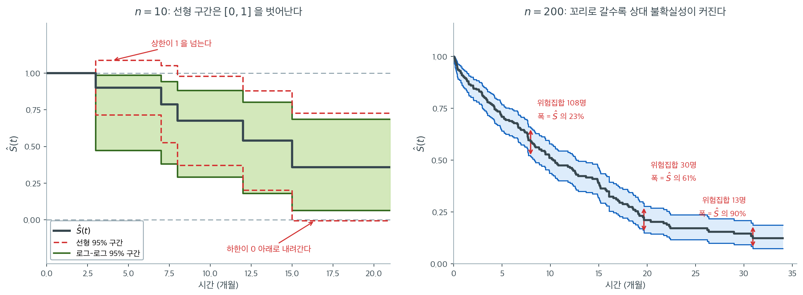

# 생존곡선의 신뢰구간

카플란–마이어 추정량 $\hat{S}(t)$는 생존함수의 점추정치다. 다른 추정량과 마찬가지로 표집
변동을 겪는다. 표본이 다르면 곡선도 달라진다. 이 불확실성을 정량화하려면 각 시점에서
신뢰구간이 필요하다.

이 절에서는 그린우드 공식으로 카플란–마이어 추정량의 분산을 유도하고, 점별 신뢰구간을
구성하며, 소표본에서 포함확률을 개선하는 변환들을 논의한다.

---

## 1. 그린우드 공식

$\hat{S}(t)$의 분산은 **그린우드 공식**(1926)으로 추정한다.

$$
\widehat{\text{Var}}\bigl(\hat{S}(t)\bigr) = \hat{S}(t)^2 \sum_{j:\, t_{(j)} \leq t} \frac{d_j}{n_j(n_j - d_j)}
$$

합은 $t$까지의 모든 사건시간 $t_{(j)}$에 걸쳐 이루어진다.

**유도 개요.** 카플란–마이어 추정량은 독립인 인자 $(1 - d_j / n_j)$의 곱이다. 곱의 로그에
델타법을 적용하면

$$
\ln \hat{S}(t) = \sum_{j:\, t_{(j)} \leq t} \ln\!\left(1 - \frac{d_j}{n_j}\right)
$$

이고, 각 항의 근사 분산은 $d_j / [n_j(n_j - d_j)]$다($n_j$가 주어졌을 때 $d_j$의 이항분산에서
나온다). 이를 더하고 델타법으로 원래 척도로 되돌리면 그린우드 공식을 얻는다.

$\hat{S}(t)$의 표준오차는

$$
\text{se}\bigl(\hat{S}(t)\bigr) = \hat{S}(t) \sqrt{\sum_{j:\, t_{(j)} \leq t} \frac{d_j}{n_j(n_j - d_j)}}
$$

이다.


<div class="storybox" markdown>

**그림으로 보는 통계학 1.** 표준오차가 추정량보다 서른두 해 먼저 왔다

위 식에 붙은 $(1926)$ 을 다시 보라. **카플란–마이어 추정량은 $1958$ 년에 나왔다.**
이 쪽이 분산을 재어 주는 그 추정량보다 공식이 서른두 해 앞선다.

메이저 그린우드($1880$–$1949$)가 그것을 적었다. 「메이저」는 계급이 아니라 **이름**이다 —
일반의였던 아버지도 같은 이름이었다. 그는 뒷날 런던 위생열대의학대학원의 **첫 역학·
생명통계 교수**가 된다.

공식이 실린 곳도 학술지가 아니었다. $1926$ 년 영국 정부가 펴낸 보건 보고서
『암의 자연 지속기간』 — 보건·의학 주제 보고 제 $33$ 호 — 이고, 식은 본문도 아닌
**부록**에 있다. 그가 풀던 문제는 생명표로 암 환자의 생존을 따라가는 일이었다.

그런데도 그 식이 삼십 년 뒤의 추정량에 그대로 붙는다. 까닭은 위 $\S 1$ 의 유도에
이미 다 있다 — 로그를 씌워 곱을 합으로 바꾸고, 구간마다의 분산을 더하고, 델타법으로
되돌린다. 그 논증은 **추정량이 곱의 꼴이라는 사실만** 쓴다. 생명표의 곱이든
카플란–마이어의 곱이든 구별하지 않는다. 그래서 그린우드가 누구의 추정량인지 알 필요가
없었던 것이다.

다만 먼저 왔다고 해서 끝까지 맞는 것은 아니다. 그린우드가 주는 것은
$\operatorname{Var}(\hat S(t))$ 하나뿐이고, 그것을 그대로 좌우 대칭으로 벌리면
**구간이 $[0,1]$ 을 넘어간다.** 아래 $\S 3$ 과 $\S 4$ 가 로그와 로그–로그 변환을
가져오는 까닭이 그것이다. 분산은 $1926$ 년에 얻었지만, 그 분산을 **어디에 어떻게
벌릴지**는 그 뒤로도 한참 더 다듬어야 했다.

_확인한 곳 — 메이저 그린우드가 $1880$ 년 $8$ 월 $9$ 일에 나서 $1949$ 년 $10$ 월 $5$ 일에 죽었고 「Major」가 군 계급이 아니라 이름이며 일반의였던 아버지도 같은 이름이었다는 것, 그리고 그가 런던 위생열대의학대학원의 첫 역학·생명통계 교수($1928$–$1945$)였다는 것 · 분산 공식이 『A Report on the Natural Duration of Cancer』(His Majesty's Stationery Office, Reports on Public Health and Medical Subjects 제 $33$ 호, $1926$)에 실렸고 그 안에서 부록에 놓여 있다는 것 · 카플란–마이어 추정량이 $1958$ 년에 발표되어 이 공식이 그보다 앞선다는 것_

</div>

---

## 2. 점별 선형 신뢰구간

가장 단순한 신뢰구간은 원래 척도에서 정규근사를 쓴다.

$$
\hat{S}(t) \pm z_{\alpha/2} \cdot \text{se}\bigl(\hat{S}(t)\bigr)
$$

여기서 $z_{\alpha/2}$는 표준정규분포의 상위 $\alpha/2$ 분위수다.

!!! warning "선형 구간의 한계"

    이 구간은 $[0, 1]$ 밖의 값을 낼 수 있으며, 특히 $\hat{S}(t)$가 0이나 1에 가까울 때
    그렇다. 또 경계 근처에서 $\hat{S}(t)$의 분포에 대한 정규근사가 나빠 소표본에서 포함확률이
    명목 수준에 못 미치는 경향이 있다.

---

## 3. 로그 변환

더 나은 접근은 구간을 만들기 전에 로그 변환을 적용하는 것이다.
$\theta(t) = \ln \hat{S}(t)$라 하면 델타법에 의해

$$
\text{se}\bigl(\theta(t)\bigr) = \frac{\text{se}(\hat{S}(t))}{\hat{S}(t)} = \sqrt{\sum_{j:\, t_{(j)} \leq t} \frac{d_j}{n_j(n_j - d_j)}}
$$

이다. $\ln S(t)$에 대한 $100(1 - \alpha)\%$ 신뢰구간은

$$
\ln \hat{S}(t) \pm z_{\alpha/2} \cdot \text{se}\bigl(\theta(t)\bigr)
$$

이고, 양 끝점을 지수화하면 $S(t)$의 신뢰구간

$$
\left[\exp\!\bigl(\ln \hat{S}(t) - z_{\alpha/2}\,\text{se}(\theta)\bigr),\; \exp\!\bigl(\ln \hat{S}(t) + z_{\alpha/2}\,\text{se}(\theta)\bigr)\right]
$$

를 얻는다. 이 구간은 항상 $(0, 1]$ 안에 있어 선형 구간보다 낫다.

!!! note "동등한 표현"
    같은 구간을 $\bigl[\hat{S}(t)^{e^{c}},\; \hat{S}(t)^{e^{-c}}\bigr]$로 쓰기도 한다.
    여기서 $c = z_{\alpha/2}\,\text{se}(\theta) / \ln \hat{S}(t)$다. 두 표현은 대수적으로
    같으며 위의 지수 형태가 읽기 쉽다.

---

## 4. 로그–로그 변환

**로그–로그 변환**(여–로그–로그 변환이라고도 한다)이 실무에서 가장 좋은 포함확률을 준다.

$$
\phi(t) = \ln\!\bigl(-\ln \hat{S}(t)\bigr) = \ln \hat{H}(t)
$$

로 정의하면 델타법에 의해

$$
\text{se}\bigl(\phi(t)\bigr) = \frac{1}{\bigl|\ln \hat{S}(t)\bigr|} \sqrt{\sum_{j:\, t_{(j)} \leq t} \frac{d_j}{n_j(n_j - d_j)}}
$$

이다($\ln \hat S(t) < 0$이므로 절댓값을 취한다). $\phi(t)$에 대한 구간

$$
\phi(t) \pm z_{\alpha/2} \cdot \text{se}\bigl(\phi(t)\bigr)
$$

을 만든 뒤 생존 척도로 되돌린다. $(\phi_L, \phi_U)$가 $\phi(t)$의 구간이면 $S(t)$의
신뢰구간은

$$
\left[\exp\!\bigl(-e^{\phi_U}\bigr),\; \exp\!\bigl(-e^{\phi_L}\bigr)\right]
$$

이다. 순서가 뒤집힌다는 점에 유의하라. $\phi$의 상한이 $S$의 하한을 준다. $\phi$가 커지면
누적위험이 커지고 따라서 생존이 낮아지기 때문이다.

!!! tip "대부분의 소프트웨어 기본값"

    로그–로그 변환이 대부분의 통계 소프트웨어에서 카플란–마이어 신뢰구간의 기본 방법이다
    (R의 `survfit`, 파이썬의 `lifelines`). 선형이나 로그 방법보다 일관되게 명목 수준에 가까운
    포함확률을 준다.

<div class="exbox" markdown>

**보기 1.** <span class="diff easy" title="쉬움"></span> 그린우드 공식에 의한 신뢰구간. 카플란–마이어 절의 보기를 이어서 $t = 3$에서 계산한다.

- $\hat{S}(3) = 0.729$
- 그린우드 합: $\frac{1}{8 \cdot 7} + \frac{1}{6 \cdot 5} = 0.01786 + 0.03333 = 0.05119$
- $\text{se}(\hat{S}(3)) = 0.729 \sqrt{0.05119} = 0.729 \times 0.2263 = 0.165$

**선형 95% 신뢰구간:**

</div>

??? success "풀이"
    $$
    0.729 \pm 1.96 \times 0.165 = (0.406,\; 1.053)
    $$

    상한이 1을 넘어 선형 방법의 한계를 보여준다.

    **로그–로그 95% 신뢰구간:**

    $$
    \phi(3) = \ln(-\ln 0.729) = \ln(0.3161) = -1.152
    $$

    $$
    \text{se}(\phi) = \frac{\sqrt{0.05119}}{|\ln 0.729|} = \frac{0.2263}{0.3161} = 0.716
    $$

    $$
    \phi(3) \pm 1.96 \times 0.716 = (-2.556,\; 0.252)
    $$

    역변환하면

    $$
    S_L = \exp(-e^{0.252}) = \exp(-1.286) = 0.276
    $$

    $$
    S_U = \exp(-e^{-2.556}) = \exp(-0.0777) = 0.925
    $$

    로그–로그 구간 $(0.276,\ 0.925)$는 $[0, 1]$ 안에 머물며 권장되는 구간이다. 폭이 $0.649$로
    매우 넓다는 점에도 주목하라. 대상이 8명뿐이므로 이 정도 불확실성은 불가피하다.

---

## 5. 방법 비교

| 방법 | 공식의 근거 | $[0,1]$ 유지 | 소표본 포함확률 |
|:-------|:-------------|:-----------------:|:---------------------:|
| 선형 | $\hat{S} \pm z \cdot \text{se}$ | 아니오 | 명목 이하 |
| 로그 | $\exp(\ln \hat{S} \pm z \cdot \text{se}_\theta)$ | 예($(0,1]$) | 중간 |
| 로그–로그 | $\ln(-\ln \hat{S}) \pm z \cdot \text{se}_\phi$의 역변환 | 예 | 가장 좋음 |



왼쪽은 카플란–마이어 절 연습문제 1의 환자 10명 자료다. **붉은 점선이 선형 구간, 초록 실선이 로그–로그 구간**이며, 회색 점선으로 $S = 0$과 $S = 1$을 그어 두었다. 선형 구간은 양쪽 끝에서 모두 경계를 뚫는다. $t = 3$에서 $\hat S = 0.900$의 선형 구간은 $(0.714,\ 1.086)$으로 **상한이 1을 넘고**, $t = 15$에서 $\hat S = 0.360$의 선형 구간은 $(-0.006,\ 0.726)$으로 **하한이 0 아래로 내려간다.** 생존확률이 $1.086$이라는 진술은 아무 의미가 없다.

같은 시점의 로그–로그 구간은 $(0.473,\ 0.985)$와 $(0.063,\ 0.686)$이다. 둘 다 $[0,1]$ 안에 있을 뿐 아니라 **비대칭이다.** $t = 3$에서는 점추정치 $0.900$ 아래로 $0.427$, 위로 $0.085$ 뻗는다. 위쪽이 다섯 배나 짧은 것은 $\hat S$가 1에 가까울 때 더 올라갈 여지가 물리적으로 없기 때문이며, $\hat S$의 표집분포가 실제로 그렇게 생겼다. 선형 구간이 양쪽으로 똑같이 $0.186$씩 뻗는 것은 그 비대칭을 무시한 결과다.

오른쪽은 표본을 $n = 200$으로 늘리고 로그–로그 띠만 그린 것이다. 띠의 **절대 폭**은 $t = 8$에서 $0.138$, $t \approx 31$에서 $0.113$으로 오히려 줄어드는 것처럼 보인다. 그러나 이는 착시다. 같은 시점의 $\hat S$가 $0.590$에서 $0.125$로 떨어졌으므로, **추정치 대비 폭**은 $23\% \to 61\% \to 90\%$로 네 배 가까이 부푼다. 위험집합이 $108$명에서 $30$명, $13$명으로 줄어든 결과이며, 그린우드 합의 각 항 $d_j/[n_j(n_j-d_j)]$가 $n_j$ 감소에 제곱으로 반응하기 때문이다.

실무적 교훈은 짧다. **곡선의 오른쪽 끝을 근거로 결론 내리지 말라.** "5년 생존율이 12.5%"라는 문장은 그 뒤에 "(95% 신뢰구간 7%--20%)"를 붙이는 순간 전혀 다른 문장이 된다. 그리고 두 집단의 곡선을 비교할 때 꼬리에서 벌어진 간격은 대개 띠 안에서 설명되는 차이다. 21.2절의 로그순위 검정이 시점별 눈대중이 아니라 전 구간 합산으로 판단하는 것도 같은 이유에서다.

---

<div class="aibox" markdown>

**AI로 보는 통계학 1.** 유지율 뒤에 남은 사람이 몇인지 적어라

위 절은 꼬리에서 띠가 벌어지는 일을 표본 $10$ 명과 $200$ 명으로 보였다. 자료가 많으면
없어지는 문제처럼 들리는데, **흐르는 창으로 보는 자료에서는 자료가 많아도 그대로
일어난다.** 가입이 계속 들어오는 서비스에서 「가입 후 $N$ 일 유지율」을 그리면, 뒤쪽
시점을 볼 수 있는 사람은 **일찍 들어온 사람뿐**이기 때문이다.

$120$ 일짜리 창에 $5{,}000$ 명이 고르게 들어온 코호트를 만들어, 그린우드 공식으로
구간을 붙여 보았다.

```python
import numpy as np
from scipy import stats

rng = np.random.default_rng(4)
N, WINDOW, LAM = 5000, 120.0, 0.012        # 5,000 명, 120 일짜리 창, 일 이탈위험 0.012
entry = rng.uniform(0, WINDOW, N)          # 가입 시점이 창 안에 흩어져 있다
life = rng.exponential(1 / LAM, N)
fu = WINDOW - entry                        # 그 사람을 볼 수 있었던 기간
t, d = np.minimum(life, fu), (life <= fu).astype(float)

o = np.argsort(t); t, d = t[o], d[o]
n_risk = np.arange(N, 0, -1)
ev = d == 1
S = np.cumprod(1 - d[ev] / n_risk[ev])                          # 카플란-마이어
acc = np.cumsum(d[ev] / (n_risk[ev] * (n_risk[ev] - d[ev])))    # 그린우드의 합
z = stats.norm.ppf(0.975)

print("  경과일   위험집합    유지율      로그-로그 95% 구간    상대 폭   참값")
for day in (7, 30, 60, 90, 110, 119):
    k = np.searchsorted(t[ev], day, side="right") - 1
    s, a, r = S[k], acc[k], n_risk[ev][k]
    g, se_g = np.log(-np.log(s)), np.sqrt(a) / abs(np.log(s))
    lo, hi = np.exp(-np.exp(g + z * se_g)), np.exp(-np.exp(g - z * se_g))
    print(f"{day:>7}{r:>11}{s:>11.4f}   [{lo:.4f}, {hi:.4f}]{(hi-lo)/s:>10.3f}"
          f"{np.exp(-LAM*day):>8.4f}")
```

출력:

```
  경과일   위험집합    유지율      로그-로그 95% 구간    상대 폭   참값
      7       4310     0.9198   [0.9118, 0.9271]     0.017  0.9194
     30       2607     0.6967   [0.6827, 0.7102]     0.039  0.6977
     60       1258     0.4885   [0.4717, 0.5050]     0.068  0.4868
     90        458     0.3503   [0.3315, 0.3692]     0.108  0.3396
    110        127     0.2688   [0.2459, 0.2921]     0.172  0.2671
    119         27     0.2486   [0.2192, 0.2789]     0.240  0.2398
```

**가입자는 $5{,}000$ 명인데 $90$ 일 유지율 뒤에 남은 사람은 $458$ 명이고 $119$ 일에는
$27$ 명이다.** 두 가지가 겹쳐 그렇게 된다 — 이탈로 줄고, **창 때문에 줄어든다.** 창이
$120$ 일이면 $90$ 일 차를 볼 수 있는 사람은 $30$ 일 이전에 들어온 $25\%$ 뿐이다.

그래서 **상대 폭이 $0.017$ 에서 $0.240$ 으로 열네 배가 된다.** 절대 폭만 보면
$0.015 \to 0.030$ 으로 두 배에 그치는데, 유지율 자체가 $0.92$ 에서 $0.25$ 로 줄었으니
비율로는 그렇지 않다. 위 절이 임상 자료에서 한 말이 대시보드에서 그대로 되풀이된다.

**대시보드가 적어야 할 것은 그래서 둘이다 — 유지율과 그 시점의 위험집합 크기.** 「$119$ 일
유지율 $24.9\%$」는 $27$ 명에서 나온 수이고, 다음 주에 두 명이 더 이탈하면 그 수가
몇 퍼센트포인트 움직인다. 구간을 붙일 수 없는 자리라면 **적어도 분모를 함께 적어야**
읽는 사람이 속지 않는다.

**다만 구간이 재는 것은 표집 변동뿐이다.** 뒤쪽 시점을 채우는 사람들은 **일찍 들어온
사람들**이므로, 유입 경로나 계절이 바뀌었다면 그들은 애초에 다른 모집단이다. 그 어긋남은
그린우드가 재지 못한다 — 21.1절 [중도절단의 유형](../introduction/censoring_types.md) 의
비정보적 절단 가정이 여기서도 전제다.

</div>

## 6. 동시 신뢰띠

위의 구간들은 **점별**이다. 각 구간은 고정된 하나의 $t_0$에서 $S(t_0)$를 확률 $1 - \alpha$로
포함한다. **동시 신뢰띠**는 구간 $[t_L, t_U]$의 모든 $t$에 대해 곡선 $S(t)$ 전체를 동시에
포함한다.

홀–웰너 띠와 등정밀도(EP) 띠가 흔히 쓰이는 두 방법이다. 모든 시점에 걸친 다중비교를 반영해야
하므로 둘 다 점별 구간보다 넓다.

??? note "동시 신뢰띠를 언제 쓰는가"

    생존곡선 전체에 대한 진술을 하고 싶을 때 동시 신뢰띠가 필요하다(예: "참 곡선이 모든
    시점에서 이 띠 안에 있다"). 특정 시점의 생존율을 보고할 때는(예: 5년 생존율) 점별 구간으로
    충분하다.

---

## 연습문제

<div class="drillbox" markdown>

**연습문제 1.** <span class="diff easy" title="쉬움"></span>
그린우드 공식

[카플란–마이어 절](kaplan_meier.md)의 연습문제 1에 나온 환자 10명 자료를 이용해 그린우드
공식으로 $\hat{S}(8)$의 표준오차를 계산하고 선형 방법으로 95% 점별 신뢰구간을 구성하라.
로그–로그 구간과도 비교하라.

</div>

??? success "풀이"

    $\hat{S}(8) = 0.675$이고 $t = 8$까지의 그린우드 합은

    $$
    \frac{1}{10 \times 9} + \frac{1}{8 \times 7} + \frac{1}{7 \times 6} = 0.0111 + 0.0179 + 0.0238 = 0.0528
    $$

    이다. 따라서

    $$
    \text{se}(\hat{S}(8)) = 0.675 \times \sqrt{0.0528} = 0.675 \times 0.2297 = 0.155
    $$

    **선형 95% 신뢰구간:** $0.675 \pm 1.96 \times 0.155 = (0.371,\ 0.979)$.

    **로그–로그 95% 신뢰구간:** $\phi(8) = \ln(-\ln 0.675) = \ln(0.3930) = -0.9340$,
    $\text{se}(\phi) = 0.2297/0.3930 = 0.5845$이므로 $\phi$의 구간은
    $(-2.0796,\ 0.2116)$이고 역변환하면 $(0.291,\ 0.883)$이다.

    | 방법 | 신뢰구간 | 폭 |
    |---|---|---|
    | 선형 | $(0.371,\ 0.979)$ | $0.608$ |
    | 로그–로그 | $(0.291,\ 0.883)$ | $0.592$ |

    두 구간이 상당히 다르다. 선형 구간은 위쪽으로 치우쳐 상한이 $0.979$까지 올라가는데, 이는
    사건이 이미 3건 관측된 자료로서는 낙관적이다. 로그–로그 구간은 아래쪽으로 더 내려가고
    위쪽으로는 덜 올라가는 **비대칭** 구간이며, $\hat S$의 표집분포가 실제로 비대칭이라는
    사실을 반영한다. $\square$

---

<div class="drillbox" markdown>

**연습문제 2.** <span class="diff med" title="중간"></span>
왜 로그–로그 변환이 로그 변환보다 나은 포함확률을 주는지 설명하라.

</div>

??? success "풀이"

    세 방법이 정규근사를 적용하는 척도가 서로 다르다.

    | 변환 | 척도 | 치역 |
    |---|---|---|
    | 선형 | $S$ | $[0, 1]$ |
    | 로그 | $\ln S$ | $(-\infty, 0]$ |
    | 로그–로그 | $\ln(-\ln S) = \ln H$ | $(-\infty, \infty)$ |

    정규근사가 잘 작동하려면 대상 통계량의 표집분포가 **경계에 부딪히지 않고** 대칭이어야
    한다.

    - **선형 척도**에서 $\hat S$는 양쪽에 경계가 있다. $\hat S$가 0이나 1 근처면 분포가
      한쪽으로 몰려 정규근사가 나쁘고, 구간이 $[0,1]$ 밖으로 나간다.
    - **로그 척도**에서는 위쪽 경계($\ln S \le 0$)만 남는다. $\hat S$가 1에 가까우면 여전히
      문제가 있지만 0 근처에서는 개선된다.
    - **로그–로그 척도**에서는 경계가 아예 없다. $\ln \hat H$는 실선 전체를 값으로 가질 수
      있으며, 실제로 $\hat H$의 표집분포가 로그 척도에서 정규에 훨씬 가깝다.

    이는 새로운 원리가 아니다. 19장에서 오즈비의 신뢰구간을 오즈비 척도가 아니라 **로그오즈비
    척도**에서 만들고 지수화한 것과 같은 이유다. 경계가 없고 대칭에 가까운 척도로 옮겨
    구간을 만든 뒤 되돌리는 것이 일반적인 처방이다.

    **모의실험으로 확인하려면** 참 $S(t)$를 알고 있는 상황에서 표본을 반복 생성하여 각 방법의
    구간이 참값을 포함하는 비율을 세면 된다. 문헌의 결과는 $n$이 작을 때 선형이 명목 95%보다
    한참 낮은 포함확률을 주고, 로그–로그가 가장 명목에 가깝다는 것이다. $\square$

---

<div class="drillbox" markdown>

**연습문제 3.** <span class="diff hard" title="어려움"></span>
그린우드 공식의 합 $\sum_j d_j/[n_j(n_j-d_j)]$을 델타법으로 유도하라. 넬슨–알렌의 분산 공식
$\sum_j d_j/n_j^2$과 어떻게 다른가?

</div>

??? success "풀이"

    $\hat p_j = d_j/n_j$라 하고 $\ln \hat S(t) = \sum_j \ln(1 - \hat p_j)$에서 출발한다.

    **각 항의 분산.** $n_j$를 조건으로 $d_j \sim \text{Binomial}(n_j, p_j)$이므로
    $\operatorname{Var}(\hat p_j) = p_j(1-p_j)/n_j$다. 델타법을 $g(p) = \ln(1-p)$에 적용하면
    $g'(p) = -1/(1-p)$이므로

    $$
    \operatorname{Var}\bigl(\ln(1-\hat p_j)\bigr) \approx \frac{p_j(1-p_j)}{n_j}\cdot\frac{1}{(1-p_j)^2}
    = \frac{p_j}{n_j(1-p_j)}
    $$

    이고 $\hat p_j = d_j/n_j$를 대입하면

    $$
    = \frac{d_j/n_j}{n_j(1 - d_j/n_j)} = \frac{d_j}{n_j(n_j - d_j)}
    $$

    를 얻는다. 항들을 (근사적으로 독립이라 보고) 더하면
    $\operatorname{Var}(\ln \hat S) \approx \sum_j d_j/[n_j(n_j-d_j)]$이고, 다시 델타법으로
    $S = e^{\ln S}$로 되돌리면 $\hat S^2$가 곱해져 그린우드 공식이 된다.

    **넬슨–알렌과의 비교.**

    | | 공식 | $d_j \ll n_j$일 때 |
    |---|---|---|
    | 그린우드 | $\sum_j \dfrac{d_j}{n_j(n_j-d_j)}$ | $\approx \sum_j d_j/n_j^2$ |
    | 넬슨–알렌 | $\sum_j \dfrac{d_j}{n_j^2}$ | 같음 |

    $d_j \ll n_j$이면 $n_j - d_j \approx n_j$이므로 두 공식이 일치한다. 그러나 위험집합이
    작아지는 **꼬리에서 갈라진다.** 그린우드는 분모에 $(n_j - d_j)$가 있어 $d_j$가 $n_j$에
    가까워지면 값이 폭발한다. 극단적으로 $d_j = n_j$(마지막 한 명이 사건을 겪는 경우)이면
    그린우드 합이 무한대가 된다.

    이는 결함이 아니라 정직함이다. $\hat S(t) = 0$인 시점에서 곡선의 불확실성은 실제로
    통제되지 않으며, 그린우드가 그것을 반영한다. 다만 구현에서는 $\hat S = 0$ 이후를
    보고하지 않거나 마지막 사건시간까지만 신뢰구간을 그리는 것이 관례다. $\square$

---

## 정리하며

$\hat S(t)$ 에도 **불확실성**이 있다.

- **그린우드 공식이 분산을 준다.** 곱 형태이므로 로그를 취해 델타 방법을 적용한 결과이며, 위험집합이 줄어드는 꼬리에서 분산이 커진다.
- **단순 정규 구간은 $[0,1]$ 을 벗어난다.** 그래서 **로그–로그 변환**($\log(-\log S)$)을 쓴 뒤 되돌리는 것이 표준이며, 구간이 항상 $[0,1]$ 안에 들어온다.
- **꼬리에서 구간이 매우 넓다.** 남은 대상이 적으면 추정이 불안정하며, **곡선의 오른쪽 끝을 근거로 결론 내리면 안 된다.**
- **점별 구간과 동시 신뢰띠가 다르다.** 점별 구간을 곡선 전체에 대한 보장으로 읽으면 9장의 다중검정 문제가 생긴다.
- **구간을 곡선과 함께 그린다.** 두 집단의 띠가 크게 겹치면 로그순위 검정이 기각해도 신중해야 한다.

다음 절 **[지수 모형](../parametric/exponential.md)**으로 넘어간다. 여기까지는 분포를 가정하지 않았고, 이제 위험률이 **상수**라는 가장 단순한 가정을 얹는다.
