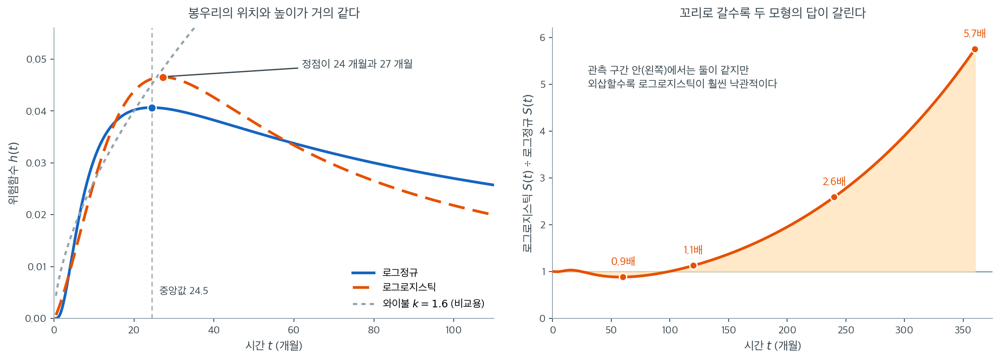

# 로그정규 모형과 로그로지스틱 모형

지수 모형과 와이불 모형은 위험함수가 단조(일정, 증가, 또는 감소)라고 가정한다. 그러나 현실의
많은 과정은 **비단조 위험**을 보인다. 위험이 어느 시점에 정점을 이룬 뒤 감소하는 것이다. 대출
부도율은 첫해에 올랐다가 살아남은 차입자 사이에서 떨어지는 경우가 많다. 질병 재발 위험은 치료
직후에 치솟았다가 잦아들 수 있다.

**로그정규**와 **로그로지스틱** 모형이 이 봉우리형 위험 양상을 수용한다. 둘 다
가속실패시간(AFT) 족에 속하며 $\ln T$를 위치–척도 분포로 모형화한다.

---

## 1. 로그정규 모형

생존시간 $T$가 $\ln T \sim N(\mu, \sigma^2)$을 만족하면 $T$는 위치모수 $\mu$와 척도모수
$\sigma > 0$을 갖는 **로그정규분포**를 따른다.

**밀도:**

$$
f(t) = \frac{1}{t \sigma \sqrt{2\pi}} \exp\!\left(-\frac{(\ln t - \mu)^2}{2\sigma^2}\right) \qquad t > 0
$$

**생존함수:**

$$
S(t) = 1 - \Phi\!\left(\frac{\ln t - \mu}{\sigma}\right)
$$

여기서 $\Phi(\cdot)$는 표준정규 누적분포함수다.

**위험함수:**

$$
h(t) = \frac{f(t)}{S(t)} = \frac{\phi\!\left(\frac{\ln t - \mu}{\sigma}\right)}{t \sigma \left[1 - \Phi\!\left(\frac{\ln t - \mu}{\sigma}\right)\right]}
$$

여기서 $\phi(\cdot)$는 표준정규 확률밀도함수다.

로그정규 위험은 **단조가 아니다.** 0에서 시작해 정점까지 올라간 뒤 $t \to \infty$에서 0을
향해 감소한다.

**평균과 중앙값:**

$$
E[T] = \exp\!\left(\mu + \frac{\sigma^2}{2}\right), \qquad t_{0.5} = e^\mu
$$

중앙값의 형태가 특히 깔끔하다. $\sigma$와 무관하게 $e^\mu$다.

!!! example "로그정규 부도 위험"

    어떤 은행이 부도까지의 시간 자료에 로그정규 모형을 적합하여 $\hat{\mu} = 3.2$,
    $\hat{\sigma} = 0.8$을 얻었다. 부도까지의 중앙시간은 $e^{3.2} = 24.5$개월이다. 위험은
    중앙값 이전에 정점을 이룬 뒤 감소하는데, 이는 대출의 숙성기에 부도 위험이 올랐다가
    떨어진다는 관찰과 부합한다.

---

## 2. 로그로지스틱 모형

$\ln T$가 위치 $\mu$, 척도 $\sigma > 0$인 로지스틱 분포를 따르면 $T$는 **로그로지스틱
분포**를 따른다. 표준적인 모수화는 형상 $k = 1/\sigma$와 척도 $\lambda = e^\mu$를 쓴다.

**생존함수:**

$$
S(t) = \frac{1}{1 + (t/\lambda)^k}
$$

**위험함수:**

$$
h(t) = \frac{(k/\lambda)(t/\lambda)^{k-1}}{1 + (t/\lambda)^k}
$$

**밀도:**

$$
f(t) = \frac{(k/\lambda)(t/\lambda)^{k-1}}{\left[1 + (t/\lambda)^k\right]^2}
$$

위험의 모양은 $k$에 달려 있다.

| $k$ | 위험의 거동 |
|:---:|:----------------|
| $k \leq 1$ | $t = 0$의 $\infty$에서 단조 감소 |
| $k > 1$ | 봉우리형. 정점까지 증가한 뒤 감소 |

$k > 1$이면 로그로지스틱 위험은 로그정규 위험과 질적으로 같은 모양(올랐다가 내려감)을 갖지만,
생존함수가 더 단순한 닫힌 형태를 갖는다.

**중앙 생존시간:**

$$
t_{0.5} = \lambda
$$

이는 $S(\lambda) = 1/(1 + 1) = 0.5$에서 곧바로 나온다.

---

## 3. 로그정규와 로그로지스틱의 비교

| 성질 | 로그정규 | 로그로지스틱 |
|:---------|:-----------|:-------------|
| $\ln T$의 분포 | 정규 | 로지스틱 |
| 생존함수 | $\Phi$를 포함(닫힌 형태 없음) | 닫힌 형태 $1/[1 + (t/\lambda)^k]$ |
| 위험의 모양 | 항상 봉우리형 | 봉우리형($k > 1$) 또는 감소($k \leq 1$) |
| 꼬리 거동 | 위험이 더 빨리 $\to 0$ | 위험이 더 느리게 $\to 0$(더 두꺼운 꼬리) |
| 중앙값 | $e^\mu$ | $\lambda$ |
| 닫힌 형태 $S(t)$ | 없음 | 있음 |

로그로지스틱 모형은 생존함수에 정규 누적분포함수가 들어가지 않아 계산이 편리하므로 자주
선호된다.



중앙값을 둘 다 $e^{3.2} = 24.5$개월로 맞추고, 로그로지스틱의 형상모수를 $k = \pi/(\sigma\sqrt{3}) = 2.27$로 두어 두 분포의 산포까지 맞췄다. 왼쪽을 보면 두 위험함수가 거의 구별되지 않는다. **정점이 각각 $24$개월과 $27$개월이고 정점 높이도 $0.041$과 $0.047$로 비슷하다.** 회색 점선으로 그린 와이불 $k = 1.6$은 비교용인데, 끝없이 올라가기만 해서 두 봉우리형과 확연히 다르다. 자료에서 위험이 올랐다가 내려가는 것이 보이면 와이불은 후보에서 빠진다.

문제는 그다음이다. **로그정규와 로그로지스틱 중 무엇을 고를 것인가는 관측 구간의 적합도만으로는 거의 결정되지 않는다.** 두 위험함수가 이렇게 겹치면 AIC 차이도 작게 나오고, 카플란–마이어와의 비교도 둘 다 통과한다.

오른쪽이 그 선택이 왜 중요한지 보여 준다. 두 생존함수의 비 $S_{\text{LL}}(t)/S_{\text{LN}}(t)$를 그린 것인데, $t = 60$개월에서는 $0.9$배로 사실상 같고 $t = 120$에서도 $1.1$배에 그친다. 그런데 $t = 240$에서 $2.6$배, $t = 360$에서 $5.7$배로 벌어진다. 구체적으로 30년 시점의 생존확률이 로그로지스틱에서는 $0.0023$, 로그정규에서는 $0.00039$다. **"아직 사건을 겪지 않은 대상이 몇 명 남아 있겠는가"를 10만 건 포트폴리오에 적용하면 $226$건과 $39$건의 차이가 된다.**

원인은 꼬리의 종류다. 로그로지스틱은 $S(t) \approx (t/\lambda)^{-k}$로 **멱함수 꼬리**를 갖는 반면 로그정규의 꼬리는 그보다 훨씬 빨리 죽는다. 보험 준비금 산정이나 장기 신용위험처럼 꼬리가 결론을 좌우하는 문제에서는, AIC 차이 몇 점보다 **"이 과정의 꼬리가 멱함수인가"라는 배경지식**이 모형 선택의 실질적 근거가 되어야 한다. 관측 구간 안에서 잘 맞는다는 사실은 관측 구간 밖에 대해 아무것도 보증하지 않는다.

---

## 4. 가속실패시간 해석

두 모형 모두 **가속실패시간(AFT)** 족에 속한다. 공변량 $\mathbf{x}$를 갖는 AFT 모형은 다음을
설정한다.

$$
\ln T = \mathbf{x}^\top \boldsymbol{\beta} + \sigma W
$$

여기서 $W$는 표준화된 오차분포다.

- $W \sim N(0, 1)$이면 로그정규 AFT 모형이 된다.
- $W \sim \text{Logistic}(0, 1)$이면 로그로지스틱 AFT 모형이 된다.

AFT 해석에서 공변량은 시간 척도를 **가속하거나 감속한다.** 계수 $\beta_j > 0$인 공변량은
생존시간을 $e^{\beta_j}$배 늘리고, $\beta_j < 0$이면 줄인다.

!!! note "AFT 대 비례위험"

    콕스 모형(21.4절)은 공변량이 위험에 곱셈적으로 작용한다고 가정한다. AFT 모형은 공변량이
    시간 척도에 곱셈적으로 작용한다고 가정한다. 비례위험 성질과 AFT 성질을 동시에 만족하는
    모형은 와이불이 유일하다.

---

<div class="aibox" markdown>

**AI로 보는 통계학 1.** 절단된 회귀가 곧 로그정규 AFT다

위 식 $\ln T = \mathbf x^\top\boldsymbol\beta + \sigma W$ 를 생존분석의 기호를 걷고 보면
**로그 눈금에서의 평범한 회귀**다. 목표값이 $\ln T$ 이고 오차가 정규이면 최소제곱이 바로
떠오른다. 오늘 이런 문제는 흔하다 — 도착까지 걸리는 시간, 장애를 복구하는 데 걸리는 시간,
문의가 해결되기까지의 시간을 회귀로 예측한다.

걸림돌은 **자료의 일부가 아직 끝나지 않았다**는 것이다. 모형을 학습시키는 시점에 어떤
건은 진행 중이고, 그 줄의 목표값은 「아직 모른다, 다만 지금까지 $t_i$ 는 넘겼다」뿐이다.
흔한 처리가 둘인데 둘 다 틀린다 — **끝난 것만 쓰거나**(오래 걸리는 건이 덜 끝났으므로
짧은 쪽만 남는다), **관측 시각을 그대로 목표로 쓰거나**(참값보다 작은 수를 정답이라
적는다). 위 모형의 가능도는 그 줄에 $1 - \Phi(z_i)$ 를 주어 「넘겼다」를 그대로 적는다.

```python
import numpy as np
from scipy import stats
from scipy.optimize import minimize
import unicodedata

rng = np.random.default_rng(5)
n = 2000
x = rng.normal(size=n)
B0, B1, SIG = 2.0, 0.6, 0.8                 # ln T = 2.0 + 0.6 x + 0.8 e
T = np.exp(B0 + B1 * x + SIG * rng.normal(size=n))
C = np.exp(rng.normal(2.3, 0.9, n))         # 관측이 끝나는 시각
t, d = np.minimum(T, C), (T <= C)
y = np.log(t)

A_done, A_all = np.c_[np.ones(d.sum()), x[d]], np.c_[np.ones(n), x]
ols_done = np.linalg.lstsq(A_done, y[d], rcond=None)[0]   # (가) 끝난 것만
ols_all = np.linalg.lstsq(A_all, y, rcond=None)[0]        # (나) 관측 시각 그대로

def nll(p):                                  # (다) 로그정규 AFT 가능도
    b0, b1, ls = p
    s = np.exp(ls)
    z = (y - b0 - b1 * x) / s
    return -np.where(d, stats.norm.logpdf(z) - ls, stats.norm.logsf(z)).sum()

aft = minimize(nll, [0.0, 0.0, 0.0], method="BFGS").x

def pad(s, w):
    """한글은 고정폭에서 두 칸을 차지하므로 f-string 자리맞춤이 어긋난다."""
    width = sum(2 if unicodedata.east_asian_width(c) in "WF" else 1 for c in s)
    return s + " " * max(0, w - width)

print(f"절단율 {100*(1-d.mean()):.1f} 퍼센트 (사건 {int(d.sum())} / {n})\n")
print(pad("", 18) + "절편     기울기    sigma")
rows = [("참값", [B0, B1, SIG]),
        ("끝난 것만", [*ols_done, np.std(y[d] - A_done @ ols_done, ddof=2)]),
        ("관측 시각 그대로", [*ols_all, np.std(y - A_all @ ols_all, ddof=2)]),
        ("AFT 가능도", [aft[0], aft[1], np.exp(aft[2])])]
for name, v in rows:
    print(pad(name, 18) + f"{v[0]:5.3f}  {v[1]:7.3f}  {v[2]:7.3f}")
```

출력:

```
절단율 42.8 퍼센트 (사건 1145 / 2000)

                  절편     기울기    sigma
참값              2.000    0.600    0.800
끝난 것만         1.650    0.450    0.716
관측 시각 그대로  1.610    0.352    0.729
AFT 가능도        2.030    0.612    0.819
```

**두 어림이 모두 기울기를 줄인다.** 참 기울기 $0.600$ 이 「끝난 것만」에서 $0.450$,
「관측 시각 그대로」에서 $0.352$ 로 내려앉는다. 공변량이 클수록 오래 걸리는데 **오래
걸리는 건일수록 덜 끝났으므로**, 둘 다 효과가 큰 쪽의 자료를 짧게 적는다. 퍼짐도 함께
줄어 $\sigma$ 가 $0.8$ 대신 $0.72$ 쯤으로 나온다 — 모형이 실제보다 정확한 척하게 된다.

**AFT 가능도는 같은 자료에서 $(2.030,\ 0.612,\ 0.819)$ 를 준다.** 자료를 더 모은 것이
아니라 절단된 줄에 「넘겼다」를 적은 것뿐이다. 이 식은 계량경제학에서 **절단 회귀**라
부르는 것과 같고, 오늘 쓰는 부스팅 라이브러리들이 「AFT 손실」이라는 이름으로 싣고 있는
것도 이 가능도다.

**다만 정규 가정이 로그 눈금에 그대로 얹힌다.** 로그정규가 아니라 꼬리가 더 두꺼운
자료라면 $1 - \Phi$ 가 꼬리를 과소평가해 반대 방향의 편향이 생긴다. 로그로지스틱으로
바꾸면 $W$ 의 분포만 갈아 끼우면 되고(위 절이 말한 대로 두 모형은 오차분포만 다르다),
어느 쪽이 맞는지는 $5$ 절의 적합도 점검이 할 일이다. **그리고 절단이 공변량과 얽혀
있으면** — 오래 걸릴 것 같은 건을 먼저 닫아 버리는 운영 규칙이 있다면 — 어떤 가능도도
그것을 고치지 못한다.

</div>

## 5. 모형 적합도 점검

**로그정규 점검.** $T$가 로그정규이면 $\Phi^{-1}(1 - \hat{S}(t))$를 $\ln t$에 대해 그린
그림이 기울기 $1/\sigma$, 절편 $-\mu/\sigma$인 직선에 가까워야 한다.

**로그로지스틱 점검.** $T$가 로그로지스틱이면 $\ln[\hat{S}(t)^{-1} - 1]$을 $\ln t$에 대해
그린 그림이 기울기 $k$, 절편 $-k \ln \lambda$인 직선에 가까워야 한다.

이 그림 점검들은 형식적 적합도 검정을 보완하며, 두 모형이 모두 그럴듯하게 맞을 때 둘을
구별하는 데 도움이 된다.

!!! tip "이 모형들을 언제 고를 것인가"

    (넬슨–알렌) 누적위험 그림이 와이불과 맞지 않는 휘어짐을 보이고, 배경지식이 위험의 정점
    이후 감소를 시사할 때 로그정규나 로그로지스틱을 쓴다. 위험이 단조라면 와이불이 더 낫고
    더 단순한 선택이다.

---

## 연습문제

<div class="drillbox" markdown>

**연습문제 1.** <span class="diff easy" title="쉬움"></span>
로그정규 모형에서 $\hat\mu = 3.2$, $\hat\sigma = 0.8$일 때 다음을 계산하라.

**(a)** 중앙 생존시간과 평균 생존시간.

**(b)** $\hat S(12)$와 $\hat S(36)$.

**(c)** 평균이 중앙값보다 훨씬 큰 이유.

</div>

??? success "풀이"

    **(a)**

    $$
    t_{0.5} = e^{\mu} = e^{3.2} = 24.53 \text{ 개월}
    $$

    $$
    E[T] = \exp\!\left(\mu + \frac{\sigma^2}{2}\right) = \exp(3.2 + 0.32) = e^{3.52} = 33.78 \text{ 개월}
    $$

    **(b)**

    $$
    \hat S(12) = 1 - \Phi\!\left(\frac{\ln 12 - 3.2}{0.8}\right) = 1 - \Phi(-0.8939) = 0.8143
    $$

    $$
    \hat S(36) = 1 - \Phi\!\left(\frac{\ln 36 - 3.2}{0.8}\right) = 1 - \Phi(0.4794) = 0.3158
    $$

    **(c)** $E[T]/t_{0.5} = e^{\sigma^2/2} = e^{0.32} = 1.377$이다. 즉 평균이 중앙값의
    $1.377$배다. 로그정규는 오른쪽으로 치우친 분포이고, 그 치우침의 크기가 오직 $\sigma$에만
    의존한다. $\sigma$가 클수록 비율이 급격히 커진다($\sigma = 1.5$이면 $e^{1.125} = 3.08$배).

    이 비율이 $\sigma$만의 함수라는 사실은 진단에도 쓸 수 있다. 자료에서 표본평균과 표본중앙값의
    비가 $e^{\hat\sigma^2/2}$와 크게 다르면 로그정규 가정이 의심스럽다. $\square$

---

<div class="drillbox" markdown>

**연습문제 2.** <span class="diff med" title="중간"></span>
로그로지스틱 위험이 $k > 1$일 때 봉우리형임을 보이고, 정점의 위치를 구하라. $k \le 1$일 때는
왜 단조 감소인가?

</div>

??? success "풀이"

    $u = (t/\lambda)^k$로 두면 위험함수는

    $$
    h(t) = \frac{(k/\lambda)(t/\lambda)^{k-1}}{1 + (t/\lambda)^k}
    $$

    이다. $\ln h(t) = \ln(k/\lambda) + (k-1)\ln(t/\lambda) - \ln(1 + u)$를 $t$로 미분하면

    $$
    \frac{h'(t)}{h(t)} = \frac{k-1}{t} - \frac{1}{1+u}\cdot\frac{ku}{t}
    = \frac{1}{t}\left[(k-1) - \frac{ku}{1+u}\right]
    $$

    이다. 대괄호를 정리하면

    $$
    (k-1) - \frac{ku}{1+u} = \frac{(k-1)(1+u) - ku}{1+u} = \frac{k - 1 - u}{1+u}
    $$

    이므로, $h'(t)$의 부호는 $k - 1 - u$의 부호와 같다.

    **$k > 1$인 경우.** $u$가 0에서 $\infty$까지 증가하므로 $k-1-u$가 처음에는 양수였다가
    $u = k-1$에서 0이 되고 그 뒤 음수가 된다. 즉 위험이 증가했다가 감소하는 **봉우리형**이다.
    정점은 $(t/\lambda)^k = k-1$, 즉

    $$
    t^{\ast} = \lambda\,(k-1)^{1/k}
    $$

    에 있다.

    **$k \le 1$인 경우.** $u > 0$이므로 $k - 1 - u < 0$이 항상 성립한다. 위험이 처음부터 끝까지
    **단조 감소**한다. 특히 $t \to 0^+$에서 $h(t) \to \infty$다($k < 1$일 때).

    **수치 예.** $k = 2$, $\lambda = 30$이면 정점은 $t^\ast = 30 \times 1^{1/2} = 30$으로
    중앙값과 일치한다. $k = 3$, $\lambda = 30$이면
    $t^\ast = 30 \times 2^{1/3} = 37.8$로 중앙값보다 뒤에 온다. $\square$

---

<div class="drillbox" markdown>

**연습문제 3.** <span class="diff med" title="중간"></span>
로그정규와 로그로지스틱은 위험 모양이 비슷한데도 꼬리 거동이 다르다. 이 차이가 실무적으로 어떤
결과를 낳는지 설명하라.

</div>

??? success "풀이"

    **꼬리 거동의 차이.** $t \to \infty$에서

    - **로그정규:** $h(t) \sim \dfrac{\ln t - \mu}{\sigma^2 t}$로, $1/t$보다 조금 느리게
      0으로 간다. 실제로는 $t\,h(t) \to \infty$다.
    - **로그로지스틱:** $S(t) \approx (t/\lambda)^{-k}$이므로 $h(t) \approx k/t$이고,
      $t\,h(t) \to k$로 수렴한다.

    로그로지스틱의 생존함수가 **멱함수 꼬리**를 가져 로그정규보다 훨씬 두껍다. 실제로
    로그로지스틱은 $k \le 1$이면 평균조차 존재하지 않는다.

    **실무적 결과.**

    1. **극단적 지속시간의 예측.** 두 모형이 관측 구간에서는 거의 같은 적합을 주더라도,
       "10년 뒤에도 부도를 내지 않을 확률" 같은 외삽에서는 크게 갈린다. 로그로지스틱이 훨씬
       큰 값을 준다.
    2. **평균의 안정성.** 로그로지스틱에서 $k$가 1에 가까우면 평균 생존시간의 추정이 극도로
       불안정하다. 표본을 조금만 바꿔도 평균이 크게 변한다. 이런 상황에서는 중앙값이나
       제한 평균(RMST)만 보고해야 한다.
    3. **모형 선택의 실질적 중요성.** AIC 차이가 작아 "둘 중 무엇이든 상관없다"고 보이더라도,
       외삽이 필요한 응용에서는 선택이 결론을 바꾼다. 보험 준비금 산정처럼 꼬리가 중요한
       문제에서는 AIC보다 배경지식과 꼬리 진단이 우선해야 한다. $\square$

---

<div class="drillbox" markdown>

**연습문제 4.** <span class="diff med" title="중간"></span>
본문의 두 그림 점검(로그정규는 $\Phi^{-1}(1-\hat S)$ 대 $\ln t$, 로그로지스틱은
$\ln[\hat S^{-1}-1]$ 대 $\ln t$)이 왜 직선이 되는지 각각 유도하라.

</div>

??? success "풀이"

    **로그정규.** $S(t) = 1 - \Phi\!\left(\frac{\ln t - \mu}{\sigma}\right)$이므로
    $1 - S(t) = \Phi\!\left(\frac{\ln t - \mu}{\sigma}\right)$이고, 양변에 $\Phi^{-1}$을
    적용하면

    $$
    \Phi^{-1}\bigl(1 - S(t)\bigr) = \frac{\ln t - \mu}{\sigma} = \frac{1}{\sigma}\ln t - \frac{\mu}{\sigma}
    $$

    이 되어 $\ln t$에 대해 기울기 $1/\sigma$, 절편 $-\mu/\sigma$인 직선이다.

    **로그로지스틱.** $S(t) = \dfrac{1}{1 + (t/\lambda)^k}$에서

    $$
    \frac{1}{S(t)} - 1 = (t/\lambda)^k
    $$

    이고 로그를 취하면

    $$
    \ln\!\left[\frac{1}{S(t)} - 1\right] = k\ln t - k\ln\lambda
    $$

    이 되어 기울기 $k$, 절편 $-k\ln\lambda$인 직선이다.

    !!! note "이 두 변환은 익숙한 것이다"
        로그로지스틱의 변환 $\ln[S^{-1} - 1] = \ln\frac{1-S}{S} = \operatorname{logit}(1-S)$는
        정확히 19장의 **로짓**이다. 로그정규의 변환은 프로빗이다. 즉 "$\ln T$가 로지스틱이면
        $F(t)$를 로짓 변환하라", "$\ln T$가 정규이면 프로빗 변환하라"는 일반 원리의 한
        사례다.

        와이불의 $\ln(-\ln \hat S)$ 변환도 같은 계열이며, 여–로그–로그 변환이라 불린다. 세
        변환 모두 $\ln T$의 분포함수를 선형화하는 것이 목적이다. 그래서 세 그림을 나란히
        그려 어느 것이 가장 직선에 가까운지 보는 것이 표준적인 모형 선택 절차가 된다.
        $\square$

<div class="drillbox" markdown>

**연습문제 5.** <span class="diff med" title="중간"></span>
로그정규 위험의 모양

**(a)** 로그정규 위험함수가 왜 비단조인지 설명하라.

**(b)** $\mu = 3$, $\sigma = 0.8$인 로그정규 모형에서 중앙 생존시간을 계산하라.

</div>

??? success "풀이"

    **(a)** 로그정규 위험 $h(t) = f(t)/S(t)$는 밀도와 생존함수의 비다. $t$가 작으면 밀도
    $f(t)$가 증가하는 동안 $S(t)$는 1에 가까우므로 위험이 증가한다. $t$가 크면 $f(t)$와
    $S(t)$가 모두 감소하지만 $f(t)$가 더 빨리 감소하여 위험이 결국 내려간다. 그 결과
    봉우리형 위험곡선이 된다.

    **(b)** 로그정규분포에서 $T$의 중앙값은 $e^{\mu}$다. $\ln T \sim N(\mu, \sigma^2)$의
    중앙값이 $\mu$이고 지수함수가 단조증가이므로 $e^\mu$가 $T$의 중앙값이 된다. 따라서

    $$
    t_{0.5} = e^{3} = 20.09
    $$

    중앙 생존시간은 약 20.1 시간단위다. 중앙값이 $\sigma$와 무관하다는 점에 주목하라.
    $\sigma$는 분포의 퍼짐만 조절하며 평균 $e^{\mu + \sigma^2/2} = e^{3.32} = 27.7$에는
    영향을 준다.

---

## 정리하며

비단조 위험에는 **다른 분포**가 필요하다.

- **로그정규와 로그로지스틱은 위험이 정점을 이룬 뒤 감소한다.** 대출 부도율이 첫해에 올랐다가 살아남은 차입자 사이에서 떨어지는 양상이 전형적이다.
- **로그를 취하면 익숙한 분포가 된다.** $\log T$ 가 정규면 로그정규, 로지스틱이면 로그로지스틱이다.
- **로그로지스틱은 생존함수가 닫힌 형태다.** $S(t)=1/(1+(t/\alpha)^\beta)$ 이며, 로그정규가 $\Phi$ 를 필요로 하는 것과 대조된다. 계산이 편해 자주 쓰인다.
- **가속고장시간(AFT) 모형에 자연스럽다.** 공변량이 시간 척도를 늘이거나 줄이는 구조이며, 계수가 "생존시간의 배수"로 해석되어 위험비보다 직관적일 수 있다.
- **모형 선택은 진단으로 한다.** 누적위험 그림의 모양과 AIC 로 후보들을 견준다.

다음 절 **[절단자료의 최대가능도](mle_censored.md)**로 넘어간다.
