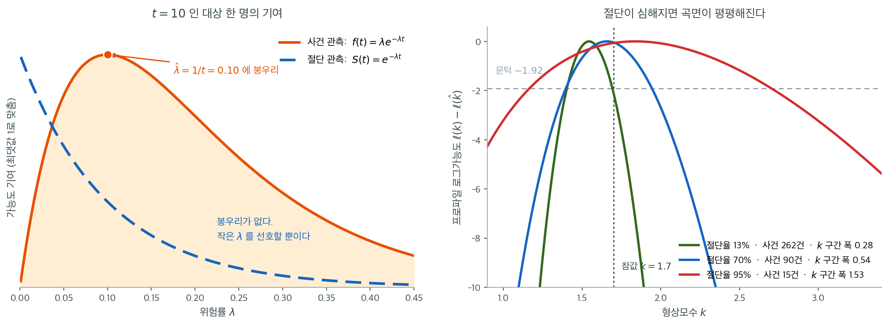
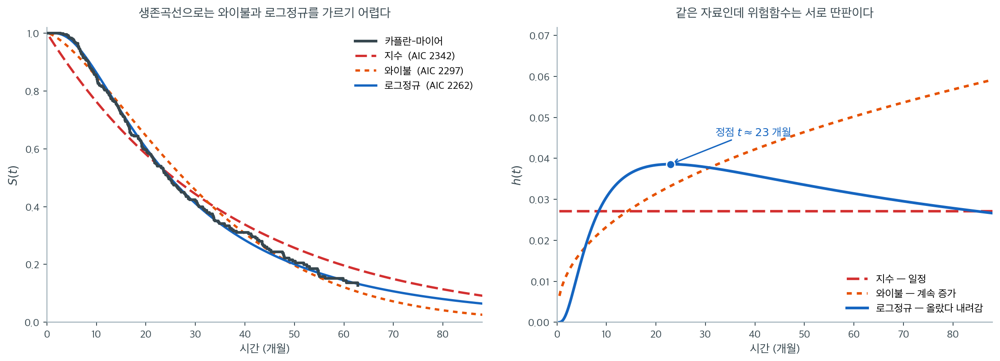

# 절단자료의 최대가능도

앞 절들에서 여러 모수적 생존 모형 --- 지수, 와이불, 로그정규, 로그로지스틱 --- 을 소개하고 지수
모형의 MLE를 유도했다. 이 절에서는 모든 모수적 생존 모형의 모수 추정을 떠받치는 **절단자료의
일반적인 가능도 틀**을 전개한다.

핵심 착상은 관측된 사건과 절단된 관측치가 가능도에 서로 다른 인자를 기여한다는 것이다. 시점
$t_i$의 사건은 밀도 $f(t_i)$를, 시점 $t_i$의 절단은 생존확률 $S(t_i)$를 기여한다.

---

## 1. 절단자료의 가능도

$(t_1, \delta_1), \ldots, (t_n, \delta_n)$을 관측 자료라 하자. $t_i$는 관측된 시간이고
$\delta_i \in \{0, 1\}$은 사건 지시자다(사건이면 $\delta_i = 1$, 절단이면 $\delta_i = 0$).

**독립 절단 가정** 아래에서 모수벡터 $\boldsymbol{\theta}$의 가능도는

$$
L(\boldsymbol{\theta}) = \prod_{i=1}^{n} \bigl[f(t_i; \boldsymbol{\theta})\bigr]^{\delta_i} \bigl[S(t_i; \boldsymbol{\theta})\bigr]^{1-\delta_i}
$$

이다.

**해석:**

- $\delta_i = 1$이면 그 대상이 정확히 $t_i$에 사건을 겪었으므로 기여는 밀도 $f(t_i)$다.
- $\delta_i = 0$이면 그 대상이 $t_i$에 절단되어 우리가 아는 것은 $T_i > t_i$뿐이므로 기여는
  $P(T_i > t_i) = S(t_i)$다.

!!! note "왜 밀도만 쓰면 안 되는가"

    절단된 관측치를 버리고 사건만 쓰면 정보를 낭비하고 추정이 짧은 생존시간 쪽으로 편향된다.
    절단된 관측치를 $S(t_i)$ 기여와 함께 포함시키면 그 대상이 적어도 $t_i$까지 생존했다는
    정보를 보존한다.

---

## 2. 로그가능도

$f(t) = h(t) S(t)$와 $S(t) = \exp(-H(t))$를 쓰면 가능도는

$$
L(\boldsymbol{\theta}) = \prod_{i=1}^{n} \bigl[h(t_i)\bigr]^{\delta_i} \exp\!\bigl(-H(t_i)\bigr)
$$

이 되고, 로그가능도는

$$
\ell(\boldsymbol{\theta}) = \sum_{i=1}^{n} \left[\delta_i \ln h(t_i; \boldsymbol{\theta}) - H(t_i; \boldsymbol{\theta})\right]
$$

이다. 이 분리된 형태는 계산에 편리하다. 위험함수와 누적위험함수가 어떤 모수 모형에서든 기본
구성요소이기 때문이다.



왼쪽은 지수 모형에서 $t = 10$에 관측된 **대상 한 명**의 가능도 기여를 $\lambda$의 함수로 그린 것이다. 사건으로 관측되었으면 기여가 $f(10) = \lambda e^{-10\lambda}$이고, 이 함수는 $\hat\lambda = 1/10 = 0.10$에서 뚜렷한 **봉우리**를 갖는다. "10개월에 사건이 일어났다"는 진술이 $\lambda$가 대략 얼마여야 하는지를 위아래 양쪽에서 좁혀 주기 때문이다.

절단으로 관측되었으면 기여가 $S(10) = e^{-10\lambda}$이고, 이 함수에는 **봉우리가 없다.** $\lambda$가 작을수록 단조 증가할 뿐이다. "적어도 10개월은 버텼다"는 진술은 $\lambda$가 너무 크지 않다는 상한만 말해 주고 하한은 전혀 말해 주지 않는다. 절단 관측이 정보를 **주기는 하되 한쪽으로만** 준다는 것이 이 두 곡선의 차이다. 앞의 상자에서 "절단된 관측치를 버리면 편향된다"고 한 것과 "절단만으로는 모수를 정할 수 없다"는 것이 동시에 참인 이유다.

오른쪽은 그 결과다. 와이불 $k = 1.7$, $\lambda = 50$에서 $n = 300$을 뽑고 절단의 강도만 바꿔 가며 형상모수의 프로파일 로그가능도 $\ell(k) - \ell(\hat k)$를 그렸다. 절단율 $13\%$(사건 262건)에서는 곡선이 뾰족해 프로파일 95% 구간이 $(1.41,\ 1.69)$로 폭 $0.28$이다. 절단율 $70\%$(사건 90건)에서는 폭이 $0.54$로 두 배, 절단율 $95\%$(사건 15건)에서는 $(1.17,\ 2.70)$으로 폭이 $1.53$까지 부푼다. **마지막 경우는 "위험이 감소한다"($k<1$)만 겨우 배제할 뿐 그 이상 아무 말도 하지 못한다.**

표본 크기 $n = 300$은 세 경우 모두 같았다는 점이 핵심이다. 달라진 것은 사건 수뿐이다. 왼쪽 그림이 그 이유를 이미 말했다. 봉우리를 만드는 것은 $\delta_i \ln h(t_i)$ 항이고, 절단 관측은 그 항을 기여하지 않는다. 그래서 생존분석에서는 **표본 크기가 아니라 사건 수를 세야 하며**, 임상시험 설계가 "환자 몇 명"이 아니라 "사건 몇 건"을 목표로 잡는 것도 이 때문이다.

---

## 3. 점수방정식

점수함수는 로그가능도의 기울기다.

$$
U(\boldsymbol{\theta}) = \frac{\partial \ell}{\partial \boldsymbol{\theta}} = \sum_{i=1}^{n} \left[\delta_i \frac{\partial \ln h(t_i)}{\partial \boldsymbol{\theta}} - \frac{\partial H(t_i)}{\partial \boldsymbol{\theta}}\right]
$$

MLE $\hat{\boldsymbol{\theta}}$는 $U(\hat{\boldsymbol{\theta}}) = \mathbf{0}$을 푼다.

---

## 4. 정보행렬

관측 피셔 정보행렬은

$$
\mathcal{I}(\boldsymbol{\theta}) = -\frac{\partial^2 \ell}{\partial \boldsymbol{\theta}\, \partial \boldsymbol{\theta}^\top}
$$

를 $\hat{\boldsymbol{\theta}}$에서 평가한 것이다. MLE의 점근 공분산은
$\text{Var}(\hat{\boldsymbol{\theta}}) \approx \mathcal{I}(\hat{\boldsymbol{\theta}})^{-1}$
이다.

개별 모수의 신뢰구간은

$$
\hat{\theta}_j \pm z_{\alpha/2} \sqrt{[\mathcal{I}^{-1}]_{jj}}
$$

이다.

---

## 5. 수치 최적화

지수 모형을 제외하면 생존 모형의 점수방정식에는 닫힌 형태의 해가 없다. 표준적인 수치 방법은
다음과 같다.

1. **뉴턴–랩슨.** 헤세행렬(관측정보)을 써서 매 반복 모수 추정치를 갱신한다.

$$
\boldsymbol{\theta}^{(m+1)} = \boldsymbol{\theta}^{(m)} + \mathcal{I}(\boldsymbol{\theta}^{(m)})^{-1} U(\boldsymbol{\theta}^{(m)})
$$

2. **피셔 점수법.** 관측정보를 기대정보로 대체한다. 모형이 옳게 지정되어 있으면 뉴턴–랩슨과
   동등하다.

3. **준뉴턴법(BFGS, L-BFGS).** 이차도함수 계산을 피하려고 헤세행렬을 근사한다. 소프트웨어
   패키지에서 널리 쓰인다.

!!! tip "초기값"

    좋은 초기값이 수렴을 앞당긴다. 와이불 모형은 $k = 1$(지수)과 $\lambda = \sum t_i / d$로
    시작한다. 로그정규와 로그로지스틱 모형은 절단되지 않은 관측치의 $\ln t_i$의 표본평균과
    표본분산을 쓴다.

    **양수 제약이 있는 모수는 로그 척도에서 최적화하라.** $k > 0$, $\lambda > 0$이므로
    $\ln k$와 $\ln\lambda$를 최적화 변수로 두면 제약 없는 최적화가 되어 BFGS 같은 일반
    최적화기를 그대로 쓸 수 있다. 아래 연습문제 2의 코드가 이 방식이다.

---

## 6. 와이불 가능도

모수가 $(k, \lambda)$인 와이불 모형에서

$$
h(t) = \frac{k}{\lambda}\left(\frac{t}{\lambda}\right)^{k-1}, \qquad H(t) = \left(\frac{t}{\lambda}\right)^k
$$

이므로 로그가능도는

$$
\ell(k, \lambda) = \sum_{i=1}^{n} \delta_i \left[\ln k - k \ln \lambda + (k-1)\ln t_i\right] - \sum_{i=1}^{n}\left(\frac{t_i}{\lambda}\right)^k
$$

$$
= d \ln k - dk \ln \lambda + (k-1)\sum_{i=1}^{n}\delta_i \ln t_i - \sum_{i=1}^{n}\left(\frac{t_i}{\lambda}\right)^k
$$

이다.

---

## 7. 가능도를 이용한 모형 비교

모수 모형은 가능도 기반 기준으로 비교할 수 있다.

**가능도비 검정**(내포 모형용). 지수 모형($k=1$)을 와이불 모형($k$ 자유)과 견주려면

$$
\Lambda = 2[\ell_{\text{Weibull}} - \ell_{\text{Exp}}] \;\xrightarrow{d}\; \chi^2_1
$$

를 쓴다.

**아카이케 정보기준**(비내포 모형용):

$$
\text{AIC} = -2\ell(\hat{\boldsymbol{\theta}}) + 2p
$$

여기서 $p$는 모수의 개수다. AIC가 낮을수록 적합도와 복잡도의 절충이 낫다. 21.5절에서 AIC와
다른 선택 기준을 자세히 다룬다.

### 세 모형의 로그가능도를 한자리에서

<div class="exbox" markdown>

**보기 1.** <span class="diff easy" title="쉬움"></span> 세 모수적 생존모형의 로그가능도. 아래 세 함수는 절단을 포함한 음의 로그가능도를 계산한다.

**(1)** 지수모형의 로그가능도 $\ell(\lambda) = d\ln\lambda - \lambda\sum_i t_i$에서 최대가능도추정량이 $\hat\lambda = d/\sum_i t_i$임을 유도하시오($d$는 사건 수). **절단된 관측도 분모의 총 관찰시간에 들어간다**는 점을 설명하시오.

**(2)** 와이불 로그가능도에 $k = 1$을 넣으면 지수 로그가능도와 **정확히 같아짐**을 식으로 보이고, 둘 다 코드로 확인하시오.

</div>

??? success "풀이"

    **(1) 해석적으로.** 위험이 상수 $\lambda$이면 $f(t) = \lambda e^{-\lambda t}$, $S(t) = e^{-\lambda t}$다. 사건을 겪은 사람은 $f(t_i)$를, 절단된 사람은 $S(t_i)$를 기여하므로 가능도는

    $$
    L(\lambda) = \prod_{i:\,\delta_i=1}\lambda e^{-\lambda t_i}\;\prod_{i:\,\delta_i=0} e^{-\lambda t_i}
    = \lambda^{d}\,e^{-\lambda\sum_i t_i}
    $$

    이다. **지수항이 두 무리에서 똑같은 꼴이라 전부 합쳐지고, $\lambda$의 거듭제곱만 사건 수 $d$만큼 남는다.** 그래서 자료가 $(d, \sum_i t_i)$ 두 수로 요약된다. 로그를 취하면

    $$
    \ell(\lambda) = d\ln\lambda - \lambda\sum_i t_i,
    \qquad
    \ell'(\lambda) = \frac{d}{\lambda} - \sum_i t_i = 0
    \quad\Longrightarrow\quad
    \hat\lambda = \frac{d}{\sum_i t_i}
    $$

    이고 $\ell''(\lambda) = -d/\lambda^2 < 0$이므로 최대다.

    분모가 관측 수 $n$이 아니라 **총 관찰시간**이라는 점이 핵심이다. 절단된 사람은 분자에 사건을 보태지 않지만 **분모에는 자기가 지켜본 시간만큼 기여한다.** $\hat\lambda$는 "단위 시간당 몇 건이 일어났는가"이고, 이것이 역학에서 말하는 **발생률**이다. 절단을 버리면 분모가 줄어 위험을 과대평가하게 된다.

    **(2) 해석적으로.** 코드의 와이불 로그가능도에 $k = 1$을 넣는다.

    $$
    \ell_W(1, \lambda)
    = d\ln 1 - d\cdot 1\cdot\ln\lambda + (1-1)\sum_i \delta_i\ln t_i - \sum_i\left(\frac{t_i}{\lambda}\right)^1
    = -d\ln\lambda - \frac{1}{\lambda}\sum_i t_i
    $$

    이다. 셋째 항의 계수 $k-1$이 0이 되어 통째로 사라진다. 한편 지수 로그가능도에 비율 $\lambda_E = 1/\lambda$를 넣으면

    $$
    \ell_E\!\left(\frac1\lambda\right)
    = d\ln\frac1\lambda - \frac{1}{\lambda}\sum_i t_i
    = -d\ln\lambda - \frac{1}{\lambda}\sum_i t_i
    $$

    로 **글자 하나까지 같다.** 근사가 아니라 항등식이다. 와이불의 $\lambda$가 척도이고 지수의 $\lambda$가 비율이어서 서로 역수라는 점만 맞추면 된다.

    그래서 두 모형은 **내포 관계**다. 와이불이 모수를 하나 더 쓰면서 $k = 1$에서 지수를 품으므로, $H_0: k = 1$에 대한 가능도비검정을 자유도 1로 할 수 있다.

    **(1)(2) 수치적으로.**

    ```python
    import numpy as np
    from scipy.optimize import minimize
    from scipy.stats import norm

    def neg_loglik_exponential(lam, times, events):
        """지수모형의 음의 로그가능도.

        위험함수가 시간에 관계없이 일정하다고 본다. 가장 단순한 모형이라
        사건 수와 총 관찰시간만 있으면 되고, MLE 도 그 비로 바로 나온다.
        """
        d = events.sum()
        total_time = times.sum()
        return -(d * np.log(lam) - lam * total_time)

    def neg_loglik_weibull(params, times, events):
        """와이불모형의 음의 로그가능도.

        모양모수 k 가 위험함수의 방향을 정한다. k>1 이면 시간이 갈수록 위험이
        커지고(마모), k<1 이면 작아지며(초기 결함), k=1 이면 지수모형이 된다.
        지수모형을 특수한 경우로 품고 있는 셈이다.
        """
        k, lam = params
        d = events.sum()
        ll = (d * np.log(k)
              - d * k * np.log(lam)
              + (k - 1) * np.sum(events * np.log(times + 1e-15))
              - np.sum((times / lam) ** k))
        return -ll

    def neg_loglik_lognormal(params, times, events):
        """로그정규모형의 음의 로그가능도.

        위험함수가 올랐다가 다시 내려가는 모양이 된다. 수술 직후 위험이 높다가
        회복하면서 낮아지는 자료처럼, 와이불로는 담기 어려운 경우에 쓴다.
        """
        mu, sigma = params
        # 1e-15 를 더하는 것은 시각이 0 일 때 로그가 발산하는 것을 막기 위함이다.
        z = (np.log(times + 1e-15) - mu) / sigma
        # 사건이 관측된 사람은 밀도함수를, 중도절단된 사람은 생존함수(logsf)를
        # 기여한다. 중도절단 자료를 다루는 가능도의 일반적인 꼴이다.
        ll = np.sum(
            events * norm.logpdf(z) - events * np.log(sigma * times + 1e-15)
            + (1 - events) * norm.logsf(z)
        )
        return -ll

    # --- 자료를 만든다. 참 비율 0.1, t = 15 에서 행정절단 ---
    rng = np.random.default_rng(1)
    n = 200
    T = rng.exponential(10.0, n)
    times = np.minimum(T, 15.0)
    events = (T <= 15.0).astype(int)

    d, S = events.sum(), times.sum()
    print(f"n = {n}, 사건 d = {d}, 총 관찰시간 = {S:.4f}")
    print(f"해석적 lambda_hat = d / sum(t) = {d / S:.6f}   (참값 0.1)")

    res = minimize(neg_loglik_exponential, x0=[0.05], args=(times, events),
                   bounds=[(1e-8, None)])
    print(f"수치최적화 lambda_hat = {res.x[0]:.6f},  -ll = {res.fun:.6f}")
    print(f"해석적 자리의 -ll      = {neg_loglik_exponential(d / S, times, events):.6f}")

    # --- (2) k = 1 에서 두 로그가능도가 같아야 한다 ---
    for lam_scale in (5.0, 10.0, 23.7):
        a = neg_loglik_weibull((1.0, lam_scale), times, events)
        b = neg_loglik_exponential(1.0 / lam_scale, times, events)
        print(f"  scale={lam_scale}: 와이불(k=1) {a:.9f}   지수(1/scale) {b:.9f}   차 {a - b:.2e}")

    print(f"  SE(lambda_hat) = lambda_hat/sqrt(d) = {(d / S) / np.sqrt(d):.6f},  "
          f"z = {(0.1 - d / S) / ((d / S) / np.sqrt(d)):+.2f}")
    ```

    출력:

    ```
    n = 200, 사건 d = 156, 총 관찰시간 = 1598.9815
    해석적 lambda_hat = d / sum(t) = 0.097562   (참값 0.1)
    수치최적화 lambda_hat = 0.097562,  -ll = 519.053513
    해석적 자리의 -ll      = 519.053513
      scale=5.0: 와이불(k=1) 570.868604999   지수(1/scale) 570.868604999   차 -1.14e-13
      scale=10.0: 와이불(k=1) 519.101419837   지수(1/scale) 519.101419837   차 0.00e+00
      scale=23.7: 와이불(k=1) 561.281679379   지수(1/scale) 561.281679379   차 0.00e+00
      SE(lambda_hat) = lambda_hat/sqrt(d) = 0.007811,  z = +0.31
    ```

    **해석적 답과 수치최적화가 소수 여섯째 자리까지 같다.** 두 자리에서의 음의 로그가능도도 $519.053513$으로 일치하니 최적화가 같은 점을 찾았다.

    $\hat\lambda = 0.097562$는 참값 $0.1$에서 $0.31$ 표준오차 떨어져 있다. **표준오차가 $\hat\lambda/\sqrt d$인 것도 (1)에서 나온다.** $\ell''(\lambda) = -d/\lambda^2$이므로 관측정보가 $d/\hat\lambda^2$이고 그 역수의 제곱근이 $\hat\lambda/\sqrt d$다. 정밀도를 정하는 것은 표본크기 $n = 200$이 아니라 **사건 수 $d = 156$**이며, 생존연구에서 "사건 수가 검정력을 정한다"고 말하는 까닭이 이것이다.

    $k = 1$에서 두 로그가능도의 차이가 세 척도 모두 $10^{-13}$ 이하다. **부동소수점 오차 수준이므로 (2)의 항등식이 그대로 확인된다.**

    각 함수는 표준 최소화 루틴을 쓸 수 있도록 음의 로그가능도를 계산한다. 사건 지시자 `events[i]` 는 관측된 사건이면 1, 절단이면 0이다. 절단된 대상은 생존함수 항 $\ln S(t_i)$을 통해 기여한다.

!!! note "$\varepsilon = 10^{-15}$ 보정에 대하여"
    코드의 `times + 1e-15`는 $t_i = 0$일 때 $\log 0$을 피하기 위한 것이다. 생존시간이 엄밀히
    양수라면 필요 없지만, 자료에 $t = 0$이 섞여 있으면 방어가 된다. 다만 $t = 0$인 관측치가
    실제로 있다면 그것은 자료 오류일 가능성이 높으므로, 보정으로 덮기보다 원인을 확인하는 편이
    낫다.

    또한 최적화 시 $k, \lambda, \sigma$가 양수여야 하므로, 21.3절에서 권한 대로 로그 척도에서
    최적화하거나 `minimize(..., bounds=...)`로 제약을 걸어야 한다. 위 함수들을 그대로
    무제약 최적화에 넘기면 음수 모수에서 `nan`이 발생할 수 있다.

---

### 같은 자료에 적합한 세 모형



참값이 로그정규($\mu = 3.2$, $\sigma = 0.8$)인 자료 $n = 400$을 만들고 무작위로 절단해 절단율 $36.5\%$, 사건 254건을 얻은 뒤 세 모형을 최대가능도로 적합했다. 결과는 $\hat\lambda = 0.0271$(지수), $\hat k = 1.43$·$\hat\lambda = 35.6$(와이불), $\hat\mu = 3.21$·$\hat\sigma = 0.83$(로그정규)이고 AIC는 각각 $2342$, $2297$, $2262$다. AIC가 로그정규를 고르며, 참값을 정확히 되찾았다.

그런데 왼쪽 그림을 보면 **그 승부가 눈으로는 잘 보이지 않는다.** 지수 모형(붉은 파선)은 초반에 카플란–마이어보다 아래로 처져 눈에 띄게 어긋나지만, 와이불(주황 점선)과 로그정규(파란 실선)는 계단을 따라 거의 나란히 지나간다. 둘의 AIC 차이 $35$는 통계적으로 결정적인 크기인데, 생존곡선 위에서는 $t = 50$ 부근에서 겨우 $0.02$ 정도 벌어질 뿐이다.

오른쪽으로 옮기면 사정이 달라진다. 같은 세 적합의 위험함수가 **서로 완전히 다른 이야기를 한다.** 지수는 $0.0271$로 평평하고, 와이불은 $\hat k = 1.43 > 1$이라 끝없이 올라가며, 로그정규는 $t \approx 23$개월에서 $h = 0.039$로 정점을 찍고 내려온다. "이 대출들의 부도 위험은 앞으로 커지는가, 줄어드는가"라는 실무 질문에 두 모형이 정반대로 답한다. 30개월 이후를 보면 와이불은 위험이 계속 커진다고 하고 로그정규는 이미 고비를 넘겼다고 한다.

그러니 순서를 이렇게 잡는 것이 좋다. **AIC로 후보를 좁히고, 생존곡선 그림으로 큰 오지정을 걸러내고, 위험함수 그림으로 결론이 실제로 무엇을 뜻하는지 확인한다.** 위 그림에서 지수 모형은 두 번째 단계에서 탈락하고, 와이불과 로그정규의 승부는 첫 번째 단계가 가른다. 그리고 그 승부의 실질적 의미는 세 번째 단계에서야 드러난다. 어느 한 단계만으로는 부족하다.

---

## 8. 좌측절단과 구간절단 다루기

가능도는 다른 절단 유형으로도 확장된다.

- **좌측절단**($T_i < t_i$): $F(t_i) = 1 - S(t_i)$를 기여한다.
- **구간절단**($L_i < T_i \leq R_i$): $S(L_i) - S(R_i) = F(R_i) - F(L_i)$를 기여한다.

여러 절단 유형이 섞인 경우의 일반적인 가능도는

$$
L(\boldsymbol{\theta}) = \prod_{i \in \mathcal{E}} f(t_i) \prod_{i \in \mathcal{R}} S(t_i) \prod_{i \in \mathcal{L}} F(t_i) \prod_{i \in \mathcal{I}} [S(L_i) - S(R_i)]
$$

이다. 여기서 $\mathcal{E}$, $\mathcal{R}$, $\mathcal{L}$, $\mathcal{I}$는 각각 정확 관측,
우측절단, 좌측절단, 구간절단 관측치의 집합이다.

!!! warning "절단이 심할 때의 식별 가능성"

    절단 비율이 매우 높으면(예: 관측치의 80% 이상이 절단) 가능도 곡면이 평평해져 MLE를
    신뢰하기 어렵다. 이런 경우에는 표본 크기를 늘리거나, 추적 기간을 연장하거나, 정보가 있는
    사전분포를 갖는 베이즈 방법을 고려하라.

---

<div class="aibox" markdown>

**AI로 보는 통계학 1.** 점검 주기가 사건 시각을 만든다

위에 적힌 네 묶음 가운데 **구간절단** $\;S(L_i) - S(R_i)\;$ 는 교과서의 특수한 경우처럼
보이지만, 오늘 모이는 자료는 대부분 그쪽이다. 사건을 **연속으로** 지켜보는 기록은 드물고,
야간 배치가 하루에 한 번 상태를 훑거나 주간 집계가 일주일에 한 번 묻는다. 그러면 알 수
있는 것은 「지난 점검에는 멀쩡했고 이번 점검에는 일어나 있었다」 — 곧 구간뿐이다.

그런데 자료표에 적히는 것은 보통 **점검 시각**이다. 그 한 줄이 가능도의 어느 묶음에
들어가느냐를 바꾼다. 점검 시각을 사건 시각으로 적으면 첫 묶음 $f(t_i)$ 를 쓰는 셈인데,
실제로 일어난 시각은 그보다 **앞**이다.

```python
import numpy as np
from scipy.optimize import brentq

rng = np.random.default_rng(3)
n, LAM, HORIZON = 4000, 0.05, 60.0        # 참 위험 0.05 (평균 20 일), 관측 60 일
T = rng.exponential(1 / LAM, n)           # 같은 자료를 네 가지 점검 주기로 본다

def fit(step):
    grid = np.arange(step, HORIZON + step, step)
    idx = np.searchsorted(grid, T)                 # 사건을 처음 알아채는 점검
    seen = idx < len(grid)
    R = np.where(seen, grid[np.clip(idx, 0, len(grid) - 1)], HORIZON)
    L = np.where(seen, R - step, HORIZON)
    d = seen.sum()
    right = d / R.sum()                            # 점검 시각을 사건 시각으로
    mid = d / np.where(seen, (L + R) / 2, HORIZON).sum()   # 구간의 중점으로
    def score(lam):                                # 구간가능도의 점수방정식
        a, b = np.exp(-lam * L[seen]), np.exp(-lam * R[seen])
        return float(((R[seen] * b - L[seen] * a) / (a - b)).sum()
                     - HORIZON * (~seen).sum())
    return d, right, mid, brentq(score, 1e-4, 1.0)

print("  점검 주기   사건 수   점검시각 그대로   구간 중점   구간가능도")
for step in (1, 7, 14, 30):
    d, a, b, c = fit(step)
    print(f"{step:>8} 일{d:>9}{a:>16.4f}{b:>13.4f}{c:>13.4f}")
print(f"\n참 위험 {LAM} (평균 {1/LAM:.0f} 일)")
```

출력:

```
  점검 주기   사건 수   점검시각 그대로   구간 중점   구간가능도
       1 일     3820          0.0495       0.0508       0.0508
       7 일     3839          0.0428       0.0503       0.0509
      14 일     3885          0.0365       0.0491       0.0512
      30 일     3820          0.0260       0.0426       0.0505

참 위험 0.05 (평균 20 일)
```

**사건 수는 네 줄이 거의 같다.** 누가 사건을 겪었는지는 점검 주기와 거의 무관하다. 달라지는
것은 **언제**이고, 그 한 열이 추정값을 무너뜨린다. 점검 시각을 그대로 적으면 위험이
$0.0495 \to 0.0260$ 으로 주는데, $30$ 일 주기에서는 **참값의 절반**이다. 평균 생존시간으로
읽으면 $20$ 일짜리를 $38$ 일이라 말하는 셈이다.

까닭은 산수에 있다. 지수모형의 추정은 $\hat\lambda = (\text{사건 수})/(\text{총 노출})$
인데, 점검 시각을 적으면 사건마다 평균 $\Delta/2$ 만큼 노출이 부풀려진다. 분자는 그대로이고
분모만 커지니 위험이 작아진다. **구간의 중점**으로 적으면 그 부풀림이 일차로 상쇄되어
$30$ 일 주기 전까지는 쓸 만하다($0.0503$, $0.0491$). 다만 지수분포는 구간 안에서도
앞쪽이 더 두터우므로 중점이 참 평균이 아니고, 주기가 길어지면 그 어긋남이 드러난다
($0.0426$).

**구간가능도만 네 줄에서 모두 맞는다.** 위 식 그대로 $S(L_i) - S(R_i)$ 를 쓰면 $0.0505$–$0.0512$
로, 자료를 바꾼 것이 아니라 **아는 것만 적었을 뿐**인데 편향이 사라진다.

**조건이 하나 있다. 점검이 사건과 무관해야 한다.** 장애가 났기 때문에 들여다보는
기록이라면 점검 시각 자체가 사건에 끌려온 것이라 구간의 길이가 더 이상 설계가 아니다.
그때는 위 가능도가 서지 않는다 — 21.1절 [중도절단의 유형](../introduction/censoring_types.md)
이 말하는 **비정보적 절단** 가정이 여기서도 똑같이 필요하다.

</div>

## 연습문제

<div class="drillbox" markdown>

**연습문제 1.** <span class="diff med" title="중간"></span>
로그가능도 $\ell = \sum_i [\delta_i \ln h(t_i) - H(t_i)]$를 원래 형태
$\prod_i f(t_i)^{\delta_i} S(t_i)^{1-\delta_i}$에서 유도하라. 절단된 관측치가 왜
$-H(t_i)$ 항만 기여하는지 설명하라.

</div>

??? success "풀이"

    $f(t) = h(t)S(t)$와 $S(t) = e^{-H(t)}$를 대입하면 각 인자는

    $$
    f(t_i)^{\delta_i} S(t_i)^{1-\delta_i}
    = \bigl[h(t_i)S(t_i)\bigr]^{\delta_i} S(t_i)^{1-\delta_i}
    = h(t_i)^{\delta_i}\,S(t_i)^{\delta_i + 1 - \delta_i}
    = h(t_i)^{\delta_i}\,S(t_i)
    $$

    가 된다. **지수 $\delta_i$가 $S$에서 완전히 사라지는 것**이 핵심이다. 사건이든 절단이든
    모든 관측치가 $S(t_i)$를 똑같이 기여하고, 사건만 추가로 $h(t_i)$를 기여한다.

    $S(t_i) = e^{-H(t_i)}$이므로 로그를 취하면

    $$
    \ell = \sum_i \bigl[\delta_i \ln h(t_i) - H(t_i)\bigr]
    $$

    **해석.** 이 형태는 두 종류의 정보를 분리해 보여준다.

    - $-H(t_i)$는 "이 대상이 $t_i$까지 살아남았다"는 정보다. 모든 대상이 기여한다.
    - $\delta_i \ln h(t_i)$는 "그리고 정확히 $t_i$에 사건을 겪었다"는 추가 정보다. 사건을
      겪은 대상만 기여한다.

    절단된 대상이 $-H(t_i)$만 기여하는 것은 그가 준 정보가 딱 그것뿐이기 때문이다. 언제
    사건이 일어날지는 말해 주지 않는다. $\square$

<div class="drillbox" markdown>

**연습문제 2.** <span class="diff med" title="중간"></span>
와이불 로그가능도를 직접 구현하고 절단자료에서 $(\hat k, \hat\lambda)$를 수치적으로 구하라.
$k = 1$로 고정한 지수 모형과 가능도비 검정으로 비교하라.

</div>

??? success "풀이"

    ```python
    import numpy as np
    from scipy.optimize import minimize
    from scipy import stats

    rng = np.random.default_rng(31)
    n = 400
    k_true, lam_true = 1.7, 50.0
    T = lam_true * rng.weibull(k_true, n)
    C = rng.exponential(70.0, n)
    t = np.minimum(T, C); d = (T <= C).astype(int)

    def neg_loglik(p):
        k, lam = np.exp(p)                 # optimize on the log scale
        h = (k / lam) * (t / lam) ** (k - 1)
        H = (t / lam) ** k
        return -np.sum(d * np.log(h) - H)

    res = minimize(neg_loglik, [0.0, np.log(t.mean())], method='BFGS')
    k_hat, lam_hat = np.exp(res.x)
    ll_weib = -res.fun

    lam_exp = t.sum() / d.sum()            # exponential MLE, closed form
    ll_exp = np.sum(d * np.log(1 / lam_exp) - t / lam_exp)

    LR = 2 * (ll_weib - ll_exp)
    print(f"Weibull : k={k_hat:.4f}, lambda={lam_hat:.3f}, loglik={ll_weib:.4f}")
    print(f"Exp     : lambda={lam_exp:.3f}, loglik={ll_exp:.4f}")
    print(f"LR = {LR:.4f}, p = {stats.chi2.sf(LR, 1):.3e}")
    ```

    출력:

    ```
    Weibull : k=1.5960, lambda=49.300, loglik=-1088.6557
    Exp     : lambda=52.155, loglik=-1124.6066
    LR = 71.9018, p = 2.262e-17
    ```

    **결과.** 절단율은 $43.2\%$이고 사건은 227건이다.

    | 모형 | 모수 | 로그가능도 | AIC |
    |---|---|---|---|
    | 와이불 | $\hat k = 1.596$, $\hat\lambda = 49.30$ | $-1088.66$ | $2181.31$ |
    | 지수 | $\hat\lambda = 52.16$ | $-1124.61$ | $2251.21$ |

    가능도비 통계량은 $\Lambda = 2(-1088.66 + 1124.61) = 71.90$이고
    $p = 2.3 \times 10^{-17}$로 지수 모형을 압도적으로 기각한다. AIC도 와이불이 $70$만큼
    낮다.

    참값 $k = 1.7$에 대해 $\hat k = 1.596$으로 다소 낮게 나왔는데, 이는 표집 변동이다.
    와이불 절 연습문제 3의 그림 기반 추정치 $1.360$과 비교하면 최대가능도 쪽이 훨씬 정확하다.
    $\square$

<div class="drillbox" markdown>

**연습문제 3.** <span class="diff med" title="중간"></span>
절단율이 매우 높으면 왜 가능도 곡면이 평평해지는지 설명하라. 사건이 하나도 없으면 어떤 일이
일어나는가?

</div>

??? success "풀이"

    로그가능도 $\ell = \sum_i [\delta_i \ln h(t_i) - H(t_i)]$에서 모수의 **모양**에 대한
    정보는 대부분 첫 항 $\delta_i \ln h(t_i)$에서 온다. 절단된 관측치는 $-H(t_i)$만
    기여하는데, 이 항은 "생존시간이 $t_i$보다 길다"는 부등식 정보라 모수를 느슨하게만
    제약한다.

    절단율이 높으면 첫 항의 항 수가 줄어들어 곡면이 평평해진다. 특히 **형상모수**는 사건이
    언제 일어나는지에 대한 정보를 필요로 하므로 절단에 특히 취약하다. 척도모수는 총 인시에서
    비교적 잘 추정되지만 형상모수는 그렇지 않다.

    **사건이 하나도 없는 경우($d = 0$).** 로그가능도가

    $$
    \ell = -\sum_i H(t_i)
    $$

    가 되어, 모든 $t_i$에서 $H$를 작게 만들수록 커진다. 와이불이면
    $H(t) = (t/\lambda)^k$이므로 $\lambda \to \infty$에서 $\ell \to 0$이고, 최대점이 경계에
    있어 **MLE가 존재하지 않는다.** 21.3절 [지수 모형](exponential.md) 연습문제 2에서 본 것과 같은 현상이다.

    **실무적 대응.**

    1. **사건 수를 세라.** 표본 크기가 아니라 사건 수가 정보량을 결정한다. 모수가 2개인 모형에
       사건이 10건뿐이면 어떤 결과도 신뢰할 수 없다.
    2. **모형을 단순화하라.** 형상모수를 추정할 수 없으면 $k = 1$로 고정한 지수 모형이 더
       정직하다.
    3. **프로파일 가능도를 그려 보라.** $k$에 대한 프로파일 로그가능도가 넓은 범위에서 평평하면
       그것이 곧 식별 불가의 증거다. 왈드 표준오차만 보면 이 문제를 놓친다. $\square$

<div class="drillbox" markdown>

**연습문제 4.** <span class="diff med" title="중간"></span>
구간절단 자료에 대한 가능도 $\prod_i [S(L_i) - S(R_i)]$를 최대화할 때, 우측절단 자료보다
계산이 어려운 이유를 설명하라.

</div>

??? success "풀이"

    **우측절단의 경우.** 로그가능도가
    $\sum_i [\delta_i \ln h(t_i) - H(t_i)]$로 **각 항이 $H$와 $\ln h$의 단순한 합**이다.
    $H$와 $h$가 모수의 매끄러운 함수이므로 기울기와 헤세행렬을 해석적으로 구할 수 있고,
    로그가 곱을 합으로 바꿔 주어 수치적으로도 안정적이다.

    **구간절단의 경우.** 각 항이 **두 생존함수의 차** $S(L_i) - S(R_i)$이며 로그가 이 차를
    분해하지 못한다.

    $$
    \ell = \sum_i \ln\bigl[S(L_i) - S(R_i)\bigr]
    $$

    여기에서 세 가지 어려움이 생긴다.

    1. **수치적 소거.** $L_i$와 $R_i$가 가까우면 $S(L_i) - S(R_i)$가 두 비슷한 수의 차라
       유효숫자가 대량으로 소실된다. 부동소수점에서 0이 되면 $\ln 0 = -\infty$가 된다.
    2. **미분이 복잡하다.** $\partial \ln[S(L)-S(R)]/\partial\theta$가 몫 형태가 되어
       기울기와 헤세행렬이 훨씬 복잡하고, 분모가 작을 때 불안정하다.
    3. **볼록성을 잃는다.** 우측절단 가능도는 많은 모형에서 로그오목이지만 구간절단 가능도는
       그렇지 않을 수 있다. 국소 최적점이 여러 개 생겨 초기값에 따라 다른 답에 이른다.

    **비모수적인 경우는 더 어렵다.** 구간절단 자료의 비모수 MLE(터른불 추정량)는 닫힌 형태가
    없고 EM 알고리즘 같은 반복법이 필요하며, 카플란–마이어처럼 한 번의 통과로 계산되지 않는다.

    **실무적 처방.** 구간 폭이 좁고 균일하면 각 구간의 중점을 정확 관측으로 근사하는 것이
    쓸 만한 지름길이다. 그러나 구간이 넓으면 편향이 커지므로(21.1절 [중도절단의 유형](../introduction/censoring_types.md) 연습문제 3의 경고) 제대로
    된 구간절단 방법을 써야 한다. `lifelines`의 `WeibullFitter.fit_interval_censoring`이나
    R의 `icenReg` 패키지가 이를 제공한다. $\square$

<div class="drillbox" markdown>

**연습문제 5.** <span class="diff easy" title="쉬움"></span>
모형 비교

어떤 분석자가 대상 100명의 같은 자료에 모형 세 개를 적합했다. 결과는 다음과 같다.

| 모형 | 모수 | 최대 로그가능도 |
|:------|:----------:|:------------------:|
| 지수 | 1 | $-312.5$ |
| 와이불 | 2 | $-298.1$ |
| 로그정규 | 2 | $-300.3$ |

**(a)** 각 모형의 AIC를 계산하라.

**(b)** $\alpha = 0.05$에서 지수 대 와이불의 가능도비 검정을 수행하라.

**(c)** 어느 모형을 고르겠는가? 이유는?

</div>

??? success "풀이"

    **(a)** AIC $= -2\hat{\ell} + 2p$이므로,

    - 지수: $-2(-312.5) + 2(1) = 627.0$
    - 와이불: $-2(-298.1) + 2(2) = 600.2$
    - 로그정규: $-2(-300.3) + 2(2) = 604.6$

    **(b)** 가능도비 통계량은

    $$
    \Lambda = 2[-298.1 - (-312.5)] = 2 \times 14.4 = 28.8
    $$

    이다. $H_0: k = 1$ 아래에서 $\Lambda \sim \chi^2_1$이고 $\alpha = 0.05$의 임계값은
    3.84다. $28.8 \gg 3.84$이므로 지수 모형을 기각하고 와이불을 택한다. 위험이 일정하지 않다.

    **(c)** 와이불 모형의 AIC가 600.2로 가장 낮고, 가능도비 검정에서 지수 모형보다 유의하게
    낫다. 로그정규보다도 낫다(AIC 600.2 대 604.6). 이 자료에서 와이불이 적합도와 간결성의
    절충이 가장 좋다.

    다만 와이불과 로그정규의 AIC 차이 $4.4$는 결정적이라 하기에는 크지 않다. 두 모형은 위험의
    **모양**에 대해 전혀 다른 이야기를 한다(단조 증가 대 봉우리형). 관측 구간 안에서 예측만
    한다면 어느 쪽이든 비슷하지만, 위험의 모양 자체가 결론이거나 외삽이 필요하다면 AIC 차이
    $4.4$에 의존해서는 안 된다. 넬슨–알렌 누적위험 그림을 보고 어느 쪽이 자료의 모양과 맞는지
    직접 확인하라.

---

## 정리하며

절단자료의 가능도는 **두 종류의 기여**로 이루어진다.

$$
L=\prod_{i}f(t_i)^{\delta_i}\,S(t_i)^{1-\delta_i}
$$

- **사건이면 밀도, 절단이면 생존함수를 곱한다.** 사건 관측은 "정확히 $t_i$ 에 일어났다"이고, 절단 관측은 **"$t_i$ 를 넘겼다"** 는 정보만 준다.
- **로그를 취하면 $\sum[\delta_i\log h(t_i)-H(t_i)]$ 가 된다.** 위험함수와 누적위험으로 적히며, 모든 모수 모형에 공통인 형태다.
- **절단 관측이 버려지지 않는다.** 정보의 양이 적을 뿐 기여는 한다. 이것이 생존분석이 절단을 다루는 방식이다.
- **무작위 절단 가정이 여기에 들어 있다.** 절단 시점이 사건시간과 독립이어야 이 가능도가 옳다.
- **6장의 최대가능도 이론이 그대로 적용된다.** 수치 최적화, 피셔 정보량, 표준오차 모두 같은 방식이다.

다음 절 **[부분가능도와 콕스 모형](../cox/partial_likelihood.md)**부터 21.4절은 분포 지정을 **아예 피한다.** 여기까지는 사건시간의 분포를 골라야 했고 잘못 고르면 공변량 효과가 편향되는데, 콕스 모형은 기저위험을 모수화하지 않고 공변량 효과만 추정한다.
